> **Taslak notu.** `[DOĞRULANACAK]` ve `[VERİ GEREKLİ]` ile işaretli yerler proje ekibince tamamlanmalıdır. Bulgular bölümündeki yorumlar veriye dayalı önerilerdir; nihai değerlendirme proje sorumlusuna aittir.

# 1. Amaç ve Kapsam

Bu çalışmada, Kalekim çimento esaslı kuru karışım ürünlerinin farklı film kalınlığına sahip ambalajlara aktarılmasının ürünün raf ömrü (son kullanma tarihi, SKT) üzerindeki etkisi incelenmiştir. Ürünler 12 µm, 20 µm ve 30 µm iç film kalınlığına sahip üç farklı torba tipine doldurulmuş, hızlandırılmış iklim şartlandırmasına tabi tutulmuş ve şartlandırma sonrasında kuru harç ile 1, 7 ve 28 günlük hidrate numuneler XRD ve FTIR yöntemleriyle karakterize edilmiştir. Mevcut (referans) ambalajdaki ürün karşılaştırma numunesi olarak kullanılmıştır.

Çalışmanın temel sorusu, ambalaj değişikliğinin depolama süresince ürüne nem girişini artırıp artırmadığı ve bunun sonucunda bağlayıcı fazlarda ön hidratasyon (prehidratasyon) ve hidratasyon kinetiğinde gecikme oluşup oluşmadığıdır. Bu rapor Groutart Rapid, Mastar 10, Macunart, İzolatex Plus ve Technopool ürünlerine ait mineralojik bulguları kapsamaktadır. Izoseal ve Izostop ürünlerine ait veri bu rapora ulaşmamıştır [VERİ GEREKLİ].

# 2. Literatür Özeti

**Ön hidratasyon ve depolama nemi.** Portland çimentosu depolama sırasında ortam nemiyle temas ettiğinde yüzeyde sınırlı bir hidratasyon (ön hidratasyon) gerçekleşir. Whittaker ve diğerleri (2013), ince tabakalar hâlinde %60 ve %85 bağıl nemde bekletilen CEM I 42,5R çimentosunda %60 bağıl nemin dayanım gelişimini ihmal edilebilir düzeyde etkilediğini, ancak işlenebilirliği azaltıp priz süresini uzattığını bildirmiştir. Aynı çalışmada %85 bağıl nemde basınç dayanımının, özellikle erken yaşta, belirgin biçimde düştüğü ve işlenebilirlik kaybının arttığı rapor edilmiştir.

**Fazların nem duyarlılığı.** Dubina ve diğerleri (2011), su buharı sorpsiyon terazisiyle klinker fazlarını ayrı ayrı incelemiş ve serbest kireç (CaO) ile C₃A'nın su buharına karşı en reaktif bileşenler olduğunu göstermiştir. Ortorombik C₃A'nın yaklaşık %55 bağıl nemden itibaren önemli miktarda su bağladığı, C₃S ve C₂S'de sorpsiyonun ancak yaklaşık %74 bağıl nemde başladığı ve miktarının düşük kaldığı, kalsiyum sülfatların ise suyu ağırlıklı olarak fiziksel yolla tuttuğu bildirilmiştir. Bu bulgular, ambalajın nem bariyeri özelliğinin özellikle alüminat ve sülfat fazlarının korunmasında belirleyici olabileceğine işaret etmektedir. Ambalaj tiplerini kuru harç raf ömrü açısından doğrudan karşılaştıran kontrollü bir çalışmaya bu literatür taramasında ulaşılamamıştır [KAYNAK GEREKLİ].

**XRD ile hidratasyonun izlenmesi.** Toz XRD ile kristalin hidratasyon ürünleri (etrenjit, portlandit, AFm fazları) ve reaksiyona girmemiş klinker fazları (alit, belit) izlenebilir; C-S-H jeli amorf olduğundan XRD'de yalnızca geniş bir zemin yükselmesi olarak görülür (Scrivener ve diğerleri, 2016). Hidratasyonun belirli bir yaşta durdurulması için RILEM TC-238 SCM önerisi, izopropanol ile solvent değişimini hidrat fazlarını en iyi koruyan yöntem olarak belirlemiştir (Snellings ve diğerleri, 2018).

**FTIR ile hidratasyonun izlenmesi.** Ylmén ve diğerleri (2009), FTIR spektroskopisiyle erken yaş hidratasyonunda sülfat bantlarının ilk saniyelerde yeniden düzenlendiğini, yaklaşık 60 dakikadan sonra silikat polimerleşmesine ait işaretlerin ortaya çıktığını ve 970–1100 cm⁻¹ aralığındaki yükselmenin C-S-H oluşumunu gösterdiğini bildirmiştir. Yu ve diğerleri (1999), sentetik C-S-H'nin ana Si–O bantlarını 950–1100, 810–830 ve 660–670 cm⁻¹ aralıklarında tanımlamış ve bant konumlarının Ca/Si oranıyla sistematik olarak kaydığını göstermiştir. Bu nedenle Si–O gerilme bandının anhidrit alite özgü ~920 cm⁻¹ konumundan ~960–1000 cm⁻¹'e kayması hidratasyonun ilerlemesinin göstergesi olarak kullanılmıştır.

# 3. Malzeme ve Yöntem

## 3.1. Ürünler ve ambalajlar

Çalışmada kullanılan torba tipleri ve ürün–ambalaj eşleşmeleri Çizelge 1'de verilmiştir.

| Torba tipi | İç film kalınlığı | Numune kodu |
|---|---|---|
| Mapei Adesilex P7 torbası | 12 µm | 12 µm |
| Mapei boş torba | 20 µm | 20 µm |
| Weber torbası (weberfloor LVL 1040) | 30 µm | 30 µm |
| Ürünün mevcut Kalekim ambalajı [DOĞRULANACAK] | [VERİ GEREKLİ] | Referans |

: Çizelge 1. Kullanılan ambalaj tipleri (Ürün Listesi dosyasına göre)

| Ürün | Referans | 12 µm | 20 µm | 30 µm |
|---|:-:|:-:|:-:|:-:|
| Groutart Rapid | ✓ | ✓ | ✓ | ✓ |
| Mastar 10 | – | ✓ | ✓ | ✓ |
| Macunart | ✓ | ✓ | ✓ | ✓ |
| İzolatex Plus (toz bileşen) | ✓ | ✓ | ✓ | ✓ |
| Technopool | ✓ | ✓ | ✓ | – |

: Çizelge 2. Ürün–ambalaj test matrisi

## 3.2. Şartlandırma

Kraft torbalardaki ürünler için soğuk ve sıcak iklim şartlandırma döngüleri tanımlanmıştır (Çizelge 3). Her iki döngü de 24 saatlik bir programdan oluşmakta olup 45 günlük döngü uygulamasının 2 yıllık depolamaya karşılık geldiği kabul edilmiştir. Soğuk döngü Moskova (Rusya) ve Fransa'nın soğuk bölgeleri, sıcak döngü ise Nairobi (Kenya), Duhok (Irak) ve Trablus (Libya) iklim verileri esas alınarak oluşturulmuştur. Ürün Listesi dosyasına göre soğuk döngü (kraft) 06.03.2026–21.04.2026 tarihleri arasında uygulanmıştır. Sıcak döngünün uygulama tarihleri ve hangi ürünlerin hangi döngüye tabi tutulduğu dosyalarda yer almamaktadır [DOĞRULANACAK].

| Soğuk döngü adımı | Bağıl nem | Yağış | Süre (sa) | | Sıcak döngü adımı | Bağıl nem | Yağış | Süre (sa) |
|---|--:|---|--:|---|---|--:|---|--:|
| −15 °C | %90 | yok | 5 | | 0 °C | %65 | yok | 3 |
| −5 °C | %90 | yok | 5 | | 5 °C | %75 | yok | 4 |
| 0 °C | %85 | yok | 4 | | 15 °C | %75 | 70 mm | 4 |
| 10 °C | %80 | 70 mm | 5 | | 35 °C | %70 | yok | 5 |
| 20 °C | %75 | 90 mm | 5 | | 45 °C | %80 | yok | 4 |
| | | | | | 45 °C | %20 | yok | 4 |
| **Toplam** | | | **24** | | **Toplam** | | | **24** |

: Çizelge 3. Kraft torbalar için soğuk ve sıcak şartlandırma döngüleri (Şartlandırma Koşulları dosyası)

Jüt torbalardaki ürünler (Fayser Std., Foamplast, Technoplast Maxi Extra, Mastar 10, Groutart Rapid) için ayrıca 160 dakikalık radyasyon (1120 W), sıcaklık (−10/23/37 °C), nem ve yağış adımlarından oluşan klasik döngü tanımlanmıştır. Bu döngüde 6 aylık depolamaya ek olarak 10, 20 ve 40 günlük uygulamaların sırasıyla toplam 6, 12 ve 24 aylık yaşlanmaya karşılık geldiği kabul edilmiştir.

## 3.3. Numune hazırlama ve hidratasyonun durdurulması

Şartlandırma sonrasında her ambalajdan alınan kuru harç doğrudan analiz edilmiştir. Hidrate numuneler ürünün karışım oranına göre hazırlanmış [karışım suyu/sıvı oranları VERİ GEREKLİ], 1, 7 ve 28 gün kür edilmiş ve ilgili yaşta hidratasyon durdurulmuştur [durdurma yöntemi ve kullanılan çözücü DOĞRULANACAK]. Technopool 20 µm numunesinin 7 günlük yaşında durdurma işlemi uygulanmış ve uygulanmamış iki numune karşılaştırmalı olarak ölçülmüştür.

## 3.4. Ölçüm koşulları

XRD ölçümleri Cu Kα ışınımıyla (λ = 1,5406 Å), numune döndürücülü yansıma geometrisinde, 5,0–70,0° 2θ aralığında ve 0,026° adım aralığıyla alınmıştır (ham veri dosyası başlık bilgilerine göre). FTIR spektrumları 4000–650 cm⁻¹ aralığında 1 cm⁻¹ veri aralığıyla geçirgenlik (%T) olarak kaydedilmiştir [cihaz ve ölçüm modu (ATR) DOĞRULANACAK]. FTIR ölçümlerinin çoğu iki, bazıları üç veya dört tekrar olarak alınmıştır.

## 3.5. Veri işleme

Ham XRD (.rd) ve FTIR (.csv) dosyaları bu rapor için yeniden işlenmiş ve tüm grafikler aynı ölçek ve renk kodlamasıyla çizilmiştir (Referans: siyah, 12 µm: mavi, 20 µm: turuncu, 30 µm: yeşil). Veri işlemede aşağıdaki adımlar izlenmiştir:

- **Numune yüksekliği kayması düzeltmesi.** Özellikle polimer modifiyeli İzolatex Plus numunelerinde pikler 0,1–0,7° 2θ kadar yüksek açıya kaymıştır. Bu kayma, iç standart olarak kuvars (101, 26,64°) ya da dolomit (104, 30,94°) piki kullanılarak Δ2θ = k·cos θ bağıntısıyla düzeltilmiştir. Diğer ürünlerde kayma 0,08°'in altındadır.
- **XRD net pik alanları.** Etrenjit (8,7–9,5°), portlandit (17,7–18,4°), alit (51,45–52,0°) ve kalsit (29,15–29,7°) pencerelerinde doğrusal taban çizgisi üzerindeki net alan hesaplanmıştır. Bu değerler yarı niceldir ve yalnızca aynı ürün içindeki göreli karşılaştırma için kullanılmalıdır. Rietveld analizi yapılmamıştır.
- **FTIR göstergeleri.** Tekrar spektrumlarının ortalaması alınmış, absorbansa (A = −log T) çevrilmiştir. Portlandit O–H bandı (3640 cm⁻¹) yerel taban çizgisine göre yükseklik olarak, yapısal su O–H bandı 3750–2700 cm⁻¹ aralığında alan olarak, Si–O gerilme bandının konumu ise 900–1060 cm⁻¹ aralığındaki en düşük geçirgenlik noktası olarak belirlenmiştir.

**Ölçüm belirsizliğine ilişkin not.** Aynı numunenin FTIR tekrarları arasında 650 cm⁻¹'deki geçirgenlik %5–9'a, O–H bandı alanı %25–30'a varan farklılık göstermektedir (örneğin Çizelge 5'te Macunart 28 gün 12 µm). Bu fark, numuneler arasındaki farklarla aynı büyüklüktedir. Bu nedenle FTIR bant şiddetlerine dayalı sıralamalar, tekrar aralıkları örtüşüyorsa "fark yok" olarak değerlendirilmiştir. XRD ölçümleri tekrarsızdır; kum içeren ürünlerde (Technopool, İzolatex Plus) iri tanelerden kaynaklanan tane istatistiği sorunu kuvars, feldispat ve kalsit pik şiddetlerini numuneden numuneye değiştirmektedir.

# 4. Bulgular ve Değerlendirme

Groutart Rapid ve Mastar 10 ürünlerine ait bulgular, proje ekibinin önceki değerlendirme raporundan (GR ve M10 SKT, son hâl) olduğu gibi aktarılmıştır (Bölüm 4.1 ve 4.2). Macunart, İzolatex Plus ve Technopool bulguları bu rapor kapsamında ham veriden yeniden işlenerek değerlendirilmiştir (Bölüm 4.3–4.5).

### 4.1. Groutart Rapid

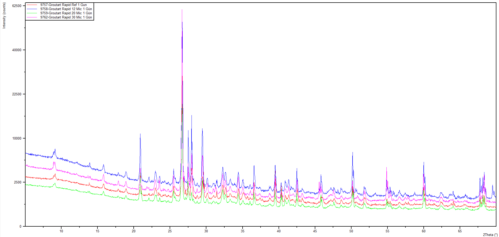{width=15.5cm}

Şekil 1'de 1 günlük hidratasyon sonrasına ait olan karşılaştırmalı XRD difraktogramları verilmiştir. Difraktogramlar incelendiğinde, tüm numunelerde hem hidratasyon ürünlerinin oluştuğu hem de karakteristik piklerin belirginleştiği görülmektedir.

$2\theta \approx 9^{\circ}$ bölgesinin Etrenjit fazını ifade ettiği düşünülmekte olup dört numunede de ilgili bölgede pikler gözlenmiştir. Pik şiddetleri karşılaştırıldığında;

Groutart Rapid-12µ \>Groutart Rapid-Referans\>Groutart Rapid-30µ\>Groutart Rapid-20 µ

şeklindedir. Sıralamadaki en yüksek pik şiddetine sahip olan Groutart Rapid-12µ numunesi, alüminyum-sülfat reaksiyonlarının bu seride daha hızlı ilerlediği izlenimini vermektedir. $2\theta \approx 18^{\circ},34^{\circ},47^{\circ}$ bölgesinde tüm numunelerde belirgin pikler görülmüş olup en şiddetli pikin Groutart Rapid-12µ numunesine ait olduğu gözlenmiştir. Diğer yandan Groutart Rapid-20µ ve Groutart Rapid-30µ numunelerinde ilgili pikin şiddetleri düşük olarak gözlenmiştir. Reaksiyona girmemiş klinker fazlarına ait pikleri ifade eden $2\theta \approx 29^{\circ}\text{-}33^{\circ},41^{\circ}\text{-}42^{\circ},51^{\circ}\text{-}52^{\circ}$ bölgesi incelendiğinde her bir numunede kalıntı fazlar gözlenmektedir. İlgili bölgede Groutart Rapid-12µ numunesinin pik şiddeti bir miktar daha düşük olması nedeniyle bu numunede erken yaştaki çimento tüketiminin daha yüksek olduğu görülmektedir. Diğer numunelerde ise kalan klinker miktarları birbirine yakın olarak değerlendirilmektedir.

Genel olarak en yüksek hidratasyon ürünü yoğunluğuna ve dolayısıyla en hızlı reaksiyon kinetiğine Groutart Rapid-12µ numunesinin sahip olduğu düşünülmektedir. Düşük etrenjt fazı ve hidratasyon ürünü göstermekte olan Groutart Rapid-20µ numunesinin ise erken yaş reaksiyon kinetiğinin en yavaş ilerleyen numune olduğu düşünülmektedir.

{width=15.5cm}

Şekil 2'de 1 günlük FTIR spektrumları karşılaştırmalı olarak verilmiştir. Her bir numune için hidratasyon reaksiyonlarının gerçekleştiği ve karakteristik bantların oluştuğu görülmektedir. Yaklaşık 3400cm-1 ve 1650cm- bölgelerinin yapısal su ve hidrat fazlarını temsil ettiği düşünülmekte olup bu bölgelerdeki en yüksek absorbans değişimi sırasıyla Groutart Rapid-12 µ ve Groutart Rapid-20µ numunelerinde görülmektedir. Bu durum bu numunelerin erken yaş hidratasyon ürünlerinin daha yoğun olarak geliştiğini göstermektedir. Şekil 1 yorumlanırken ifade edilen portlandit fazına şekil 2'deki FTIR spektrumunda yaklaşık 3640cm-1 bandı her bir numunede gözlenmiştir. En belirgin absorbans ise Groutart Rapid-12µ ve Groutart Rapid-20µ numunelerinde gözlenirken Groutart Rapid-Referans ve Groutart Rapid-30µ numunelerinde ilgili oluşum daha düşük seviyede kalmıştır.

1000cm-1 ve 1100cm-1 aralığındaki C-S-H jeli ve etrenjit fazları birlikte değerlendirildiğinde en yüksek bant gelişiminin Groutart Rapid-20µ ve Groutart Rapid-12µ numunelerinde olduğu tespit edilmiştir. Groutart Rapid-20µ numunesinde özellikle 970-1000cm-1 bölgesinde göstermiş olduğu derin bant belirginliği amorf C-S-H jeli oluşumunun bu numunede diğer numunelere kıyasla daha yüksek olduğunu ortaya koymaktadır.

1 günlük kür süresi sonunda yapılan XRD ve FTIR analizi sonuçları birlikte değerlendirildiğinde Groutart Rapid-12µ numunesinde kristal hidratasyon ürünlerinin, Groutart Rapid-20µ numunesinde ise temel bağlayıcı faz olarak değerlendirilen amorf C-S-H jeli oluşumunun öne çıktığı görülmektedir. Tüm bu tespitler doğrultusunda erken yaş hidratasyon verimi ve bağlayıcı faz gelişimi açısından Groutart Rapid-20µ numunesinin diğer numunelere göre daha avantajlı olduğu değerlendirilmektedir.

Şekil 3'te 7 günlük hidratasyon sonrasına ait olan karşılaştırmalı XRD difraktogramlarına yer verilmiştir.

{width=15.5cm}

 Şekil 1'de verilen 1 günlük kürlenme sonuçları ile kıyaslandığında tüm numunelerde hidratasyon reaksiyonlarının belirgin şekilde ilerlemiş olduğu ve üründe gözlemlenen piklerin daha da belirginleştiği görülmektedir. Etrenjit fazını ifade eden $2\theta \approx 9^{\circ}$ bölgesindeki piklerin tüm numunelerde belirgin şekilde görüldüğü ve en yüksek pik şiddetine sahip olan numunenin Groutart Rapid-20µ olduğu, Groutart Rapid-12µ ve Groutart Rapid-30µ numunelerinin birbirine yakın davranış sergilediği, Groutart Rapid-Referans numunesinde ise diğer numunelere kıyasla etrenjit gelişiminin daha düşük seviyede kaldığı görülmüştür. $2\theta \approx 18^{\circ},34^{\circ},47^{\circ}$ bölgesi portlandit fazını temsil etmekte olup bu bölgedeki en şiddetli pik Groutart Rapid-20µ numunesinde gözlenmiş olup bunu sırasıyla Groutart Rapid-12µ, Groutart Rapid-30µ ve Groutart Rapid-Referans numuneleri takip etmektedir. Bu durumda Groutart Rapid-20µ numunesinin silikat fazı hidratasyonunun gelişiminin diğer numunelerden önde olduğu düşünülmektedir.

Reaksiyona girmemiş klinker fazlarına ait pikleri ifade eden $2\theta \approx 29^{\circ}\text{-}33^{\circ},41^{\circ}\text{-}42^{\circ},51^{\circ}\text{-}52^{\circ}$ bölgesi incelendiğinde her bir numunede kalıntı fazlar gözlenmekle birlikte en düşük pik şiddetleri Groutart Rapid-20µ numunesinde gözlenmiştir. Diğer yandan Groutart Rapid-Referans numunesi bu bölgede en şiddetli piklere sahip olduğundan reaksiyona girmemiş fazların varlığının bu numunede en yüksek olduğu düşünülmektedir. Hidratasyon ürünleri ve klinker tüketimi piklerinin şiddetleri birlikte değerlendirildiğinde Groutart Rapid-20µ numunesi hem yüksek kristal faz yoğunluğu hem de ileri reaksiyon kinetiği açısından öne çıkmaktadır.

Sonuç olarak, 7 günlük kür süresi sonunda hidratasyon ilerleme dereceleri şu şekilde sıralanabilir;

Groutart Rapid-20µ\>Groutart Rapid-12µ\>Groutart Rapid-30µ≈Groutart Rapid-Referans

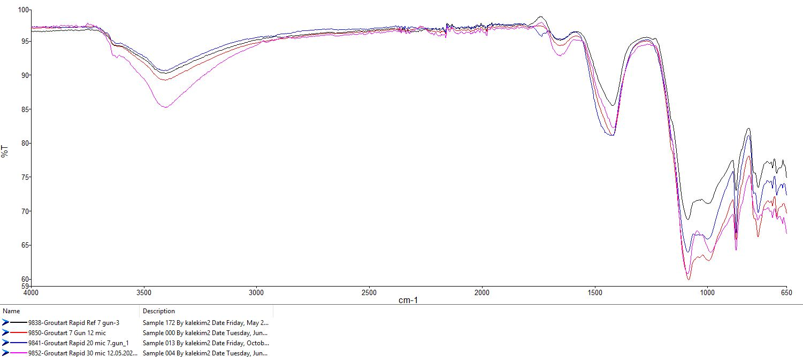{width=15.5cm}

Şekil 4'te 7 günlük FTIR spektrumları karşılaştırmalı olarak verilmiştir. Şekil 2'de verilen 1 günlük kür süresi sonunda yapılan FTIR analizi sonuçları ile karşılaştırıldığında tüm numunelerde hidratasyon reaksiyonlarının devam ettiği ve Şekil 2'ye göre bantların daha belirgin hala geldiği görülmektedir. Yapısal su ve hidrat fazlarını ifade eden 3400cm-1 ve 1650cm-1 bölgelerinde en yüksek bant şiddeti gösteren numunenin Groutart Rapid-30µ olduğu tespit edilmiştir. Groutart Rapid-20µ ve Groutart Rapid-12µ numunelerinin benzer davranışta oldukları gözlenirken Groutart Rapid-Referans numunesinin gelişiminin diğer numunelere kıyasla daha sınırlı kaldığı düşünülmektedir. Yaklaşık 3640cm-1 bölgesi portlandit fazını ifade etmekte olup tüm numunelerde varlığını devam ettirdiği ve XRD bulguları ile örtüşmektedir.

C-S-H jeli ve etrenjit oluşumlarını ifade eden 900-1200cm-1 bölgesinde en belirgin bant gösteren numunenin Groutart Rapid-30µ olduğu görülmektedir. Yaklaşık 950-1000cm-1 bölgesindeki bant derinlikleri ve yayılımları, amorf yapılı C-S-H jelinin oluşumu incelendiğinde en yüksek seviyeye ulaşan numunenin Groutart Rapid-30µ olduğu tespit edilmiştir. Bunu sırasıyla Groutart Rapid-20µ, Groutart Rapid-12µ ve Groutart Rapid-Referans numuneleri takip etmektedir.

1 günlük kür süresi sonunda yapılan FTIR analizi sonucunda en yüksek performans gösteren Groutart Rapid-20µ numunesi iken 7 günlük kür süresi sonunda en yüksek performans gösteren numune Groutart Rapid-30µ olarak tespit edilmiştir. Bu durum mikronize katkı boyutunun zamanla reaksiyon kinetiğinin üzerindeki etkisinin değiştiğine ve Groutart Rapid-30µ numunesinin ilerleyen kür sürelerinde daha yüksek bağlayıcı faz ürettiğini ifade etmektedir.

Sonuç olarak 7 günlük XRD analizlerinde kristal hidratasyon ürünlerinin açısından Groutart Rapid-20µ numunesi öne çıksa da mekanik bağlayıcı performansı belirleyen amorf C-S-H jeli gelişimi açısından sonuçlar;

Groutart Rapid-30µ\> Groutart Rapid-20µ\>Groutart Rapid-Referans

şeklinde sıralanmaktadır. Bu durumda 7 günlük nihai reaksiyon verimi ve bağlayıcı fazın optimizasyonu açısından en yüksek performansı Groutart Rapid-30µ numunesinin gösterdiği tespit edilmiştir.

{width=15.5cm}

Şekil 5'te 28 günlük hidratasyon sonrasına ait olan karşılaştırmalı XRD difraktogramlarına yer verilmiştir. Şekil 1 ve Şekil 3'te verilen sırasıyla 1 ve 7 günlük kür sürelerine ait XRD difraktogramları ile kıyaslandığında tüm numunelerde hidratasyon reaksiyonlarının ilerlediği ve hidratasyon ürünlerinin kararlı bir yapı kazandığı tespit edilmiştir. Etrenjit fazını ifade eden $2\theta \approx 9^{\circ}$ bölgesindeki pik şiddetleri kıyaslandığında en yüksek yoğunluğun Groutart Rapid-12µ numunesinde olduğu görülmektedir. Groutart Rapid-20µ ve Groutart Rapid-Referans numunelerinin benzer davranış sergilediği görülürken Groutart Rapid-30µ numunesinin etrenjit bölgesindeki piklerinin daha düşük şiddette kaldığı görülmektedir. Portlandit fazını ifade eden $2\theta \approx 18^{\circ},34^{\circ},47^{\circ}$ bölgesi incelendiğinde en yüksek pik verenin Groutart Rapid-12µ numunesi olduğu ve bunu sırayla Groutart Rapid-Referans, Groutart Rapid-20µ ve Groutart Rapid-30µ numunelerinin takip ettiği görülmektedir.

Reaksiyona girmemiş klinker fazlarının incelendiği $2\theta \approx 29^{\circ}\text{-}33^{\circ},41^{\circ}\text{-}42^{\circ},51^{\circ}\text{-}52^{\circ}$ bölgesindeki piklerin şiddetleri önceki kür sürelerine kıyasla düşük olması, çimento tüketiminin 28 gün boyunca sürdüğünü doğrulamaktadır. 1, 7 ve 28 günlük XRD sonuçları birlikte değerlendirildiğinde; 1.günde Groutart Rapid-12µ, 7.günde Groutart Rapid-20µ numuneleri öndeyken 28.günde kristal hidratasyon ürünleri bakımından Groutart Rapid-12µ numunesinin tekrar diğerlerinden üstün hale geldiği görülmektedir. Bu dalgalanma, mikronize katkı boyutunun hidratasyon kinetiğini kür yaşına bağlı olarak farklı aşamalarda aktive ettiğini ortaya koymaktadır.

Sonuç olarak, 28 günlük XRD difraktogramlarına göre kristal hidratasyon ürünlerinin gelişimi;

Groutart Rapid-12µ\>Groutart Rapid-Referans\>Groutart Rapid-20µ\>Groutart Rapid-30µ

şeklindedir.

{width=15.5cm}

Şekil 6'da 28 günlük FTIR spektrumları karşılaştırmalı olarak verilmiştir. Hidratasyon reaksiyonlarının her bir numunede belirgin şekilde ilerlediği görülmektedir. Yapısal su ve hidrat fazlarını ifade eden 3400cm-1 ve 1650cm-1 bölgelerinde en yüksek bant şiddeti gösteren numunenin Groutart Rapid-20µ olduğu dünüşülmekte olup bu numuneyi sırasıyla Groutart Rapid-Referans, Groutart Rapid-30µ ve Groutart Rapid-12µ numuneleri izlemektedir.

Hidratasyon sonucundaki verimi ve C-S-H jeli ile etrenjit oluşumlarını kapsayan 900-1200cm^-1^ bölgelerinde özellikle 950-1000cm^-1^ aralığındaki bant derinliğinde net bir ayrım gözlenmekte olup en belirgin seviyeye ulaşan numunenin Groutart Rapid-20µ olduğu tespit edilmiştir. Bunu sırasıyla Groutart Rapid-Referans, Groutart Rapid-30µ ve en düşük olarak seyreden Groutart Rapid-12µ numunesi izlemektedir. Dolayısıyla C-S-H oluşumu sınırlı kalan numune Groutart Rapid-12µ olmuştur.

28 günlük kür süreli analizlerde XRD sonuçları kristalin faz yoğunlukları açısından Groutart Rapid-12µ numunesini öne çıkarırken, amorf C-S-H gelişimi açısından FTIR verilerine göre;

Groutart Rapid-20µ\>Groutart Rapid-Referans\>Groutart Rapid-30µ\>Groutart Rapid-12µ

şeklinde sıralanmaktadır.

Bütünsel olarak 1, 7, 28 günlük kür süreli FTIR sonuçları ele alındığında;

-   1.günde Groutart Rapid-20µ numunesi,

-   7.günde Groutart Rapid-30µ numunesi,

-   28.günde Groutart Rapid-20µ numunesi,

ön plana çıkmaktadır. Kristal hidratasyon ürünleri açısından Groutart Rapid-12µ numunesi her ne kadar yüksek pikler göstermiş olsa da bağlayıcı C-S-H jeli oluşumu, sürecin dengesi ve nihai mekanik dayanımın potansiyeli açısından en optimize ve avantajlı sonuçları Groutart Rapid-20µ numunesinin verdiği düşünülmektedir.

### 4.2. Mastar 10

{width=15.5cm}

Şekil 7'de 1 günlük hidratasyon sonrasına ait olan XRD difraktogramlarına yer verilmiştir. Tüm numunelerde hidratasyon reaksiyonlarının başlamış olduğu aynı zamanda karakteristik hidratasyon ürünlerinin oluştuğu gözlenmektedir.

$2\theta \approx 9^{\circ}$ bölgesinin Etrenjit fazını ifade ettiği düşünülmekte olup pik şiddetleri karşılaştırıldığında en yüksek yoğunluk gözlenen numunenin Mastar10-30 µ numunesi, olduğu ve bunu sırasıyla takip eden Mastar10-12 µ ve Mastar10-20 µ numuneleridir. Bu durumda Mastar10-30 µ numunesinin alüminat-sülfat reaksiyonlarının daha hızlı ilerlediğini işaret etmektedir. $2\theta \approx 18^{\circ},34^{\circ},47^{\circ}$ bölgesi portlandit fazını temsil etmekte olup bu bölgedeki en belirgin pikleri sırasıyla Mastar10-30 µ, Mastar10-12 µ ve Mastar10-20 µ numunelerinin verdiği düşünülmektedir.

Reaksiyona girmemiş klinker fazlarını ifade eden $2\theta \approx 29^{\circ}\text{-}33^{\circ},41^{\circ}\text{-}42^{\circ},51^{\circ}\text{-}52^{\circ}$ bölgelerindeki pikler, erken kür süresi olması nedeniyle tüm numunelerde baskın şekilde gözlenmektedir. Ancak Mastar10-30 µ numunesinde hidratasyon ürünlerinin belirgin olması nedeniyle hidratasyon reaksiyonunun ilerleme derecesi diğer numunelerden yüksek olduğuna işaret etmektedir.

Sonuç olarak 1 günlük kür süresi sonunda yapılan reaksiyon durdurma işleminin ardından hidratasyon ürünlerinin gelişimi şu şekilde sıralanabilir;

{width=15.5cm}

Mastar10-30 µ \> Mastar10-12 µ \>Mastar10-20 µ

Şekil 8'de 1 günlük kür süresi ardından reaksiyon durdurma işlemine tabi tutulan numunelerin FTIR analizlerine yer verilmiştir. Spektrumlar incelendiğinde tüm numunelerde hidratasyon ürünlerine ait karakteristik bantların bulunduğu gözlenmektedir.

Yapısal su ve hidrat fazlarını ifade eden yaklaşık 3400cm^-1^ ve 1650cm^-1^ bölgesi incelendiğinde absorpsiyonu en şiddetli olan numunenin Mastar10-30mic numunesi olduğu bunu takiben sırayla Mastar10-20 µ ve en düşük şiddette olanın Mastar10-12 µ numunesi olduğu gözlenmektedir.

C-S-H gelişimi açısından önemli olan 900-1200cm^-1^ bandında en belirgin olan numunenin Mastar10-30 µ olduğu görülmektedir. Mastar10-12 µ ve Mastar10-20 µ numuneleri ise birbirine yakın olarak gözlenmektedir.

1 günlük FTIR spektrumlarına göre hidratasyon ürünlerinin gelişimi değerlendirildiğinde numuneler;

Mastar10-30 µ \>Mastar10-20 µ \>Mastar10-12 µ

Şeklinde sıralanabilmektedir.

Hem XRD hem de FTIR analiz sonuçları birlikte değerlendirildiğinde, Mastar10-30 µ numunesinin hidratasyon ilerlemesi gelişimi açısından diğer numunelerden önde olduğu düşünülmektedir. Sonuç olarak 1 günlük kür sonrasında yapılan reaksiyon durdurma işleminde hidratasyon ilerleme derecesi açısından sıralama şu şekilde yapılabilir;

Mastar10-30 µ \>Mastar10-12µ$\approx$Mastar10-20 µ

{width=15.5cm}

Şekil 9'da 7 günlük kür süresi sonunda reaksiyon durdurma işlemi uygulanan numunelerin karşılaştırmalı XRD difraktogramlarına yer verilmiştir. Difraktogramlar incelendiğinde tüm numunelerde hidratasyon reaksiyonlarının devam etmekte olduğu düşünülmektedir.

Etrenjit fazını ifade eden $2\theta \approx 9^{\circ}$ bölgesinde en belirgin pik gelişimi Mastar10-20 µ numunesinde gözlenmektedir. Mastar10-30 µ numunesi yakın davranış sergilerken Mastar10-12 µ numunesinde ise ilgili faz pikinin diğerlerinden daha düşük kaldığı görülmektedir. $2\theta \approx 29^{\circ}\text{-}33^{\circ},41^{\circ}\text{-}42^{\circ},51^{\circ}\text{-}52^{\circ}$ bölgelerindeki pikler, ilgili tüm numunelerde reaksiyona girmemiş klinker fazlarının halihazırda bulunmaya devam ettiğine işaret etmektedir.

1 günlük kür süreli XRD difraktogramları ile kıyaslandığında 1.günde en belirgin kristal ürün gelişimi Mastar10-30 µ numunesinde görülürken 7.günde Mastar10-20 µ numunesinin önde olduğu değerlendirilmektedir.

7 günlük kür süreli XRD difraktogramları hidratasyon ürünlerinin gelişimi açısından;

Mastar10-20 µ \>Mastar10-30 µ \>Mastar10-12 µ

Şeklinde sıralanabilmektedir.

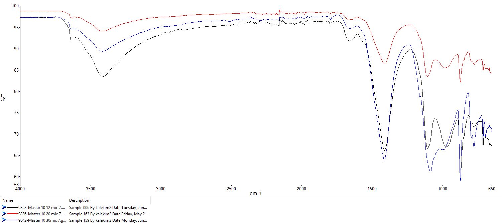{width=15.5cm}

Şekil 10'da 7 günlük kür sonunda reaksiyon durdurma işlemi uygulanan numunelerin FTIR spektrumlarına yer verilmiştir. Spektrumlar incelendiğinde tüm numunelerde hidratasyon ürünlerine ait karakteristik bantların bulunduğuna dair işaretler görülmektedir.

Yapısal su ve hidrat fazlarını ifade eden yaklaşık 3400cm^-1^ ve 1650cm^-1^ bölgesi incelendiğinde en belirgin bant gelişiminin Mastar10-12 µ numunesinde olduğu, Masta10-20 µ numunesinin ise bu bölgede zayıf kaldığı değerlendirilmektedir. Portlandit fazını ifade eden 3640cm^-1^ bölgesinde Mastar10-12 µ ve Mastar10-30 µ numuneleri belirgin pik verirken Mastar10-20mic numunesinin zayıf pik verdiği görülmektedir.

C-S-H ile ifade edilen 900-1200cm-1bandında Mastar10-30 µ numunesinde en derin bandı verenin Mastar10-30 µ numunesinin olduğu, Mastar10-12 µ numunesinin bunu takip ettiği ancak Mastar10-20 µ numunesinin bant gelişiminin bu bölgede sınırlı kaldığı görülmektedir. Bu durum Mastar10-30 µ ve Mastar10-12 µ numunelerinin Mastar10-20 µ numunesine kıyasla C-S-H oluşumlarının daha ileri olabileceğine işaret etmektedir.

7 günlük FTIR spektrumlarına bakıldığında hidratasyon gelişimi sıralaması;

Mastar10-30µ$\approx$Mastar10-12 µ \>Mastar10-20 µ

şeklinde sıralanabilmektedir.

Hem XRD hem de FTIR sonuçları birlikte değerlendirildiğinde XRD'de kristal hidratasyon açısından Mastar10-20 µ numunesi öne çıkmaktadır. FTIR'da bağlı su ve C-S-H açısından Mastar10-30 µ ve Mastar10-12 µ numunelerinin Mastar10-20 µ numunesinin önünde olduğu görülmektedir. Mastar10-30 µ numunesi her iki analizde de üst sıralarda yer alarak tutarlı bir davranış sergilediği düşünülmektedir. Bu nedenle 7 günlük kür sonunda hidratasyon gelişiminin Mastar10-30 µ numunesinde daha ileri olduğu, Mastar10-12 µ ve Mastar10-20 µ numuneleri arasındaki farkın ise sınırlı olduğu düşünülmektedir. Bu durumda hidratasyon gelişimi bakımından şu şekilde bir sıralama yapılabilir;

Mastar10-30 µ \>Mastar10-12µ$\approx$Mastar10-20 µ

{width=15.5cm}

Şekil 11'de 28 günlük kür süresi sonunda reaksiyon durdurma işlemi uygulanan numunelerin karşılaştırmalı XRD difraktogramlarına yer verilmiştir. Difraktogramlar incelendiğinde tüm numunelerde hidratasyon reaksiyonlarının devam etmekte olduğu düşünülmektedir.

Etrenjit fazını ifade eden $2\theta \approx 9^{\circ}$ bölgesinde en belirgin pik şiddeti Mastar10-12 µ numunesinde görülmektedir. İlgili bölgedeki pik şiddeti en düşük olan numune Mastar10-20 µ numunesi olarak tespit edilmiştir. $2\theta \approx 18^{\circ},34^{\circ},47^{\circ}$ bölgesi portlandit fazını temsil etmekte olup bu bölgedeki en belirgin pik Mastar10-12 µ numunesinde görülmektedir.

$2\theta \approx 29^{\circ}\text{-}33^{\circ},41^{\circ}\text{-}42^{\circ},51^{\circ}\text{-}52^{\circ}$ bölgelerindeki pikler incelendiğinde tüm numunelerde reaksiyona girmemiş klinker fazlarının halen mevcut olduğu göstermektedir. 28 günlük kür sonunda elde edilen XRD verilerine göre kristal hidratasyon ürünlerinin gelişimi açısından;

Mastar10-12 µ \>Mastar10-30 µ \>Mastar10-20 µ

Şeklinde sıralanabilmektedir.

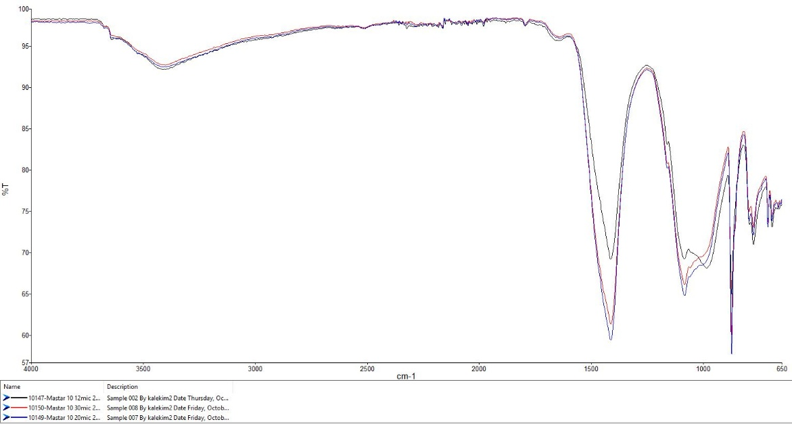{width=15.5cm}

Şekil 12'de 28 günlük kür sonunda reaksiyon durdurma işlemi uygulanan numunelerin FTIR spektrumlarına yer verilmiştir. Spektrumlar incelendiğinde tüm numunelerde hidratasyon ürünlerine ait karakteristik bantların bulunduğuna dair işaretler görülmektedir.

Yapısal su ve hidrat fazlarını ifade eden yaklaşık 3400 cm⁻¹ ve 1650 cm⁻¹ bölgeleri incelendiğinde üç numunenin birbirine çok yakın şiddette bant verdiği, bu göstergelerle numuneler arasında ayrım yapılamadığı değerlendirilmektedir. Portlandit fazını ifade eden 3640 cm⁻¹ bölgesinde Mastar10-12 µ, Mastar10-20 µ ve Mastar10-30 µ numunelerinin hepsinde zayıf bir omuz görülmekte olup bu bölge sıralamada belirleyici kabul edilmemiştir.

C-S-H ile ifade edilen 900-1200 cm⁻¹ bandında Mastar10-20 µ ve Mastar10-30 µ numunelerinin \~1090 cm⁻¹ civarında benzer derinlikte bant verdiği, Mastar10-12 µ numunesinin ise bu bölgede daha sığ bir bant ve omuz yapısı gösterdiği görülmektedir. Bu durum Mastar10-20 µ ve Mastar10-30 µ numunelerinin C-S-H oluşumlarının Mastar10-12 µ numunesine kıyasla bir miktar daha ileri olabileceğine işaret etmektedir. Ancak farklar sınırlıdır ve bu bölge \~1420-1480 cm⁻¹ karbonat bantlarından etkilenebilmektedir.

28 günlük FTIR spektrumlarına bakıldığında C-S-H gelişimi sıralaması;

Mastar10-20 µ ≈Mastar10-30 µ \>Mastar10-12 µ

şeklinde sıralanabilmektedir.

Hem XRD hem de FTIR sonuçları birlikte değerlendirildiğinde XRD'de kristal hidratasyon ürünleri açısından Mastar10-12 µ numunesi öne çıkmaktadır. FTIR'da ise C-S-H açısından Mastar10-20µ ve Mastar10-30µ numunelerinin Mastar10-12µ numunesinin önünde olduğu görülmektedir. Mastar10-30µ numunesi XRD'de ikinci, FTIR'da ilk sırada yer alarak her iki analizde de üst sıralarda bulunmakta ve tutarlı bir davranış sergilediği düşünülmektedir. Bu nedenle 28 günlük kür sonunda hidratasyon gelişiminin Mastar10-30µ numunesinde daha dengeli ilerlediği, Mastar10-12µ ve Mastar10-20µ numuneleri arasındaki farkın ise sınırlı olduğu düşünülmektedir. Bu durumda hidratasyon gelişimi bakımından;

Mastar10-30µ\>Mastar10-12µ ≈ Mastar10-20µ

Şeklinde sıralanabilmektedir.

Bütünsel olarak 1, 7 ve 28 günlük kür süreli FTIR sonuçları ele alındığında, bağlı su ve Si-O (C-S-H) göstergeleri bakımından;

-   1\. günde Mastar10-30µ numunesi,

-   7\. günde Mastar10-30µ ve Mastar10-12µ numuneleri (Mastar10-30µ ufak farkla önde),

-   28\. günde ise Mastar10-20µ ve Mastar10-30µ numuneleri ön plana çıkmaktadır.

Bağlayıcı C-S-H göstergeleri ve yöntemler arası tutarlılık birlikte değerlendirildiğinde Mastar10-30µ numunesi her üç yaşta da üst sıralarda yer almış, bu nedenle hidratasyon gelişimi bakımından en dengeli davranışı sergileyen numune olarak Mastar10-30µ öne çıkmıştır.

### 4.3. Macunart

Macunart numunelerinin difraktogramlarında baskın faz dolomittir (30,9° ve 41,1°). Bunun yanında kalsit (29,4°), alit (32,2° ve 51,7°) ve belit (32,6°) pikleri bulunmaktadır. Hesaplanan XRD göstergeleri Çizelge 4'te, FTIR göstergeleri Çizelge 5'te verilmiştir.

**Kuru harç.** Şekil 13'te verilen kuru harç difraktogramlarında referans ve üç ambalaj tipine ait desenler birbirine çok yakındır. Etrenjit ve portlandit bölgelerindeki net alanlar tüm numunelerde gürültü düzeyindedir (etrenjit 15–30, portlandit 18–45). Alit piki de benzer büyüklüktedir (225–254). Şekil 14'teki FTIR spektrumları neredeyse üst üste çakışmaktadır. 3640 cm⁻¹ portlandit bandı görülmemekte, Si–O bandı tüm numunelerde anhidrit alite özgü ~925 cm⁻¹ konumunda bulunmaktadır. Bu bulgular, şartlandırma sonrasında hiçbir ambalaj tipinde XRD ve FTIR ile saptanabilir düzeyde ön hidratasyon oluşmadığını göstermektedir.

> **Uyarı.** "Macunart Ref Kuru Harç" adıyla kaydedilen ikinci ölçüm (9811) belirgin etrenjit (121) ve portlandit (718) pikleri içermekte, alit piki ise neredeyse kaybolmuş durumdadır (13). Bu desen kuru harçtan çok sertleşmiş bir numuneye benzemektedir ve 28 günlük referans ölçümünün eksik olması dikkat çekicidir. Numune adlandırmasının kontrol edilmesi önerilir [DOĞRULANACAK]. Bu ölçüm değerlendirmeye alınmamıştır.

{width=16cm}

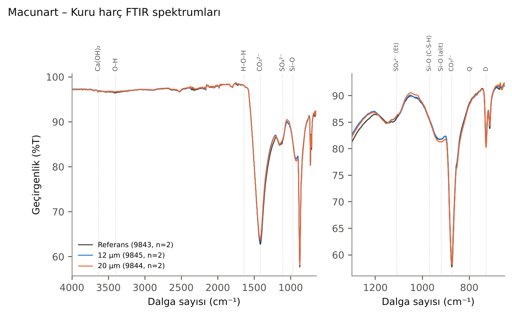{width=16cm}

**1 gün.** Şekil 15'te 1 günlük difraktogramlar verilmiştir. Tüm numunelerde etrenjit ve portlandit oluşmuş, alit piki kuru harca göre yaklaşık dörtte birine inmiştir. Portlandit net alanı Referans (959) ve 12 µm (1010) numunelerinde birbirine yakın, 20 µm (504) ve 30 µm (436) numunelerinde ise yaklaşık yarısı düzeyindedir. Etrenjit 30 µm numunesinde (90) diğerlerine (145–154) göre daha düşüktür. Kalan alit miktarları birbirine yakın olduğundan (43–60), bu farkın klinker tüketiminden çok portlandit kristallenmesindeki farklılıktan kaynaklanabileceği düşünülmektedir. Şekil 16'daki FTIR spektrumlarında 3640 cm⁻¹ bandı ve O–H bandı alanı numuneler arasında tekrar aralığı içinde kalmaktadır. Si–O bandı Referansta 960 cm⁻¹, ambalaj numunelerinde 966–971 cm⁻¹ konumundadır.

1 günlük XRD verilerine göre erken hidratasyon ürünü gelişimi: **12 µm ≈ Referans > 20 µm > 30 µm** şeklinde sıralanabilir.

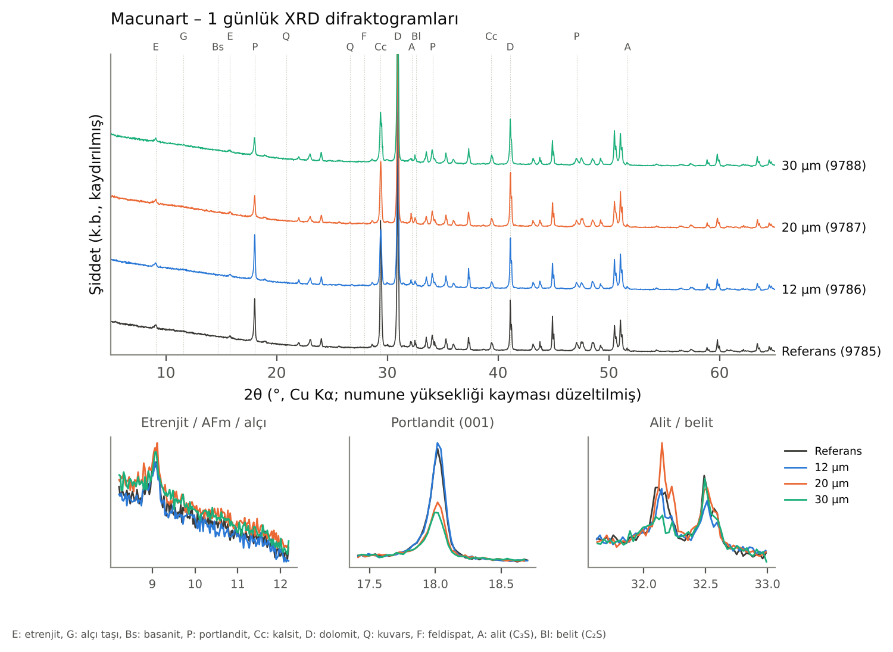{width=16cm}

{width=16cm}

**7 gün.** Şekil 17'de alit pikinin tüm numunelerde neredeyse tamamen tükendiği görülmektedir (1–5). Ambalaj numunelerinde etrenjit (145–147) ve portlandit (425–715) birbirine yakındır. En yüksek portlandit 12 µm numunesindedir. Referans numunesinde (9864) ise hem etrenjit (72) hem portlandit (380), ambalaj numunelerinin ve aynı numunenin 1 günlük değerinin altında kalmıştır. Referans numunesinin XRD ve FTIR ölçümlerinin diğer 7 günlük numunelerden belirgin biçimde sonra alınmış olması (ölçüm no 9864 ve 9871), bu numunenin ayrı bir karışımdan hazırlanmış olabileceğini düşündürmektedir [DOĞRULANACAK]. Şekil 18'deki FTIR spektrumlarında 3640 cm⁻¹ bandı en belirgin 12 µm numunesindedir. Diğer göstergeler tekrar aralığı içindedir.

7 günlük sonuçlara göre ambalaj numuneleri arasında anlamlı bir fark görülmemekte, sıralama **12 µm ≥ 30 µm ≈ 20 µm** şeklindedir. Referans numunesi bu yaşta güvenilir bir karşılaştırma noktası olarak kabul edilmemiştir.

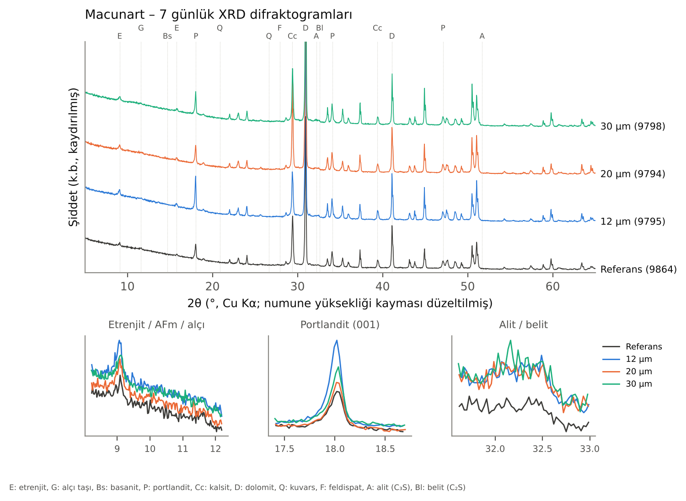{width=16cm}

{width=16cm}

**28 gün.** 28 günlük yaşta XRD ölçümü yalnızca 12 µm ve 30 µm (Şekil 19), FTIR ölçümü yalnızca 12 µm ve 20 µm numunelerinde (Şekil 20) mevcuttur. 12 µm ve 30 µm numunelerinin etrenjit (105 ve 98) ve portlandit (496 ve 435) değerleri birbirine yakındır. FTIR'da 12 µm ve 20 µm numunelerinin tüm göstergeleri tekrar aralığı içinde örtüşmektedir. Referans ve 20 µm XRD ile Referans ve 30 µm FTIR ölçümleri eksiktir [VERİ GEREKLİ].

**Macunart için genel değerlendirme.** Kuru harçta ön hidratasyon bulgusu yoktur. 1 günlük yaşta 20 µm ve 30 µm numunelerinde portlandit gelişimi bir miktar geride kalmış, ancak bu fark 7 ve 28 günlük yaşlarda kapanmıştır. 12 µm ambalaj, tüm yaşlarda Referans ile aynı ya da daha yüksek hidratasyon ürünü göstermiştir.

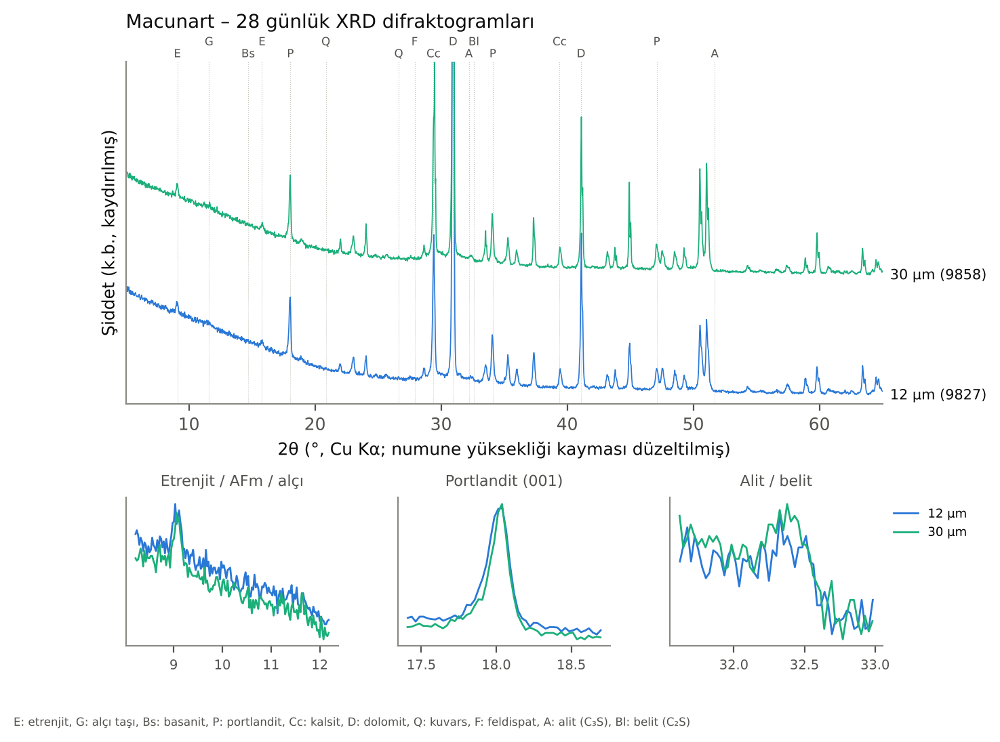{width=16cm}

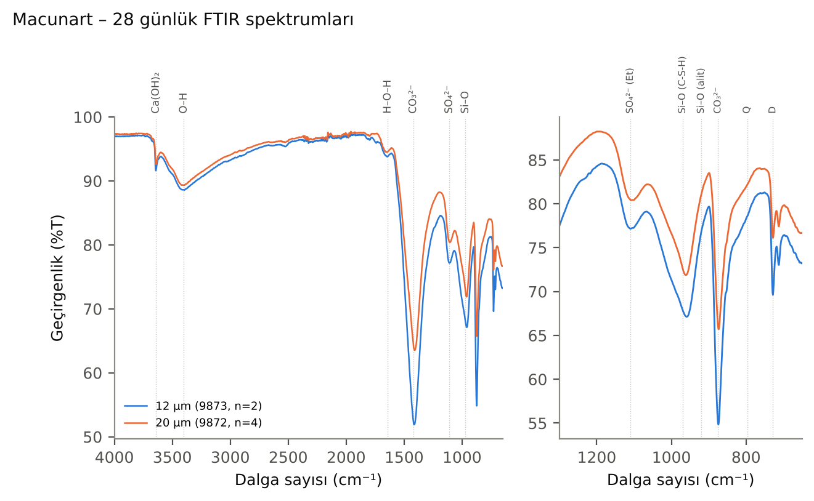{width=16cm}

| Yaş | Ambalaj | Ölçüm no | Etrenjit (9,1°) | Portlandit (18,0°) | Alit (51,7°) | Kalsit (29,4°) |
|---|---|---|--:|--:|--:|--:|
| Kuru harç | Referans | 9803 | 15 | 45 | 225 | 3604 |
| Kuru harç | 12 µm | 9804 | 30 | 18 | 254 | 1831 |
| Kuru harç | 20 µm | 9805 | 21 | 24 | 240 | 3244 |
| Kuru harç | 30 µm | 98066 | 27 | 29 | 246 | 1937 |
| 1 gün | Referans | 9785 | 146 | 959 | 60 | 3062 |
| 1 gün | 12 µm | 9786 | 145 | 1010 | 55 | 1643 |
| 1 gün | 20 µm | 9787 | 154 | 504 | 43 | 1699 |
| 1 gün | 30 µm | 9788 | 90 | 436 | 58 | 1486 |
| 7 gün | Referans | 9864 | 72 | 380 | 4 | 1262 |
| 7 gün | 12 µm | 9795 | 145 | 715 | 2 | 1114 |
| 7 gün | 20 µm | 9794 | 146 | 425 | 1 | 1874 |
| 7 gün | 30 µm | 9798 | 147 | 492 | 5 | 1224 |
| 28 gün | 12 µm | 9827 | 105 | 496 | 1 | 1104 |
| 28 gün | 30 µm | 9858 | 98 | 435 | 4 | 1452 |
| Kuru harç? (adlandırma şüpheli) | Referans | 9811 | 121 | 718 | 13 | 1604 |

: Çizelge 4. Macunart XRD net pik alanları (k.b.; doğrusal taban çizgisi üzerindeki alan, numune yüksekliği kayması düzeltilmiş)

| Yaş | Ambalaj | Ölçüm no | n | Ca(OH)₂ 3640 cm⁻¹ (mAbs) | O–H bandı alanı (k.b.) | Si–O bandı minimumu (cm⁻¹) |
|---|---|---|--:|--:|--:|--:|
| Kuru harç | Referans | 9843 | 2 | 1,4 (1,2–1,7) | 1605 (1439–1771) | 927 (927–927) |
| Kuru harç | 12 µm | 9845 | 2 | 1,3 (1,3–1,3) | 1561 (1471–1651) | 924 (921–927) |
| Kuru harç | 20 µm | 9844 | 2 | 1,4 (1,4–1,4) | 1595 (1591–1600) | 924 (922–927) |
| 1 gün | Referans | 9865 | 2 | 14,0 (12,4–15,7) | 14900 (13772–16028) | 960 (960–960) |
| 1 gün | 12 µm | 9866 | 2 | 12,8 (11,6–14,1) | 16029 (14922–17137) | 966 (966–966) |
| 1 gün | 20 µm | 9867 | 2 | 12,8 (11,9–13,8) | 16040 (14998–17081) | 971 (971–971) |
| 1 gün | 30 µm | 9868 | 1 | 13,2 | 15929 | 967 |
| 7 gün | Referans | 9871 | 2 | 13,0 (12,1–13,8) | 17848 (17408–18289) | 963 (963–963) |
| 7 gün | 12 µm | 9839 | 2 | 16,4 (16,0–16,7) | 18597 (17895–19299) | 959 (959–959) |
| 7 gün | 20 µm | 9837 | 2 | 12,4 (11,6–13,2) | 17222 (16750–17694) | 954 (953–956) |
| 7 gün | 30 µm | 9840 | 2 | 12,1 (11,5–12,7) | 18126 (17041–19210) | 966 (965–966) |
| 28 gün | 12 µm | 9873 | 2 | 15,1 (11,8–18,4) | 17715 (13194–22236) | 960 (959–960) |
| 28 gün | 20 µm | 9872 | 4 | 12,5 (9,6–17,6) | 15951 (13189–20062) | 961 (960–962) |

: Çizelge 5. Macunart FTIR göstergeleri (tekrar ölçümlerin ortalaması; parantez içinde en küçük–en büyük değer)

### 4.4. İzolatex Plus

İzolatex Plus iki bileşenli bir üründür. Ambalaj değişikliği toz bileşeni kapsamaktadır. Kuru harç difraktogramlarında kuvars (26,6° ve 20,9°) ve kalsit (29,4°) baskın olup alit ve belit pikleri bulunmaktadır. Hidrate numunelerin FTIR spektrumlarında 2950, 1730, 1160 ve 700 cm⁻¹ civarındaki bantlar sıvı bileşenden gelen polimere aittir (C–H, C=O, C–O ve aromatik halka titreşimleri; stiren-akrilik tipte bir dispersiyonla uyumlu [DOĞRULANACAK]). Bu bantlar 900–1200 cm⁻¹ Si–O bölgesiyle örtüştüğünden İzolatex Plus için FTIR'da C-S-H değerlendirmesi sınırlıdır. Ayrıca hidrate numunelerde 0,1–0,7° 2θ'lik numune yüksekliği kayması saptanmış ve düzeltilmiştir (Bölüm 3.5). Esnek membran numunelerinin düz bir yüzey oluşturmaması, numuneler arasında pik şiddetlerini de etkilemektedir. Göstergeler Çizelge 6 ve Çizelge 7'de verilmiştir.

> **Not.** "İzolatex 05.05.2026" adlı numuneler Referans olarak değerlendirilmiştir. Aynı ölçüm numarası (9725) hem "1.gün" hem "1.gün 12 Mikron" dosyalarında kullanılmıştır. İkincisi 12 µm kabul edilmiştir. 7 günlük "Izolatex Plus 05.05.2026" FTIR numunesinde (9807) film kalınlığı belirtilmemiştir ve 12 µm olarak varsayılmıştır (12 µm*) [DOĞRULANACAK].

**Kuru harç.** Şekil 21'deki difraktogramlarda tüm ambalaj tiplerinde etrenjit (15–58) ve portlandit (10–45) gürültü düzeyindedir. Alit piki Referansta 220, ambalaj numunelerinde 122–181 aralığındadır. Ancak 31,9–32,8° bölgesinin toplam alanı ambalaj numunelerinde daha düşük değildir. Bu nedenle alit farkı tane istatistiğine bağlanmış, ön hidratasyon göstergesi olarak kabul edilmemiştir. 11,6° alçı taşı piki ambalaj numunelerinde (41–68) Referansa (13) göre daha belirgindir. Bu farkın hemihidratın nemle alçı taşına dönüşmesinden mi yoksa üretim partisi farkından mı kaynaklandığı mevcut verilerle ayırt edilememektedir [DOĞRULANACAK: referans numunenin üretim tarihi/partisi]. Kuru harç FTIR ölçümü yoktur.

{width=16cm}

**1 gün.** Şekil 22'de 1 günlük yaşta hiçbir numunede belirgin etrenjit veya portlandit piki oluşmadığı görülmektedir (net alanlar 5–31). Alit pikleri hâlâ belirgindir. Bu durum, polimer modifiyeli sistemde erken yaşta kristalin hidratasyon ürünlerinin sınırlı kaldığını göstermektedir. 30 µm numunesinin deseni (yüksek zemin ve daha yüksek kalsit ile alit) diğerlerinden farklıdır ve numune hazırlamadan kaynaklanabilir. Şekil 23'teki FTIR spektrumları yalnızca Referans ve 12 µm numunelerini içermektedir ve polimer bantları dışında belirgin bir fark görülmemektedir.

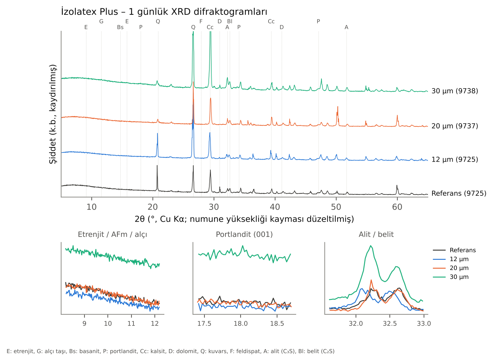{width=16cm}

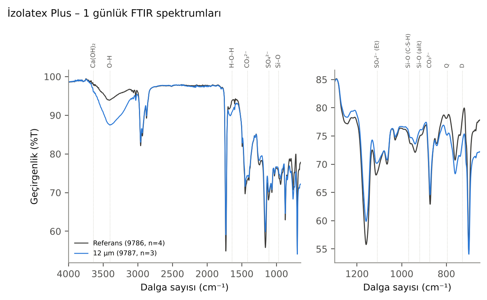{width=16cm}

**7 gün.** Şekil 24'teki 7 günlük difraktogramlarda portlandit oluşumu başlamıştır. Ancak değerler numuneden numuneye çok değişkendir: 12 µm 606, Referans 370, 20 µm 149, 30 µm 49. Aynı 7 günlük 30 µm numunesinin ikinci ölçümünde (9844) portlandit 509 ve etrenjit 102 bulunmuştur. Bu, aynı ambalaj ve yaş için ölçümler arasında yaklaşık 10 katlık bir fark anlamına gelir. Bu tekrarlanabilirlik düzeyinde 7 günlük XRD verileri ambalaj sıralaması için yeterli görülmemektedir. Şekil 25'teki FTIR spektrumlarında 3640 cm⁻¹ bandı 12 µm* (15,6) ve 30 µm ikinci ölçümünde (17,0) Referansa (10,4) göre biraz daha belirgindir, ancak tekrar aralıkları geniştir.

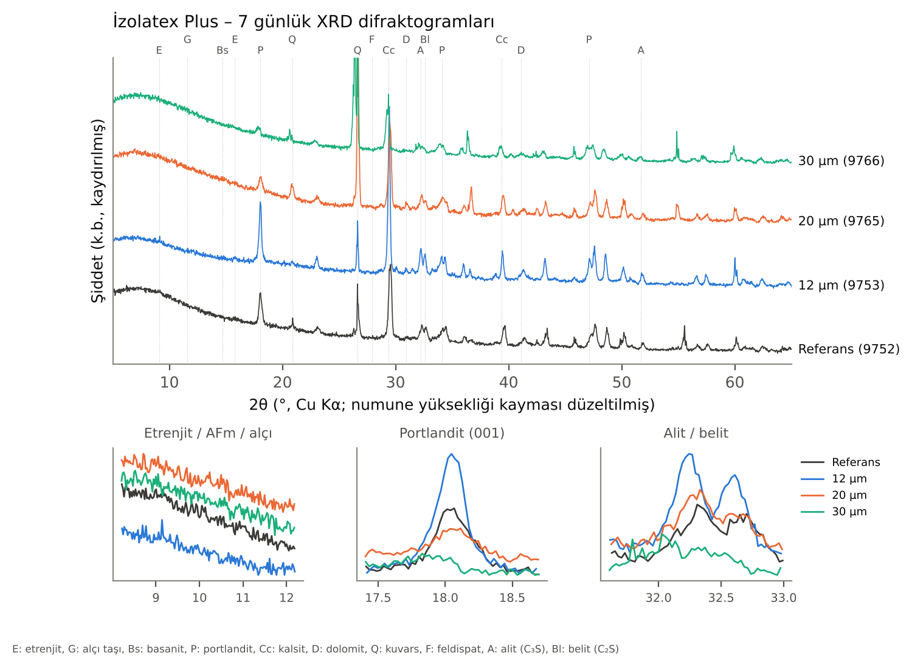{width=16cm}

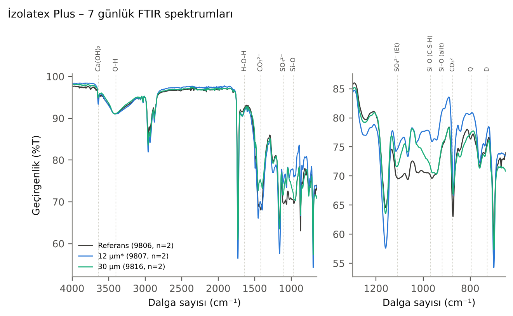{width=16cm}

**28 gün.** Şekil 26'da 28 günlük yaşta tüm numunelerde etrenjit ve portlandit belirginleşmiştir. Portlandit 20 µm (428) > 12 µm (257) ≈ Referans (220), etrenjit 20 µm (116) > Referans (91) ≈ 12 µm (81) sıralamasındadır. Kalan alit miktarları birbirine yakındır (30–48). Şekil 27'deki FTIR spektrumlarında Referans ve 12 µm numuneleri neredeyse çakışmaktadır (3640 cm⁻¹: 19,8 ve 18,9 mAbs; Si–O: 963 ve 962 cm⁻¹). 30 µm numunesinin 28 günlük ölçümü yoktur [VERİ GEREKLİ].

**İzolatex Plus için genel değerlendirme.** Kuru harçta ön hidratasyon bulgusu yoktur. Alçı taşı pikindeki fark izlenmelidir. 28 günlük yaşta 12 µm ve 20 µm ambalajlar Referans ile aynı ya da daha yüksek hidratasyon ürünü göstermiştir. Erken yaş (1 ve 7 gün) verileri numune geometrisi ve tekrarlanabilirlik sorunları nedeniyle karar için kullanılmamalıdır.

{width=16cm}

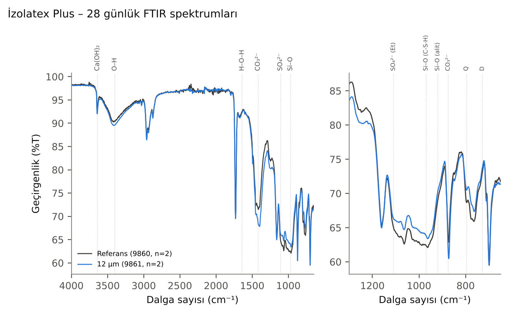{width=16cm}

| Yaş | Ambalaj | Ölçüm no | Etrenjit (9,1°) | Portlandit (18,0°) | Alit (51,7°) | Kalsit (29,4°) |
|---|---|---|--:|--:|--:|--:|
| Kuru harç | Referans | 9736 | 58 | 25 | 220 | 3872 |
| Kuru harç | 12 µm | 9733 | 35 | 45 | 122 | 3030 |
| Kuru harç | 20 µm | 9732 | 45 | 27 | 181 | 6512 |
| Kuru harç | 30 µm | 9731 | 15 | 10 | 140 | 5235 |
| 1 gün | Referans | 9725 | 13 | 5 | 57 | 1022 |
| 1 gün | 12 µm | 9725 | 17 | 7 | 113 | 863 |
| 1 gün | 20 µm | 9737 | 31 | 14 | 58 | 1200 |
| 1 gün | 30 µm | 9738 | 12 | 21 | 152 | 3880 |
| 7 gün | Referans | 9752 | 24 | 370 | 23 | 363 |
| 7 gün | 12 µm | 9753 | 17 | 606 | 68 | 1353 |
| 7 gün | 20 µm | 9765 | 16 | 149 | 24 | 499 |
| 7 gün | 30 µm | 9766 | 9 | 49 | 27 | 185 |
| 28 gün | Referans | 9821 | 91 | 220 | 48 | 1141 |
| 28 gün | 12 µm | 9822 | 81 | 257 | 45 | 1896 |
| 28 gün | 20 µm | 9845 | 116 | 428 | 30 | 1814 |
| 7 gün (tekrar) | 30 µm | 9844 | 102 | 509 | 36 | 1644 |

: Çizelge 6. İzolatex Plus XRD net pik alanları (k.b.; doğrusal taban çizgisi üzerindeki alan, numune yüksekliği kayması düzeltilmiş)

| Yaş | Ambalaj | Ölçüm no | n | Ca(OH)₂ 3640 cm⁻¹ (mAbs) | O–H bandı alanı (k.b.) | Si–O bandı minimumu (cm⁻¹) |
|---|---|---|--:|--:|--:|--:|
| 1 gün | Referans | 9786 | 4 | 0,8 (0,6–0,8) | 14865 (14026–15966) | 1060 (1060–1060) |
| 1 gün | 12 µm | 9787 | 3 | 1,8 (0,7–2,6) | 28028 (16424–49261) | 1060 (1060–1060) |
| 7 gün | Referans | 9806 | 2 | 10,4 (9,0–11,9) | 14627 (13830–15425) | 1012 (963–1060) |
| 7 gün | 12 µm* | 9807 | 2 | 15,6 (8,6–22,6) | 20063 (19925–20202) | 1060 (1060–1060) |
| 7 gün | 30 µm | 9816 | 2 | 8,4 (7,8–9,1) | 16049 (15918–16180) | 944 (944–944) |
| 28 gün | Referans | 9860 | 2 | 19,8 (18,7–20,9) | 18040 (16850–19229) | 963 (963–963) |
| 28 gün | 12 µm | 9861 | 2 | 18,9 (14,3–23,6) | 18932 (16813–21050) | 962 (961–964) |
| 7 gün (tekrar) | 30 µm | 9880 | 2 | 17,0 (14,7–19,3) | 17099 (15175–19023) | 961 (960–962) |

: Çizelge 7. İzolatex Plus FTIR göstergeleri (tekrar ölçümlerin ortalaması; parantez içinde en küçük–en büyük değer)

### 4.5. Technopool

Technopool difraktogramlarında kuvars (26,6°) ve feldispat (27,6–28,0°) agrega fazları baskındır. Kalsit, alit ve belit pikleri bulunmaktadır. Technopool için 30 µm ambalaj test edilmemiştir. Göstergeler Çizelge 8 ve Çizelge 9'da verilmiştir. Kum içeriği nedeniyle 900–1200 cm⁻¹ FTIR bölgesi kuvarsın ~1080 cm⁻¹ bandıyla örtüşmektedir.

**Kuru harç.** Şekil 28'de üç numunede de etrenjit (33–44) ve portlandit (11–26) gürültü düzeyindedir. Alit piki ambalaj numunelerinde Referansa göre daha düşük değildir (Referans 160; 12 µm 271; 20 µm 203). Kuru harçta ön hidratasyon bulgusu yoktur. Kuru harç FTIR ölçümü yoktur.

{width=16cm}

**1 gün.** Şekil 29'da Referans numunesinin portlandit piki (563) 12 µm (308) ve 20 µm (309) numunelerinin yaklaşık iki katıdır. Etrenjit de Referans (224) > 12 µm (204) > 20 µm (164) sırasındadır. Kalan alit 12 µm numunesinde (147) Referanstan (108) yüksektir. Bu durum 12 µm numunesinde silikat hidratasyonunun bir miktar geride olduğunu düşündürmektedir. Şekil 30'daki FTIR spektrumlarında O–H bandı alanı ambalaj numunelerinde daha yüksek görünmektedir. Ancak Si–O ve kuvars bantlarının örtüşmesi ve tekrarlar arasındaki geniş fark (12 µm Si–O minimumu 944–987 cm⁻¹) nedeniyle FTIR'dan bir sıralama çıkarılamamaktadır.

1 günlük XRD verilerine göre sıralama: **Referans > 12 µm ≥ 20 µm.**

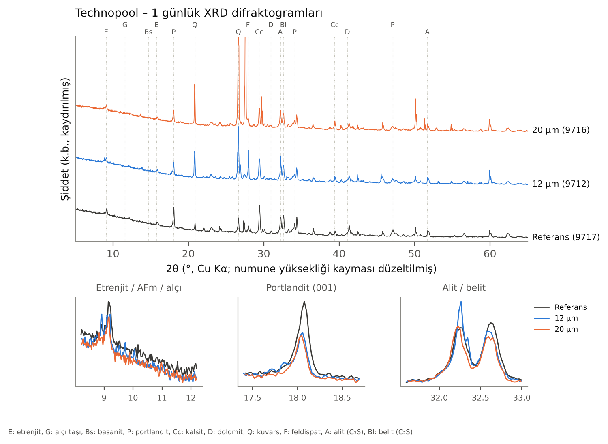{width=16cm}

{width=16cm}

**7 gün.** Şekil 31'de alitin büyük ölçüde tükendiği görülmektedir. Portlandit Referansta (1070), 12 µm (851) ve 20 µm (847) numunelerine göre yaklaşık %26 daha yüksektir. Etrenjit de aynı eğilimi izlemektedir (299, 273, 263). Şekil 32'deki FTIR spektrumlarında O–H bandı alanı Referansta (20199) 12 µm (17014) ve 20 µm (15973) numunelerinden yüksektir. Bu sonuç XRD bulgusuyla uyumludur.

**Hidratasyon durdurmanın etkisi.** 7 günlük 20 µm numunesinin durdurulmamış ölçümünde (9741) portlandit (994) ve etrenjit (301), durdurulmuş numuneye (9742; 847 ve 263) göre sırasıyla yaklaşık %17 ve %14 yüksektir. Bu sonuç, durdurma yapılmadığında hidratasyonun numune alındıktan sonra da sürdüğünü göstermekte ve tüm yaşlarda durdurma işleminin standart uygulanmasının önemini ortaya koymaktadır.

{width=16cm}

{width=16cm}

**28 gün.** Şekil 33'te portlandit Referans (748) ≈ 12 µm (713) > 20 µm (516), etrenjit Referans (256) > 12 µm (181) = 20 µm (181) sırasındadır. 11,7° civarında tüm numunelerde AFm fazına (muhtemelen monokarbonat) ait bir pik gelişmiştir. 28 günlük FTIR ölçümü yalnızca 12 µm numunesinde mevcuttur (Şekil 34). Bu nedenle FTIR karşılaştırması yapılamamıştır [VERİ GEREKLİ: Referans ve 20 µm 28 gün FTIR].

**Technopool için genel değerlendirme.** Kuru harçta ön hidratasyon bulgusu olmamasına karşın, Referans numunesi 1, 7 ve 28 günlük yaşların tamamında en yüksek portlandit ve etrenjit değerlerini vermiştir. 12 µm ambalaj 28 günde Referansa yaklaşmış, 20 µm ambalaj ise 28 günde de geride kalmıştır. Bu eğilimin ambalaj kaynaklı, XRD'de saptanamayan amorf ya da yüzeysel bir ön hidratasyondan mı yoksa parti ve numune farkından mı kaynaklandığı mevcut verilerle ayırt edilememektedir. Technopool için performans testlerinin (yapışma dayanımı, açık bekletme süresi) sonuçlarıyla birlikte değerlendirilmesi önerilir.

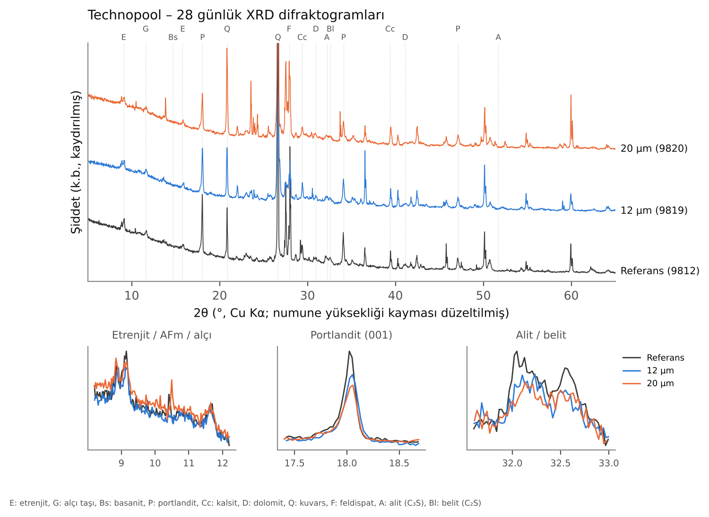{width=16cm}

{width=16cm}

| Yaş | Ambalaj | Ölçüm no | Etrenjit (9,1°) | Portlandit (18,0°) | Alit (51,7°) | Kalsit (29,4°) |
|---|---|---|--:|--:|--:|--:|
| Kuru harç | Referans | 9744 | 33 | 26 | 160 | 956 |
| Kuru harç | 12 µm | 9708 | 34 | 11 | 271 | 763 |
| Kuru harç | 20 µm | 9709 | 44 | 11 | 203 | 715 |
| 1 gün | Referans | 9717 | 224 | 563 | 108 | 784 |
| 1 gün | 12 µm | 9712 | 204 | 308 | 147 | 659 |
| 1 gün | 20 µm | 9716 | 164 | 309 | 73 | 487 |
| 7 gün | Referans | 9743 | 299 | 1070 | 9 | 356 |
| 7 gün | 12 µm | 9740 | 273 | 851 | 28 | 364 |
| 7 gün | 20 µm | 9742 | 263 | 847 | 30 | 287 |
| 28 gün | Referans | 9812 | 256 | 748 | 10 | 97 |
| 28 gün | 12 µm | 9819 | 181 | 713 | 7 | 232 |
| 28 gün | 20 µm | 9820 | 181 | 516 | 3 | 147 |
| 7 gün (durdurulmamış) | 20 µm | 9741 | 301 | 994 | 34 | 333 |

: Çizelge 8. Technopool XRD net pik alanları (k.b.; doğrusal taban çizgisi üzerindeki alan, numune yüksekliği kayması düzeltilmiş)

| Yaş | Ambalaj | Ölçüm no | n | Ca(OH)₂ 3640 cm⁻¹ (mAbs) | O–H bandı alanı (k.b.) | Si–O bandı minimumu (cm⁻¹) |
|---|---|---|--:|--:|--:|--:|
| 1 gün | Referans | 9785 | 2 | 5,1 (4,4–5,8) | 14348 (14284–14412) | 1009 (1008–1010) |
| 1 gün | 12 µm | 9783 | 2 | 5,0 (4,1–5,8) | 19432 (18535–20329) | 966 (944–987) |
| 1 gün | 20 µm | 9784 | 2 | 8,3 (7,6–8,9) | 22013 (20989–23037) | 1010 (1009–1010) |
| 7 gün | Referans | 9798 | 2 | 10,2 (9,5–11,0) | 20199 (19755–20644) | 984 (984–985) |
| 7 gün | 12 µm | 9793 | 2 | 10,2 (9,2–11,2) | 17014 (15599–18428) | 988 (988–989) |
| 7 gün | 20 µm | 9797 | 1 | 9,5 | 15973 | 991 |
| 28 gün | 12 µm | 9855 | 2 | 6,9 (5,8–8,0) | 15577 (13572–17581) | 982 (980–983) |

: Çizelge 9. Technopool FTIR göstergeleri (tekrar ölçümlerin ortalaması; parantez içinde en küçük–en büyük değer)

# 5. Genel Değerlendirme

Macunart, İzolatex Plus ve Technopool için XRD hidratasyon göstergelerinin yaşa göre değişimi Şekil 35'te topluca verilmiştir. Ürün bazındaki bulgular Çizelge 10'da özetlenmiştir.

{width=16cm}

| Ürün | Kuru harçta ön hidratasyon | Erken yaş (1–7 gün) | 28 gün | Öne çıkan / geride kalan ambalaj |
|---|---|---|---|---|
| Groutart Rapid* | – | 1 g: 12 µm (kristalin), 20 µm (C-S-H); 7 g: 20 µm (XRD), 30 µm (FTIR) | 12 µm (kristalin), 20 µm (C-S-H) | En dengeli: 20 µm |
| Mastar 10* | – | 30 µm önde | 30 µm dengeli; 12 ≈ 20 µm | En dengeli: 30 µm |
| Macunart | Saptanmadı | 1 g: 12 µm ≈ Ref > 20 > 30 µm; 7 g: ambalajlar benzer | 12 ≈ 30 µm (XRD), 12 ≈ 20 µm (FTIR) | Belirgin olumsuz etki yok; 12 µm Ref ile eşdeğer |
| İzolatex Plus | Saptanmadı (alçı taşı farkı izlenmeli) | Tekrarlanabilirlik yetersiz | 20 > 12 µm ≈ Ref | Belirgin olumsuz etki yok |
| Technopool | Saptanmadı | Ref > 12 ≥ 20 µm | Ref ≈ 12 > 20 µm | Ref önde; 20 µm geride |

: Çizelge 10. Ürün bazında bulguların özeti (*önceki rapordan; kuru harç ölçümü bu raporda bulunmamaktadır)

Bu bulgulara göre aşağıdaki değerlendirmeler önerilmektedir:

1. **Ön hidratasyon.** Uygulanan şartlandırma sonrasında Macunart, İzolatex Plus ve Technopool kuru harçlarında hiçbir ambalaj tipinde XRD ile saptanabilir kristalin hidratasyon ürünü (etrenjit, portlandit) oluşmamış, alit korunmuştur. Macunart FTIR verileri de bunu desteklemektedir. Ancak XRD'nin kristalin fazlar için algılama sınırı genellikle yaklaşık %1 düzeyindedir. Literatürde nem duyarlılığı en yüksek olduğu bildirilen C₃A ve serbest kireçteki yüzeysel değişimler ile amorf ön hidratasyon ürünleri bu yöntemle saptanamayabilir (Dubina ve diğerleri, 2011).
2. **Hidratasyon kinetiği.** Ambalaj tipinin etkisi ürüne göre değişmektedir. Bütün ürünlerde tutarlı biçimde olumsuz sonuç veren tek bir ambalaj tipi görülmemiştir. Film kalınlığı ile hidratasyon göstergeleri arasında da sistematik bir ilişki (kalınlık arttıkça daha iyi koruma) gözlenmemiştir. Bu nedenle numuneler arası farkların bir bölümü numune hazırlama ve ölçüm değişkenliğinden kaynaklanıyor olabilir.
3. **Technopool.** Referans ambalajın tüm yaşlarda önde olduğu tek üründür. 20 µm ambalaj 28 günde de geride kalmıştır. Bu ürün için ambalaj değişikliği kararı performans testleriyle desteklenmelidir.
4. **SKT açısından.** Mineralojik veriler, 2 yıllık depolamaya karşılık kabul edilen şartlandırma sonunda 12 µm ve 20 µm ambalajların Macunart ve İzolatex Plus için raf ömrünü kısaltacak bir ön hidratasyona yol açtığını göstermemektedir. SKT kararı için XRD ve FTIR tek başına yeterli değildir. Ürün standartlarındaki performans testlerinin (Ürün Listesi – Testler sayfası: kıvam, priz, yapışma, basınç/eğilme dayanımı, kap ömrü vb.) Referans ile karşılaştırmalı sonuçları gereklidir [VERİ GEREKLİ].

# 6. Öneriler

- **Eksik ölçümlerin tamamlanması.** Macunart 28 gün Referans ve 20 µm XRD; Technopool 28 gün Referans ve 20 µm FTIR; İzolatex Plus 28 gün 30 µm XRD/FTIR; İzolatex Plus ve Technopool kuru harç FTIR ölçümleri.
- **Ön hidratasyonun daha duyarlı ölçülmesi.** Kuru harçlarda TGA ile 40–200 °C (bağlı su) ve 400–500 °C (portlandit) kütle kayıpları, Referans ile karşılaştırmalı olarak ölçülmelidir. TGA, XRD'de görünmeyen amorf ön hidratasyon ürünlerini de yansıtır.
- **Nicel faz analizi.** Kuru harçlarda C₃A (kübik/ortorombik), alçı taşı, basanit ve anhidrit oranlarının Rietveld analiziyle belirlenmesi. Nem girişine en duyarlı fazlar bunlardır.
- **Tekrarlanabilirlik.** XRD ölçümlerinin en az iki bağımsız numune hazırlamasıyla tekrarlanması ve agrega içeren ürünlerde numunenin 63 µm altına öğütülmesi ya da elenmesi. İzolatex Plus gibi esnek numunelerde yüzeyin tutucuyla aynı seviyeye getirilmesi.
- **Hidratasyon durdurma.** Tüm yaşlarda aynı durdurma prosedürünün uygulanması. RILEM önerisine göre izopropanol ile solvent değişimi tercih edilebilir (Snellings ve diğerleri, 2018).
- **Ambalaj verileri.** Referans ambalajın yapısı ve torbaların su buharı geçirgenliği (WVTR) değerlerinin rapora eklenmesi. Film kalınlığı tek başına nem bariyerini tanımlamaz.

# Kaynaklar

Dubina, E., Wadsö, L., & Plank, J. (2011). A sorption balance study of water vapour sorption on anhydrous cement minerals and cement constituents. *Cement and Concrete Research, 41*(11), 1196–1204. https://doi.org/10.1016/j.cemconres.2011.07.009

Scrivener, K., Snellings, R., & Lothenbach, B. (Eds.). (2016). *A practical guide to microstructural analysis of cementitious materials*. CRC Press. ISBN 978-1-4987-3865-1

Snellings, R., vd. (2018). RILEM TC-238 SCM recommendation on hydration stoppage by solvent exchange for the study of hydrate assemblages. *Materials and Structures, 51*(6), 172. https://doi.org/10.1617/s11527-018-1298-5 [yazar listesi DOI sayfasından DOĞRULANACAK]

Whittaker, M., Dubina, E., Al-Mutawa, F., vd. (2013). The effect of prehydration on the engineering properties of CEM I Portland cement. *Advances in Cement Research, 25*(1), 12–20. https://doi.org/10.1680/adcr.12.00030

Ylmén, R., Jäglid, U., Steenari, B.-M., & Panas, I. (2009). Early hydration and setting of Portland cement monitored by IR, SEM and Vicat techniques. *Cement and Concrete Research, 39*(5), 433–439. https://doi.org/10.1016/j.cemconres.2009.01.017

Yu, P., Kirkpatrick, R. J., Poe, B., McMillan, P. F., & Cong, X. (1999). Structure of calcium silicate hydrate (C-S-H): Near-, mid-, and far-infrared spectroscopy. *Journal of the American Ceramic Society, 82*(3), 742–748. https://doi.org/10.1111/j.1151-2916.1999.tb01826.x

# Ek A. Ölçüm Listesi ve Veri Dosyaları

Ham veriler `veri/xrd/` ve `veri/ftir/` klasörlerinde, işlenmiş göstergeler `sekiller/gostergeler.json` dosyasında, grafikleri ve çizelgeleri üreten kodlar `kod/` klasöründe bulunmaktadır. Ölçüm numaraları Çizelge 4–9'da verilmiştir. XRD ve FTIR ölçüm numaraları birbirinden bağımsızdır.
