Metindeki [DOĞRULANACAK] ve [VERİ GEREKLİ] işaretli yerler proje ekibince tamamlanacaktır.

# 1. Amaç

Çimento esaslı yapı kimyasalları; Portland çimentosu (OPC) ve kalsiyum alüminat çimentosu (CAC) gibi mineral bağlayıcılar, kalsiyum sülfat türleri, kum, kalsit ve dolomit gibi dolgular ile polimer ve kimyasal katkılardan oluşan toz karışımlardır. Bu ürünlerin raf ömrü, içerdikleri ham maddelerin raf ömrü esas alınarak belirlenmektedir. Ancak ürün nemli ya da sıcak ortamda depolandığında veya ambalaj nemi yeterince tutmadığında bağlayıcılar havadaki nemle tepkimeye girebilir (ön hidratasyon). Bunun sonucunda ürünün bağlayıcılığı ve dayanımı düşer, uygulamada beklenen performansa ulaşılamaz. Bu durum hem kalite kaybına hem de gereksiz malzeme, enerji ve maliyet kullanımına yol açmaktadır.

Ekibin 2025 yılında yürüttüğü raf ömrü çalışmasında, orijinal ambalajında işletme koşullarında bekletilen ürünlerde raf süresi uzadıkça hidratasyon veriminin ve performansın düştüğü, CAC içeren bazı ürünlerde 6–12. aylarda taşlaşma ve topaklanma görüldüğü bildirilmiştir [1]. Aynı çalışmada nem bariyeri artırılmış ambalajlara geçilmesi ya da ambalaj film kalınlığının artırılması önerilmiştir [1].

Bu proje, söz konusu öneriden hareketle, farklı iklim koşullarında ürün stabilitesini artırmak ve raf ömrünü uzatmak için ambalaj yapısının optimize edilmesini amaçlamaktadır. Sıcak ve soğuk iklim senaryolarını temsil eden, sıcaklık, nem ve yağış adımlarından oluşan iklim profilleri hazırlanmış ve farklı içerikteki ürünler bu profiller altında hızlandırılmış yaşlandırmaya tabi tutulmuştur. Yaşlandırmadan sonra ürünlerin performansı ve mikroyapısı incelenerek ambalaj yapıları karşılaştırılmakta, gerekli görülen ürünlerde ambalajın bariyer özelliklerinin ve yapısının revize edilmesi öngörülmektedir.

Projeden beklenen çıktılar, farklı coğrafi pazarlarda ürün dayanıklılığının artırılması, kalite kayıplarının azaltılması ve daha uzun raf ömrüne sahip ürünlerin geliştirilmesidir. Bu çıktıların çevresel ve ekonomik sürdürülebilirlik hedeflerine de katkı sağlaması beklenmektedir. Sonuçların performansa göre ticarileştirilmesi ve akademik yayına dönüştürülmesi planlanmaktadır.

Bu rapor projenin mikroyapı ayağına ait ara rapordur ve Groutart Rapid, Mastar 10, Macunart, İzolatex Plus ve Technopool ürünlerini kapsamaktadır. Raporun sorusu, ambalaj tipinin depolama sırasında ürüne nem girişini değiştirip değiştirmediği ve buna bağlı olarak ön hidratasyon ya da hidratasyonda gecikme oluşup oluşmadığıdır. Performans test sonuçları ile Izoseal ve Izostop verileri bu rapora dahil değildir [VERİ GEREKLİ].

# 2. Literatür Özeti

## 2.1. Portland çimentosu ve hidratasyon reaksiyonları

Portland çimentosu, klinkerin uygun oranda alçı taşı ile öğütülmesiyle elde edilir. Klinkerin ana fazları trikalsiyum silikat (C₃S, alit), dikalsiyum silikat (C₂S, belit), trikalsiyum alüminat (C₃A) ve tetrakalsiyum alüminoferrittir (C₄AF) [2]. Bu raporda kullanılan faz adları ve kısaltmaları Tablo 1'de verilmiştir.

| Faz | Formül | Kısaltma | XRD'deki adı |
|---|---|---|---|
| Trikalsiyum silikat | 3CaO·SiO₂ | C₃S | Alit / hatrurit |
| Dikalsiyum silikat | 2CaO·SiO₂ | C₂S | Belit / larnit |
| Trikalsiyum alüminat | 3CaO·Al₂O₃ | C₃A | – |
| Tetrakalsiyum alüminoferrit | 4CaO·Al₂O₃·Fe₂O₃ | C₄AF | Brovnmillerit |
| Kalsiyum silikat hidrat | değişken | C-S-H | amorf |
| Kalsiyum hidroksit | Ca(OH)₂ | CH | Portlandit |
| Etrenjit | 3CaO·Al₂O₃·3CaSO₄·32H₂O | AFt | Etrenjit |
| Monosülfat / monokarbonat | – | AFm | – |
| Alçı taşı | CaSO₄·2H₂O | CS̄H₂ | Jips |

: Tablo 1. Çimento fazları ve hidratasyon ürünlerinin gösterimi [2]

Çimento su ile karıştırıldığında C₃S ve C₂S, amorf C-S-H jeli ile kristalin portlanditi (CH) oluşturur. C-S-H, sertleşmiş çimento hamurunun dayanımını sağlayan ana üründür. C₃S erken yaş dayanımını, C₂S ise ileri yaş dayanımını belirler. C₃A, ortamdaki alçı taşı ile önce etrenjiti (AFt), sülfat tükendikten sonra ise monosülfat gibi AFm fazlarını oluşturur [2]. Ortamda kalsit bulunduğunda monosülfat yerine monokarbonat kararlı hâle gelir ve etrenjit de daha kararlı kalır [3, 4].

## 2.2. Kalsiyum alüminat çimentosu ve ikili/üçlü bağlayıcı sistemler

CAC'nin ana reaktif fazı monokalsiyum alüminattır (CA) [2]. CAC hızlı priz ve erken dayanım gerektiren tesviye şapları, hızlı tamir harçları ve teknik yapıştırıcılarda OPC ve kalsiyum sülfat ile birlikte ikili ya da üçlü bağlayıcı sistem olarak kullanılır [1, 5]. OPC–CAC–kalsiyum sülfat üçlü sistemlerinde CAC ve sülfatça zengin karışımlar ağırlıklı olarak etrenjit ve alüminyum hidroksit (AH₃) oluşturur [5]. Bu çalışmadaki ürünlerden Mastar 10, OPC, CAC ve anhidrit içeren üçlü bir sistemdir [1]. Diğer ürünlerin bağlayıcı sistemleri Tablo 3'te verilmiştir.

## 2.3. Ön hidratasyon ve depolama nemi

Çimento depolama sırasında nemle temas ettiğinde tane yüzeyinde sınırlı bir hidratasyon (ön hidratasyon) başlar. Whittaker ve diğerleri, ince tabaka hâlinde %60 ve %85 bağıl nemde bekletilen CEM I 42,5R çimentosunda %60 bağıl nemin dayanımı ihmal edilebilir düzeyde etkilediğini, ancak işlenebilirliği azalttığını ve priz süresini uzattığını bildirmiştir [6]. %85 bağıl nemde ise basınç dayanımı, özellikle erken yaşta, büyük ölçüde düşmüştür [6].

Dubina ve diğerleri, klinker fazlarının su buharı alımını ayrı ayrı ölçmüş ve en reaktif bileşenlerin serbest kireç (CaO) ile C₃A olduğunu göstermiştir [7]. Ortorombik C₃A yaklaşık %55 bağıl nemde su bağlamaya başlarken C₃S ve C₂S'de sorpsiyon ancak %74 bağıl nemde başlamış ve düşük kalmıştır. Kalsiyum sülfatlar suyu çoğunlukla fiziksel olarak tutmuştur [7]. Torbaya nem girdiğinde ilk etkilenecek fazların alüminat ve sülfat fazları olması beklenir.

Ekibin 2025 çalışmasında da benzer bir tablo görülmüştür. Mastar 10'un 12. ay numunelerinde 24 saatlik kuruma gerçekleşmemiş ve bu durum CAC'nin rafta ön hidratasyona girmesine bağlanmıştır. CAC içeren ikili sistemlerde (Rapitech, Ultratech) 6–12. aylarda taşlaşma görülmüş, yalnız OPC içeren ürünlerde ise raf süresi uzadıkça hidratasyon verimi ve performans düşmüştür [1].

## 2.4. Ambalajın nem bariyeri ve hızlandırılmış yaşlandırma

Bir ambalaj filminin nem bariyeri su buharı geçirgenliği (WVTR) ile tanımlanır. ASTM F1249, plastik film ve levhaların WVTR, su buharı geçirgenliği ve homojen malzemeler için geçirgenlik katsayısının belirlenmesini tanımlar ve WVTR'yi paketlenmiş ürünün raf ömrü ve stabilitesiyle ilişkilendirir [8]. Aynı standart, WVTR'nin film kalınlığıyla ters orantılı olduğu varsayımının her zaman geçerli olmadığını da belirtir [8]. Bu nedenle torbaların bariyer performansı yalnızca film kalınlığından çıkarılamaz.

Hızlandırılmış yaşlandırma, bozulma tepkimelerinin sıcaklıkla Arrhenius bağıntısına göre hızlandığı varsayımına dayanır. Tıbbi ambalajlar için hazırlanmış olan ASTM F1980, hızlandırılmış yaşlandırma çalışmalarının gerçek zamanlı yaşlandırma çalışmalarıyla birlikte yürütülmesini öngörmektedir [9]. Bu projede kullanılan "45 günlük döngü = 2 yıl" eşdeğerliği de gerçek zamanlı depolama verisiyle doğrulanmalıdır.

## 2.5. Hidratasyonun XRD ve FTIR ile izlenmesi

XRD ile etrenjit, portlandit ve AFm gibi kristalin hidratasyon ürünleri ile reaksiyona girmemiş alit ve belit izlenebilir; amorf C-S-H ise yalnızca geniş bir zemin yükselmesi verir [10]. Rietveld analiziyle bulunan faz miktarlarının görüntü analizi ve TGA ile uyumlu olduğu gösterilmiştir [11]. Hidratasyonu belirli bir yaşta durdurmak için RILEM TC-238 SCM, izopropanol ile solvent değişimini önermektedir [12].

FTIR'da C-S-H oluşumu 970–1100 cm⁻¹ aralığındaki banttan izlenir [13]. Sentetik C-S-H'nin ana Si–O bantları 950–1100, 810–830 ve 660–670 cm⁻¹ aralığındadır ve konumları Ca/Si oranına göre kayar [14]. Etrenjit ve alçı taşının sülfat bantları ile 1600–1700 cm⁻¹ aralığındaki H–O–H bükülme bandı, C₃A–alçı taşı–kalsit sisteminde hidratasyonun izlenmesinde kullanılmıştır [15]. Bu raporda Si–O bandının anhidrit alitteki ~920 cm⁻¹ konumundan ~960–1000 cm⁻¹'e kayması hidratasyon göstergesi olarak kullanılmıştır.

# 3. Deneysel Çalışmalar

## 3.1. Numune hazırlanışı

### 3.1.1. Ambalaj seçimi

Çalışmada üç farklı torba tipi kullanılmış ve ürünün mevcut ambalajı referans alınmıştır (Tablo 2).

| Torba tipi | İç film kalınlığı | Numune kodu |
|---|---|---|
| Mapei Adesilex P7 torbası | 12 µm | 12 µm |
| Mapei boş torba | 20 µm | 20 µm |
| Weber torbası (weberfloor LVL 1040) | 30 µm | 30 µm |
| Ürünün mevcut Kalekim ambalajı [DOĞRULANACAK] | [VERİ GEREKLİ] | Referans |

: Tablo 2. Ambalaj tipleri (Ürün Listesi dosyası)

### 3.1.2. Ürün seçimi

Farklı bağlayıcı sistemlerini ve kullanım alanlarını temsil eden beş ürün seçilmiştir (Tablo 3). Ürün–ambalaj eşleşmeleri de aynı tabloda verilmiştir.

| Ürün | Bağlayıcı sistemi | Referans | 12 µm | 20 µm | 30 µm |
|---|---|:-:|:-:|:-:|:-:|
| Groutart Rapid | [DOĞRULANACAK] | ✓ | ✓ | ✓ | ✓ |
| Mastar 10 | Üçlü (OPC + CAC + anhidrit) [1] | – | ✓ | ✓ | ✓ |
| Macunart | [DOĞRULANACAK] | ✓ | ✓ | ✓ | ✓ |
| İzolatex Plus (toz bileşen) | [DOĞRULANACAK] | ✓ | ✓ | ✓ | ✓ |
| Technopool | [DOĞRULANACAK] | ✓ | ✓ | ✓ | – |

: Tablo 3. Ürünler, bağlayıcı sistemleri ve test edilen ambalajlar

## 3.2. Deney planı

Kraft torbalar için sıcak ve soğuk iklim senaryolarını temsil eden 24 saatlik iki iklim profili tanımlanmıştır (Tablo 4). Soğuk profil Moskova ve Fransa'nın soğuk bölgelerinin, sıcak profil ise Nairobi, Duhok ve Trablus'un iklim verilerine göre hazırlanmıştır. 45 günlük uygulamanın 2 yıllık depolamaya karşılık geldiği kabul edilmiştir. Soğuk profil 06.03.2026–21.04.2026 tarihleri arasında uygulanmıştır. Sıcak profilin tarihleri ve hangi ürünün hangi profile girdiği dosyalarda yer almamaktadır [DOĞRULANACAK]. Sonuçların iklim profiline göre yorumlanabilmesi için bu bilgi gereklidir.

| Soğuk profil adımı | Bağıl nem | Yağış | Süre (sa) | | Sıcak profil adımı | Bağıl nem | Yağış | Süre (sa) |
|---|--:|---|--:|---|---|--:|---|--:|
| −15 °C | %90 | yok | 5 | | 0 °C | %65 | yok | 3 |
| −5 °C | %90 | yok | 5 | | 5 °C | %75 | yok | 4 |
| 0 °C | %85 | yok | 4 | | 15 °C | %75 | 70 mm | 4 |
| 10 °C | %80 | 70 mm | 5 | | 35 °C | %70 | yok | 5 |
| 20 °C | %75 | 90 mm | 5 | | 45 °C | %80 | yok | 4 |
| | | | | | 45 °C | %20 | yok | 4 |
| Toplam | | | 24 | | Toplam | | | 24 |

: Tablo 4. Kraft torbalar için soğuk ve sıcak iklim profilleri (Şartlandırma Koşulları dosyası)

Jüt torbalarda (Fayser Std., Foamplast, Technoplast Maxi Extra, Mastar 10, Groutart Rapid) radyasyon (1120 W), −10/23/37 °C sıcaklık, nem ve yağış adımlarından oluşan 160 dakikalık klasik döngü kullanılmıştır. 6 aylık depolamaya ek olarak 10, 20 ve 40 günlük uygulama sırasıyla 6, 12 ve 24 aylık yaşlanmaya karşılık gelmektedir.

Yaşlandırmadan sonra her ambalajdan alınan kuru harç doğrudan analiz edilmiş, hidrate numuneler ise 1, 7 ve 28 gün kür edildikten sonra incelenmiştir [karışım oranları VERİ GEREKLİ].

## 3.3. Reaksiyon takibi

### 3.3.1. Reaksiyon durdurma

2025 raf ömrü çalışmasında hidratasyon, AG_YK_TL_0397 numaralı "Çözücü Değişim Metodu ile Çimento Hidratasyonu Durdurma" talimatına göre durdurulmuştur: numuneler havanda dövülmüş, 100 ml aseton ve 50 ml dietil eter ile yıkanmış ve mavi bant filtre kâğıdından süzülmüştür [1]. Bu çalışmada da aynı talimatın uygulandığı varsayılmıştır [DOĞRULANACAK]. Technopool 20 µm numunesi 7. günde hem durdurulmuş hem durdurulmamış olarak ölçülmüştür.

### 3.3.2. XRD ölçümleri

Ham veri dosyalarının başlık bilgilerine göre XRD ölçümleri Cu Kα ışınımıyla (λ = 1,5406 Å), numune döndürücülü yansıma (reflection) geometrisinde, 2θ = 5–70° aralığında ve 0,026° adımla alınmıştır.

### 3.3.3. FTIR ölçümleri

FTIR spektrumları 4000–650 cm⁻¹ aralığında 1 cm⁻¹ aralıkla %T olarak kaydedilmiş, numunelerin çoğu iki, bazıları üç ya da dört tekrar ölçülmüştür. 2025 çalışmasında FTIR ölçümleri transmisyon modunda alınmıştır [1]; bu çalışmadaki ölçüm modu [DOĞRULANACAK].

### 3.3.4. Veri işleme

Ham XRD (.rd) ve FTIR (.csv) dosyaları yeniden işlenmiş ve tüm grafikler aynı ölçek ve renklerle çizilmiştir (Referans siyah, 12 µm mavi, 20 µm turuncu, 30 µm yeşil).

İzolatex Plus hidrate numunelerinde pikler 0,1–0,7° 2θ kadar yüksek açıya kaymıştır; diğer ürünlerde kayma 0,08°'in altındadır. Kayma, kuvars (26,64°) ya da dolomit (30,94°) piki iç standart alınarak Δ2θ = k·cos θ bağıntısıyla düzeltilmiştir.

Her numunede etrenjit (8,7–9,5°), portlandit (17,7–18,4°), alit (51,45–52,0°) ve kalsit (29,15–29,7°) pencerelerinde doğrusal taban çizgisi üzerindeki net pik alanı hesaplanmıştır. Bu değerler yarı nicel olup yalnızca aynı ürünün numuneleri arasında karşılaştırma için kullanılmıştır. Rietveld analizi yapılmamıştır.

FTIR tekrarlarının ortalaması alınarak absorbansa (A = −log T) çevrilmiştir. 3640 cm⁻¹ portlandit bandının yüksekliği, 3750–2700 cm⁻¹ O–H bandının alanı ve 900–1060 cm⁻¹ aralığındaki Si–O bandının konumu gösterge olarak kullanılmıştır.

Aynı numunenin FTIR tekrarları arasında O–H bandı alanı %25–30'a kadar değişmektedir (Tablo 7, Macunart 28 gün 12 µm). Bu fark numuneler arasındaki farkla aynı büyüklükte olduğundan tekrar aralıkları örtüşen FTIR sonuçları "fark yok" olarak değerlendirilmiştir. XRD ölçümleri tekrarsızdır. Kum içeren ürünlerde (Technopool, İzolatex Plus) iri taneler nedeniyle kuvars, feldispat ve kalsit pik şiddetleri numuneden numuneye değişmektedir.

## 3.4. Performans testleri

Ürünlere uygulanacak performans testleri Ürün Listesi dosyasındaki Testler sayfasında tanımlanmıştır (Tablo 5). Testler referans ambalajla karşılaştırmalı yapılacak ve ürünlerin kalite kontrol planlarındaki limit değerlerle değerlendirilecektir. 2025 çalışmasında Mastar 10 için TS EN 13813, TS EN 13888, TS EN 196-3 ve TS EN 196-10 standartları uygulanmıştır [1]. Diğer ürünler için uygulanacak standartlar ve kalite kontrol planı kodları [DOĞRULANACAK].

| Ürün | Testler |
|---|---|
| Macunart | Ambalaj ve ürün görünüşü, işlenebilirlik ve kat kuruma, kap ömrü, zımpara sonrası yüzey görünüşü, tiksotropi, basınç dayanımı, betona yapışma |
| Groutart Rapid | Ambalaj ve ürün görünüşü, kap ömrü, tiksotropi, kapiler su emme, basınç dayanımı (1 saat, 1 gün, 7 gün), betona yapışma |
| İzolatex Plus | Toz ve sıvı bileşen görünüşü, sıvı bileşen katı madde miktarı, işlenebilirlik, viskozite, su geçirimsizlik (pozitif ve negatif basınç), kuru ve ıslak çekme dayanımı, 23 °C'de çatlak köprüleme, su emme, kap ömrü, yapışma |
| Technopool | Ambalaj ve ürün görünüşü, işlenebilirlik, viskozite, seramik düzeltilebilme süresi, kayma, kuru/ıslak/sıcak yapışma, açık bekletme süresi, esneklik, kabuklaşma |
| Mastar 10 | Ambalaj ve ürün görünüşü, kürlenmiş yüzey görünüşü, işlenebilirlik, yayılma çapı (0 ve 15 dk), viskozite, eğilme ve basınç dayanımı (24 saat, 28 gün), ilk ve son priz, aşınma |

: Tablo 5. Ürünlere uygulanacak performans testleri (Ürün Listesi – Testler sayfası)

# 4. Bulgular ve Tartışma

Groutart Rapid ve Mastar 10 bölümleri ekibin önceki raporundan (GR ve M10 SKT, son hâl) değiştirilmeden alınmıştır. Macunart, İzolatex Plus ve Technopool bölümleri bu rapor için ham veriden hazırlanmıştır.

### 4.1. Groutart Rapid

{width=15.5cm}

Şekil 1'de 1 günlük hidratasyon sonrasına ait olan karşılaştırmalı XRD difraktogramları verilmiştir. Difraktogramlar incelendiğinde, tüm numunelerde hem hidratasyon ürünlerinin oluştuğu hem de karakteristik piklerin belirginleştiği görülmektedir.

$2\theta \approx 9^{\circ}$ bölgesinin Etrenjit fazını ifade ettiği düşünülmekte olup dört numunede de ilgili bölgede pikler gözlenmiştir. Pik şiddetleri karşılaştırıldığında;

Groutart Rapid-12µ \>Groutart Rapid-Referans\>Groutart Rapid-30µ\>Groutart Rapid-20 µ

şeklindedir. Sıralamadaki en yüksek pik şiddetine sahip olan Groutart Rapid-12µ numunesi, alüminyum-sülfat reaksiyonlarının bu seride daha hızlı ilerlediği izlenimini vermektedir. $2\theta \approx 18^{\circ},34^{\circ},47^{\circ}$ bölgesinde tüm numunelerde belirgin pikler görülmüş olup en şiddetli pikin Groutart Rapid-12µ numunesine ait olduğu gözlenmiştir. Diğer yandan Groutart Rapid-20µ ve Groutart Rapid-30µ numunelerinde ilgili pikin şiddetleri düşük olarak gözlenmiştir. Reaksiyona girmemiş klinker fazlarına ait pikleri ifade eden $2\theta \approx 29^{\circ}\text{-}33^{\circ},41^{\circ}\text{-}42^{\circ},51^{\circ}\text{-}52^{\circ}$ bölgesi incelendiğinde her bir numunede kalıntı fazlar gözlenmektedir. İlgili bölgede Groutart Rapid-12µ numunesinin pik şiddeti bir miktar daha düşük olması nedeniyle bu numunede erken yaştaki çimento tüketiminin daha yüksek olduğu görülmektedir. Diğer numunelerde ise kalan klinker miktarları birbirine yakın olarak değerlendirilmektedir.

Genel olarak en yüksek hidratasyon ürünü yoğunluğuna ve dolayısıyla en hızlı reaksiyon kinetiğine Groutart Rapid-12µ numunesinin sahip olduğu düşünülmektedir. Düşük etrenjt fazı ve hidratasyon ürünü göstermekte olan Groutart Rapid-20µ numunesinin ise erken yaş reaksiyon kinetiğinin en yavaş ilerleyen numune olduğu düşünülmektedir.

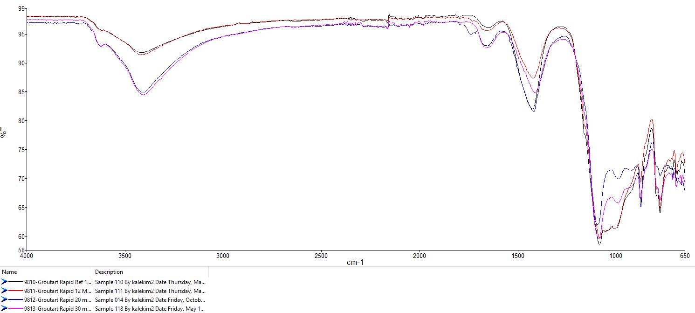{width=15.5cm}

Şekil 2'de 1 günlük FTIR spektrumları karşılaştırmalı olarak verilmiştir. Her bir numune için hidratasyon reaksiyonlarının gerçekleştiği ve karakteristik bantların oluştuğu görülmektedir. Yaklaşık 3400cm-1 ve 1650cm- bölgelerinin yapısal su ve hidrat fazlarını temsil ettiği düşünülmekte olup bu bölgelerdeki en yüksek absorbans değişimi sırasıyla Groutart Rapid-12 µ ve Groutart Rapid-20µ numunelerinde görülmektedir. Bu durum bu numunelerin erken yaş hidratasyon ürünlerinin daha yoğun olarak geliştiğini göstermektedir. Şekil 1 yorumlanırken ifade edilen portlandit fazına şekil 2'deki FTIR spektrumunda yaklaşık 3640cm-1 bandı her bir numunede gözlenmiştir. En belirgin absorbans ise Groutart Rapid-12µ ve Groutart Rapid-20µ numunelerinde gözlenirken Groutart Rapid-Referans ve Groutart Rapid-30µ numunelerinde ilgili oluşum daha düşük seviyede kalmıştır.

1000cm-1 ve 1100cm-1 aralığındaki C-S-H jeli ve etrenjit fazları birlikte değerlendirildiğinde en yüksek bant gelişiminin Groutart Rapid-20µ ve Groutart Rapid-12µ numunelerinde olduğu tespit edilmiştir. Groutart Rapid-20µ numunesinde özellikle 970-1000cm-1 bölgesinde göstermiş olduğu derin bant belirginliği amorf C-S-H jeli oluşumunun bu numunede diğer numunelere kıyasla daha yüksek olduğunu ortaya koymaktadır.

1 günlük kür süresi sonunda yapılan XRD ve FTIR analizi sonuçları birlikte değerlendirildiğinde Groutart Rapid-12µ numunesinde kristal hidratasyon ürünlerinin, Groutart Rapid-20µ numunesinde ise temel bağlayıcı faz olarak değerlendirilen amorf C-S-H jeli oluşumunun öne çıktığı görülmektedir. Tüm bu tespitler doğrultusunda erken yaş hidratasyon verimi ve bağlayıcı faz gelişimi açısından Groutart Rapid-20µ numunesinin diğer numunelere göre daha avantajlı olduğu değerlendirilmektedir.

Şekil 3'te 7 günlük hidratasyon sonrasına ait olan karşılaştırmalı XRD difraktogramlarına yer verilmiştir.

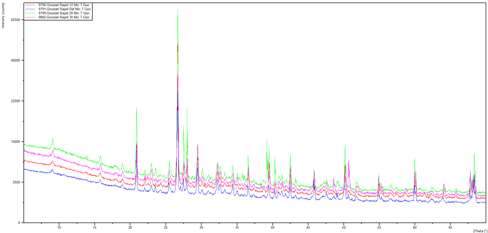{width=15.5cm}

 Şekil 1'de verilen 1 günlük kürlenme sonuçları ile kıyaslandığında tüm numunelerde hidratasyon reaksiyonlarının belirgin şekilde ilerlemiş olduğu ve üründe gözlemlenen piklerin daha da belirginleştiği görülmektedir. Etrenjit fazını ifade eden $2\theta \approx 9^{\circ}$ bölgesindeki piklerin tüm numunelerde belirgin şekilde görüldüğü ve en yüksek pik şiddetine sahip olan numunenin Groutart Rapid-20µ olduğu, Groutart Rapid-12µ ve Groutart Rapid-30µ numunelerinin birbirine yakın davranış sergilediği, Groutart Rapid-Referans numunesinde ise diğer numunelere kıyasla etrenjit gelişiminin daha düşük seviyede kaldığı görülmüştür. $2\theta \approx 18^{\circ},34^{\circ},47^{\circ}$ bölgesi portlandit fazını temsil etmekte olup bu bölgedeki en şiddetli pik Groutart Rapid-20µ numunesinde gözlenmiş olup bunu sırasıyla Groutart Rapid-12µ, Groutart Rapid-30µ ve Groutart Rapid-Referans numuneleri takip etmektedir. Bu durumda Groutart Rapid-20µ numunesinin silikat fazı hidratasyonunun gelişiminin diğer numunelerden önde olduğu düşünülmektedir.

Reaksiyona girmemiş klinker fazlarına ait pikleri ifade eden $2\theta \approx 29^{\circ}\text{-}33^{\circ},41^{\circ}\text{-}42^{\circ},51^{\circ}\text{-}52^{\circ}$ bölgesi incelendiğinde her bir numunede kalıntı fazlar gözlenmekle birlikte en düşük pik şiddetleri Groutart Rapid-20µ numunesinde gözlenmiştir. Diğer yandan Groutart Rapid-Referans numunesi bu bölgede en şiddetli piklere sahip olduğundan reaksiyona girmemiş fazların varlığının bu numunede en yüksek olduğu düşünülmektedir. Hidratasyon ürünleri ve klinker tüketimi piklerinin şiddetleri birlikte değerlendirildiğinde Groutart Rapid-20µ numunesi hem yüksek kristal faz yoğunluğu hem de ileri reaksiyon kinetiği açısından öne çıkmaktadır.

Sonuç olarak, 7 günlük kür süresi sonunda hidratasyon ilerleme dereceleri şu şekilde sıralanabilir;

Groutart Rapid-20µ\>Groutart Rapid-12µ\>Groutart Rapid-30µ≈Groutart Rapid-Referans

{width=15.5cm}

Şekil 4'te 7 günlük FTIR spektrumları karşılaştırmalı olarak verilmiştir. Şekil 2'de verilen 1 günlük kür süresi sonunda yapılan FTIR analizi sonuçları ile karşılaştırıldığında tüm numunelerde hidratasyon reaksiyonlarının devam ettiği ve Şekil 2'ye göre bantların daha belirgin hala geldiği görülmektedir. Yapısal su ve hidrat fazlarını ifade eden 3400cm-1 ve 1650cm-1 bölgelerinde en yüksek bant şiddeti gösteren numunenin Groutart Rapid-30µ olduğu tespit edilmiştir. Groutart Rapid-20µ ve Groutart Rapid-12µ numunelerinin benzer davranışta oldukları gözlenirken Groutart Rapid-Referans numunesinin gelişiminin diğer numunelere kıyasla daha sınırlı kaldığı düşünülmektedir. Yaklaşık 3640cm-1 bölgesi portlandit fazını ifade etmekte olup tüm numunelerde varlığını devam ettirdiği ve XRD bulguları ile örtüşmektedir.

C-S-H jeli ve etrenjit oluşumlarını ifade eden 900-1200cm-1 bölgesinde en belirgin bant gösteren numunenin Groutart Rapid-30µ olduğu görülmektedir. Yaklaşık 950-1000cm-1 bölgesindeki bant derinlikleri ve yayılımları, amorf yapılı C-S-H jelinin oluşumu incelendiğinde en yüksek seviyeye ulaşan numunenin Groutart Rapid-30µ olduğu tespit edilmiştir. Bunu sırasıyla Groutart Rapid-20µ, Groutart Rapid-12µ ve Groutart Rapid-Referans numuneleri takip etmektedir.

1 günlük kür süresi sonunda yapılan FTIR analizi sonucunda en yüksek performans gösteren Groutart Rapid-20µ numunesi iken 7 günlük kür süresi sonunda en yüksek performans gösteren numune Groutart Rapid-30µ olarak tespit edilmiştir. Bu durum mikronize katkı boyutunun zamanla reaksiyon kinetiğinin üzerindeki etkisinin değiştiğine ve Groutart Rapid-30µ numunesinin ilerleyen kür sürelerinde daha yüksek bağlayıcı faz ürettiğini ifade etmektedir.

Sonuç olarak 7 günlük XRD analizlerinde kristal hidratasyon ürünlerinin açısından Groutart Rapid-20µ numunesi öne çıksa da mekanik bağlayıcı performansı belirleyen amorf C-S-H jeli gelişimi açısından sonuçlar;

Groutart Rapid-30µ\> Groutart Rapid-20µ\>Groutart Rapid-Referans

şeklinde sıralanmaktadır. Bu durumda 7 günlük nihai reaksiyon verimi ve bağlayıcı fazın optimizasyonu açısından en yüksek performansı Groutart Rapid-30µ numunesinin gösterdiği tespit edilmiştir.

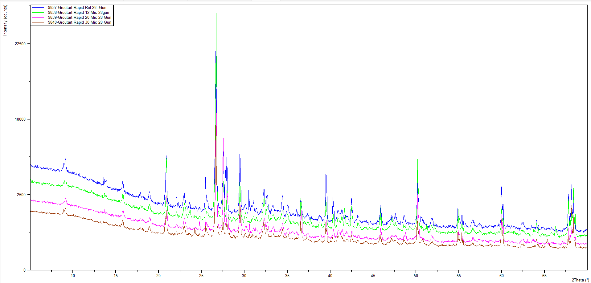{width=15.5cm}

Şekil 5'te 28 günlük hidratasyon sonrasına ait olan karşılaştırmalı XRD difraktogramlarına yer verilmiştir. Şekil 1 ve Şekil 3'te verilen sırasıyla 1 ve 7 günlük kür sürelerine ait XRD difraktogramları ile kıyaslandığında tüm numunelerde hidratasyon reaksiyonlarının ilerlediği ve hidratasyon ürünlerinin kararlı bir yapı kazandığı tespit edilmiştir. Etrenjit fazını ifade eden $2\theta \approx 9^{\circ}$ bölgesindeki pik şiddetleri kıyaslandığında en yüksek yoğunluğun Groutart Rapid-12µ numunesinde olduğu görülmektedir. Groutart Rapid-20µ ve Groutart Rapid-Referans numunelerinin benzer davranış sergilediği görülürken Groutart Rapid-30µ numunesinin etrenjit bölgesindeki piklerinin daha düşük şiddette kaldığı görülmektedir. Portlandit fazını ifade eden $2\theta \approx 18^{\circ},34^{\circ},47^{\circ}$ bölgesi incelendiğinde en yüksek pik verenin Groutart Rapid-12µ numunesi olduğu ve bunu sırayla Groutart Rapid-Referans, Groutart Rapid-20µ ve Groutart Rapid-30µ numunelerinin takip ettiği görülmektedir.

Reaksiyona girmemiş klinker fazlarının incelendiği $2\theta \approx 29^{\circ}\text{-}33^{\circ},41^{\circ}\text{-}42^{\circ},51^{\circ}\text{-}52^{\circ}$ bölgesindeki piklerin şiddetleri önceki kür sürelerine kıyasla düşük olması, çimento tüketiminin 28 gün boyunca sürdüğünü doğrulamaktadır. 1, 7 ve 28 günlük XRD sonuçları birlikte değerlendirildiğinde; 1.günde Groutart Rapid-12µ, 7.günde Groutart Rapid-20µ numuneleri öndeyken 28.günde kristal hidratasyon ürünleri bakımından Groutart Rapid-12µ numunesinin tekrar diğerlerinden üstün hale geldiği görülmektedir. Bu dalgalanma, mikronize katkı boyutunun hidratasyon kinetiğini kür yaşına bağlı olarak farklı aşamalarda aktive ettiğini ortaya koymaktadır.

Sonuç olarak, 28 günlük XRD difraktogramlarına göre kristal hidratasyon ürünlerinin gelişimi;

Groutart Rapid-12µ\>Groutart Rapid-Referans\>Groutart Rapid-20µ\>Groutart Rapid-30µ

şeklindedir.

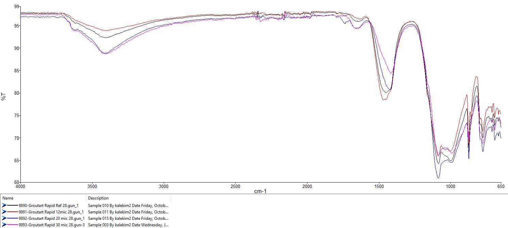{width=15.5cm}

Şekil 6'da 28 günlük FTIR spektrumları karşılaştırmalı olarak verilmiştir. Hidratasyon reaksiyonlarının her bir numunede belirgin şekilde ilerlediği görülmektedir. Yapısal su ve hidrat fazlarını ifade eden 3400cm-1 ve 1650cm-1 bölgelerinde en yüksek bant şiddeti gösteren numunenin Groutart Rapid-20µ olduğu dünüşülmekte olup bu numuneyi sırasıyla Groutart Rapid-Referans, Groutart Rapid-30µ ve Groutart Rapid-12µ numuneleri izlemektedir.

Hidratasyon sonucundaki verimi ve C-S-H jeli ile etrenjit oluşumlarını kapsayan 900-1200cm^-1^ bölgelerinde özellikle 950-1000cm^-1^ aralığındaki bant derinliğinde net bir ayrım gözlenmekte olup en belirgin seviyeye ulaşan numunenin Groutart Rapid-20µ olduğu tespit edilmiştir. Bunu sırasıyla Groutart Rapid-Referans, Groutart Rapid-30µ ve en düşük olarak seyreden Groutart Rapid-12µ numunesi izlemektedir. Dolayısıyla C-S-H oluşumu sınırlı kalan numune Groutart Rapid-12µ olmuştur.

28 günlük kür süreli analizlerde XRD sonuçları kristalin faz yoğunlukları açısından Groutart Rapid-12µ numunesini öne çıkarırken, amorf C-S-H gelişimi açısından FTIR verilerine göre;

Groutart Rapid-20µ\>Groutart Rapid-Referans\>Groutart Rapid-30µ\>Groutart Rapid-12µ

şeklinde sıralanmaktadır.

Bütünsel olarak 1, 7, 28 günlük kür süreli FTIR sonuçları ele alındığında;

-   1.günde Groutart Rapid-20µ numunesi,

-   7.günde Groutart Rapid-30µ numunesi,

-   28.günde Groutart Rapid-20µ numunesi,

ön plana çıkmaktadır. Kristal hidratasyon ürünleri açısından Groutart Rapid-12µ numunesi her ne kadar yüksek pikler göstermiş olsa da bağlayıcı C-S-H jeli oluşumu, sürecin dengesi ve nihai mekanik dayanımın potansiyeli açısından en optimize ve avantajlı sonuçları Groutart Rapid-20µ numunesinin verdiği düşünülmektedir.

### 4.2. Mastar 10

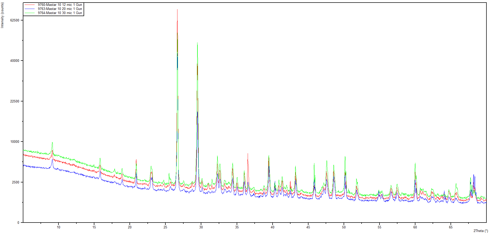{width=15.5cm}

Şekil 7'de 1 günlük hidratasyon sonrasına ait olan XRD difraktogramlarına yer verilmiştir. Tüm numunelerde hidratasyon reaksiyonlarının başlamış olduğu aynı zamanda karakteristik hidratasyon ürünlerinin oluştuğu gözlenmektedir.

$2\theta \approx 9^{\circ}$ bölgesinin Etrenjit fazını ifade ettiği düşünülmekte olup pik şiddetleri karşılaştırıldığında en yüksek yoğunluk gözlenen numunenin Mastar10-30 µ numunesi, olduğu ve bunu sırasıyla takip eden Mastar10-12 µ ve Mastar10-20 µ numuneleridir. Bu durumda Mastar10-30 µ numunesinin alüminat-sülfat reaksiyonlarının daha hızlı ilerlediğini işaret etmektedir. $2\theta \approx 18^{\circ},34^{\circ},47^{\circ}$ bölgesi portlandit fazını temsil etmekte olup bu bölgedeki en belirgin pikleri sırasıyla Mastar10-30 µ, Mastar10-12 µ ve Mastar10-20 µ numunelerinin verdiği düşünülmektedir.

Reaksiyona girmemiş klinker fazlarını ifade eden $2\theta \approx 29^{\circ}\text{-}33^{\circ},41^{\circ}\text{-}42^{\circ},51^{\circ}\text{-}52^{\circ}$ bölgelerindeki pikler, erken kür süresi olması nedeniyle tüm numunelerde baskın şekilde gözlenmektedir. Ancak Mastar10-30 µ numunesinde hidratasyon ürünlerinin belirgin olması nedeniyle hidratasyon reaksiyonunun ilerleme derecesi diğer numunelerden yüksek olduğuna işaret etmektedir.

Sonuç olarak 1 günlük kür süresi sonunda yapılan reaksiyon durdurma işleminin ardından hidratasyon ürünlerinin gelişimi şu şekilde sıralanabilir;

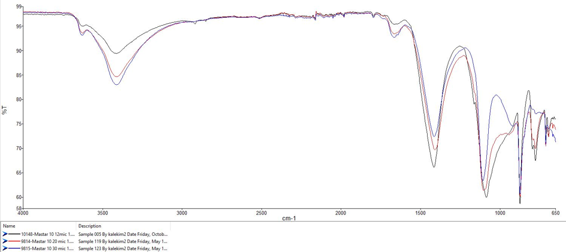{width=15.5cm}

Mastar10-30 µ \> Mastar10-12 µ \>Mastar10-20 µ

Şekil 8'de 1 günlük kür süresi ardından reaksiyon durdurma işlemine tabi tutulan numunelerin FTIR analizlerine yer verilmiştir. Spektrumlar incelendiğinde tüm numunelerde hidratasyon ürünlerine ait karakteristik bantların bulunduğu gözlenmektedir.

Yapısal su ve hidrat fazlarını ifade eden yaklaşık 3400cm^-1^ ve 1650cm^-1^ bölgesi incelendiğinde absorpsiyonu en şiddetli olan numunenin Mastar10-30mic numunesi olduğu bunu takiben sırayla Mastar10-20 µ ve en düşük şiddette olanın Mastar10-12 µ numunesi olduğu gözlenmektedir.

C-S-H gelişimi açısından önemli olan 900-1200cm^-1^ bandında en belirgin olan numunenin Mastar10-30 µ olduğu görülmektedir. Mastar10-12 µ ve Mastar10-20 µ numuneleri ise birbirine yakın olarak gözlenmektedir.

1 günlük FTIR spektrumlarına göre hidratasyon ürünlerinin gelişimi değerlendirildiğinde numuneler;

Mastar10-30 µ \>Mastar10-20 µ \>Mastar10-12 µ

Şeklinde sıralanabilmektedir.

Hem XRD hem de FTIR analiz sonuçları birlikte değerlendirildiğinde, Mastar10-30 µ numunesinin hidratasyon ilerlemesi gelişimi açısından diğer numunelerden önde olduğu düşünülmektedir. Sonuç olarak 1 günlük kür sonrasında yapılan reaksiyon durdurma işleminde hidratasyon ilerleme derecesi açısından sıralama şu şekilde yapılabilir;

Mastar10-30 µ \>Mastar10-12µ$\approx$Mastar10-20 µ

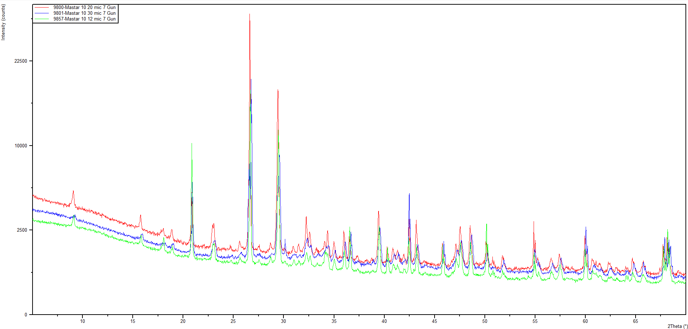{width=15.5cm}

Şekil 9'da 7 günlük kür süresi sonunda reaksiyon durdurma işlemi uygulanan numunelerin karşılaştırmalı XRD difraktogramlarına yer verilmiştir. Difraktogramlar incelendiğinde tüm numunelerde hidratasyon reaksiyonlarının devam etmekte olduğu düşünülmektedir.

Etrenjit fazını ifade eden $2\theta \approx 9^{\circ}$ bölgesinde en belirgin pik gelişimi Mastar10-20 µ numunesinde gözlenmektedir. Mastar10-30 µ numunesi yakın davranış sergilerken Mastar10-12 µ numunesinde ise ilgili faz pikinin diğerlerinden daha düşük kaldığı görülmektedir. $2\theta \approx 29^{\circ}\text{-}33^{\circ},41^{\circ}\text{-}42^{\circ},51^{\circ}\text{-}52^{\circ}$ bölgelerindeki pikler, ilgili tüm numunelerde reaksiyona girmemiş klinker fazlarının halihazırda bulunmaya devam ettiğine işaret etmektedir.

1 günlük kür süreli XRD difraktogramları ile kıyaslandığında 1.günde en belirgin kristal ürün gelişimi Mastar10-30 µ numunesinde görülürken 7.günde Mastar10-20 µ numunesinin önde olduğu değerlendirilmektedir.

7 günlük kür süreli XRD difraktogramları hidratasyon ürünlerinin gelişimi açısından;

Mastar10-20 µ \>Mastar10-30 µ \>Mastar10-12 µ

Şeklinde sıralanabilmektedir.

{width=15.5cm}

Şekil 10'da 7 günlük kür sonunda reaksiyon durdurma işlemi uygulanan numunelerin FTIR spektrumlarına yer verilmiştir. Spektrumlar incelendiğinde tüm numunelerde hidratasyon ürünlerine ait karakteristik bantların bulunduğuna dair işaretler görülmektedir.

Yapısal su ve hidrat fazlarını ifade eden yaklaşık 3400cm^-1^ ve 1650cm^-1^ bölgesi incelendiğinde en belirgin bant gelişiminin Mastar10-12 µ numunesinde olduğu, Masta10-20 µ numunesinin ise bu bölgede zayıf kaldığı değerlendirilmektedir. Portlandit fazını ifade eden 3640cm^-1^ bölgesinde Mastar10-12 µ ve Mastar10-30 µ numuneleri belirgin pik verirken Mastar10-20mic numunesinin zayıf pik verdiği görülmektedir.

C-S-H ile ifade edilen 900-1200cm-1bandında Mastar10-30 µ numunesinde en derin bandı verenin Mastar10-30 µ numunesinin olduğu, Mastar10-12 µ numunesinin bunu takip ettiği ancak Mastar10-20 µ numunesinin bant gelişiminin bu bölgede sınırlı kaldığı görülmektedir. Bu durum Mastar10-30 µ ve Mastar10-12 µ numunelerinin Mastar10-20 µ numunesine kıyasla C-S-H oluşumlarının daha ileri olabileceğine işaret etmektedir.

7 günlük FTIR spektrumlarına bakıldığında hidratasyon gelişimi sıralaması;

Mastar10-30µ$\approx$Mastar10-12 µ \>Mastar10-20 µ

şeklinde sıralanabilmektedir.

Hem XRD hem de FTIR sonuçları birlikte değerlendirildiğinde XRD'de kristal hidratasyon açısından Mastar10-20 µ numunesi öne çıkmaktadır. FTIR'da bağlı su ve C-S-H açısından Mastar10-30 µ ve Mastar10-12 µ numunelerinin Mastar10-20 µ numunesinin önünde olduğu görülmektedir. Mastar10-30 µ numunesi her iki analizde de üst sıralarda yer alarak tutarlı bir davranış sergilediği düşünülmektedir. Bu nedenle 7 günlük kür sonunda hidratasyon gelişiminin Mastar10-30 µ numunesinde daha ileri olduğu, Mastar10-12 µ ve Mastar10-20 µ numuneleri arasındaki farkın ise sınırlı olduğu düşünülmektedir. Bu durumda hidratasyon gelişimi bakımından şu şekilde bir sıralama yapılabilir;

Mastar10-30 µ \>Mastar10-12µ$\approx$Mastar10-20 µ

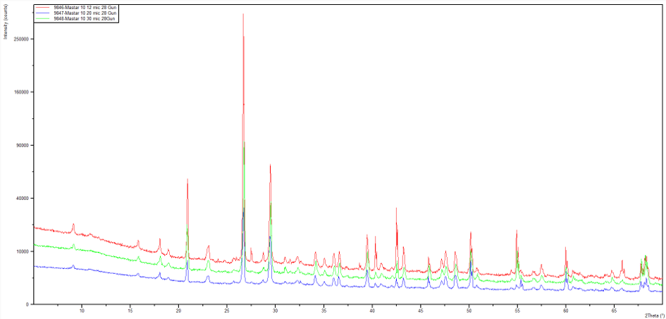{width=15.5cm}

Şekil 11'de 28 günlük kür süresi sonunda reaksiyon durdurma işlemi uygulanan numunelerin karşılaştırmalı XRD difraktogramlarına yer verilmiştir. Difraktogramlar incelendiğinde tüm numunelerde hidratasyon reaksiyonlarının devam etmekte olduğu düşünülmektedir.

Etrenjit fazını ifade eden $2\theta \approx 9^{\circ}$ bölgesinde en belirgin pik şiddeti Mastar10-12 µ numunesinde görülmektedir. İlgili bölgedeki pik şiddeti en düşük olan numune Mastar10-20 µ numunesi olarak tespit edilmiştir. $2\theta \approx 18^{\circ},34^{\circ},47^{\circ}$ bölgesi portlandit fazını temsil etmekte olup bu bölgedeki en belirgin pik Mastar10-12 µ numunesinde görülmektedir.

$2\theta \approx 29^{\circ}\text{-}33^{\circ},41^{\circ}\text{-}42^{\circ},51^{\circ}\text{-}52^{\circ}$ bölgelerindeki pikler incelendiğinde tüm numunelerde reaksiyona girmemiş klinker fazlarının halen mevcut olduğu göstermektedir. 28 günlük kür sonunda elde edilen XRD verilerine göre kristal hidratasyon ürünlerinin gelişimi açısından;

Mastar10-12 µ \>Mastar10-30 µ \>Mastar10-20 µ

Şeklinde sıralanabilmektedir.

{width=15.5cm}

Şekil 12'de 28 günlük kür sonunda reaksiyon durdurma işlemi uygulanan numunelerin FTIR spektrumlarına yer verilmiştir. Spektrumlar incelendiğinde tüm numunelerde hidratasyon ürünlerine ait karakteristik bantların bulunduğuna dair işaretler görülmektedir.

Yapısal su ve hidrat fazlarını ifade eden yaklaşık 3400 cm⁻¹ ve 1650 cm⁻¹ bölgeleri incelendiğinde üç numunenin birbirine çok yakın şiddette bant verdiği, bu göstergelerle numuneler arasında ayrım yapılamadığı değerlendirilmektedir. Portlandit fazını ifade eden 3640 cm⁻¹ bölgesinde Mastar10-12 µ, Mastar10-20 µ ve Mastar10-30 µ numunelerinin hepsinde zayıf bir omuz görülmekte olup bu bölge sıralamada belirleyici kabul edilmemiştir.

C-S-H ile ifade edilen 900-1200 cm⁻¹ bandında Mastar10-20 µ ve Mastar10-30 µ numunelerinin \~1090 cm⁻¹ civarında benzer derinlikte bant verdiği, Mastar10-12 µ numunesinin ise bu bölgede daha sığ bir bant ve omuz yapısı gösterdiği görülmektedir. Bu durum Mastar10-20 µ ve Mastar10-30 µ numunelerinin C-S-H oluşumlarının Mastar10-12 µ numunesine kıyasla bir miktar daha ileri olabileceğine işaret etmektedir. Ancak farklar sınırlıdır ve bu bölge \~1420-1480 cm⁻¹ karbonat bantlarından etkilenebilmektedir.

28 günlük FTIR spektrumlarına bakıldığında C-S-H gelişimi sıralaması;

Mastar10-20 µ ≈Mastar10-30 µ \>Mastar10-12 µ

şeklinde sıralanabilmektedir.

Hem XRD hem de FTIR sonuçları birlikte değerlendirildiğinde XRD'de kristal hidratasyon ürünleri açısından Mastar10-12 µ numunesi öne çıkmaktadır. FTIR'da ise C-S-H açısından Mastar10-20µ ve Mastar10-30µ numunelerinin Mastar10-12µ numunesinin önünde olduğu görülmektedir. Mastar10-30µ numunesi XRD'de ikinci, FTIR'da ilk sırada yer alarak her iki analizde de üst sıralarda bulunmakta ve tutarlı bir davranış sergilediği düşünülmektedir. Bu nedenle 28 günlük kür sonunda hidratasyon gelişiminin Mastar10-30µ numunesinde daha dengeli ilerlediği, Mastar10-12µ ve Mastar10-20µ numuneleri arasındaki farkın ise sınırlı olduğu düşünülmektedir. Bu durumda hidratasyon gelişimi bakımından;

Mastar10-30µ\>Mastar10-12µ ≈ Mastar10-20µ

Şeklinde sıralanabilmektedir.

Bütünsel olarak 1, 7 ve 28 günlük kür süreli FTIR sonuçları ele alındığında, bağlı su ve Si-O (C-S-H) göstergeleri bakımından;

-   1\. günde Mastar10-30µ numunesi,

-   7\. günde Mastar10-30µ ve Mastar10-12µ numuneleri (Mastar10-30µ ufak farkla önde),

-   28\. günde ise Mastar10-20µ ve Mastar10-30µ numuneleri ön plana çıkmaktadır.

Bağlayıcı C-S-H göstergeleri ve yöntemler arası tutarlılık birlikte değerlendirildiğinde Mastar10-30µ numunesi her üç yaşta da üst sıralarda yer almış, bu nedenle hidratasyon gelişimi bakımından en dengeli davranışı sergileyen numune olarak Mastar10-30µ öne çıkmıştır.

### 4.3. Macunart

Macunart'ta baskın faz dolomittir (30,9° ve 41,1°); kalsit (29,4°), alit (32,2° ve 51,7°) ve belit (32,6°) de bulunmaktadır. XRD göstergeleri Tablo 6'da, FTIR göstergeleri Tablo 7'de verilmiştir.

#### Kuru harç

Dört numunenin difraktogramları birbirine çok yakındır (Şekil 13). Etrenjit (15–30) ve portlandit (18–45) gürültü düzeyinde, alit 225–254 aralığındadır. FTIR spektrumları üst üste çakışmakta, 3640 cm⁻¹ bandı görülmemekte ve Si–O bandı anhidrit alitin konumunda (~925 cm⁻¹) bulunmaktadır (Şekil 14). Hiçbir ambalajda ön hidratasyon saptanmamıştır.

"Macunart Ref Kuru Harç" adıyla kaydedilen ikinci XRD ölçümünde (9811) ise etrenjit 121, portlandit 718 olup alit neredeyse kalmamıştır (13). Bu desen sertleşmiş bir numuneye aittir. 28 günlük referans ölçümü de eksik olduğundan numunenin yanlış adlandırılmış olabileceği düşünülmektedir [DOĞRULANACAK]. Bu ölçüm değerlendirmeye alınmamıştır.

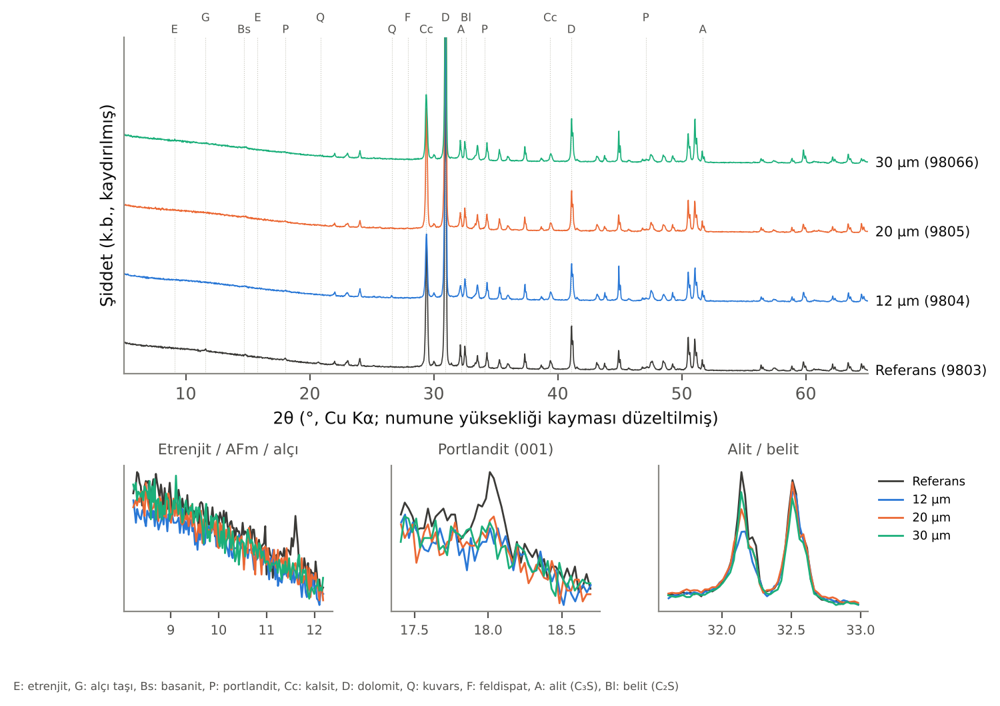{width=16cm}

{width=16cm}

#### 1 gün

1\. günde tüm numunelerde etrenjit ve portlandit oluşmuş, alit kuru harçtaki değerin yaklaşık dörtte birine inmiştir (Şekil 15). Portlandit Referansta 959, 12 µm'de 1010'dur; 20 µm (504) ve 30 µm (436) numunelerinde ise bunun yaklaşık yarısıdır. Etrenjit 30 µm'de 90, diğer numunelerde 145–154 aralığındadır. Kalan alit tüm numunelerde birbirine yakın olduğundan (43–60) fark klinker tüketiminde değil portlandit pikindedir.

FTIR'da 3640 cm⁻¹ bandı ve O–H alanı tekrar aralığı içinde kalmaktadır (Şekil 16). Si–O bandı Referansta 960 cm⁻¹, ambalaj numunelerinde 966–971 cm⁻¹ konumundadır.

1 günlük XRD sonuçlarına göre sıralama şöyledir:

12 µm ≈ Referans > 20 µm > 30 µm

{width=16cm}

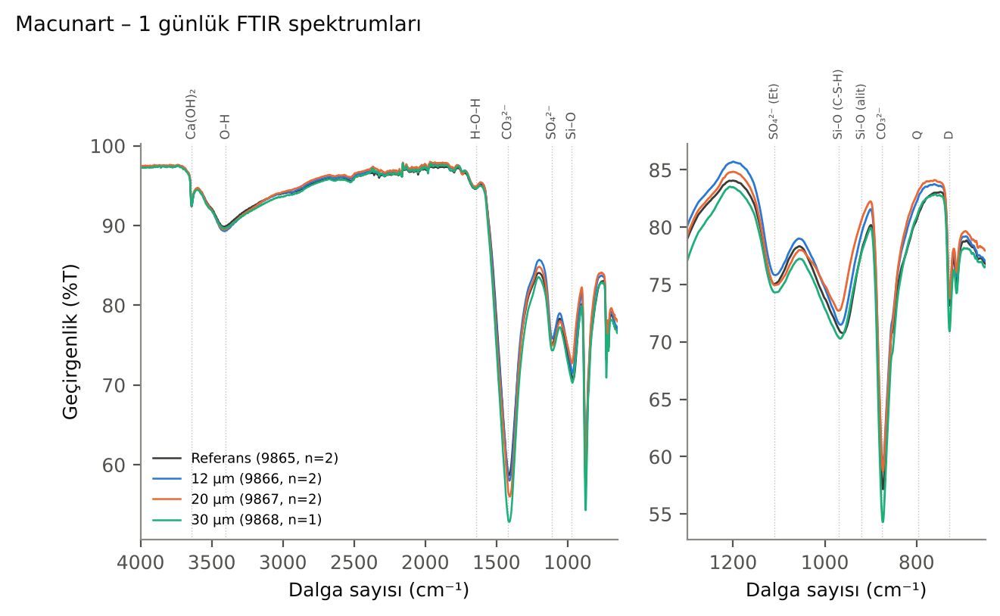{width=16cm}

#### 7 gün

7\. günde alit tüm numunelerde tükenmiştir (1–5; Şekil 17). Ambalaj numunelerinde etrenjit 145–147, portlandit 425–715 aralığında olup en yüksek portlandit 12 µm'dedir. Referansta ise etrenjit 72, portlandit 380'dir; bu değerler hem ambalaj numunelerinin hem de Referansın 1 günlük değerinin altındadır. Referansın XRD (9864) ve FTIR (9871) ölçümleri diğer 7 günlük numunelerden çok sonra alındığı için ayrı bir karışımdan hazırlanmış olabilir [DOĞRULANACAK]. Bu nedenle Referans 7. günde karşılaştırmaya alınmamıştır.

FTIR'da 3640 cm⁻¹ bandı en belirgin 12 µm'de görülmekte, diğer göstergeler tekrar aralığında kalmaktadır (Şekil 18). Ambalaj numuneleri arasındaki fark küçüktür:

12 µm ≥ 30 µm ≈ 20 µm

{width=16cm}

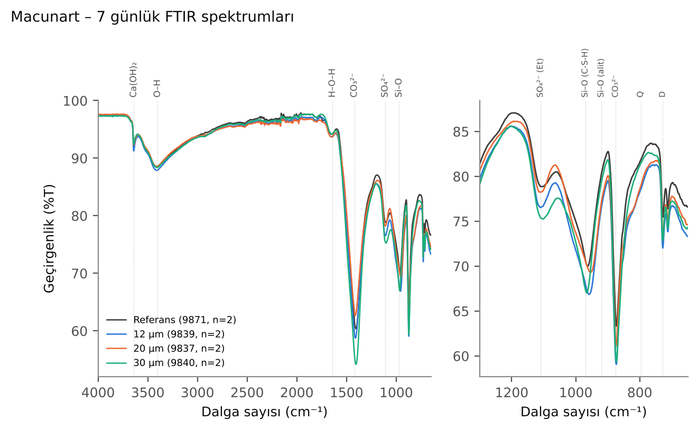{width=16cm}

#### 28 gün

28 günlük yaşta yalnızca 12 ve 30 µm'nin XRD (Şekil 19), 12 ve 20 µm'nin FTIR (Şekil 20) ölçümü bulunmaktadır. 12 ve 30 µm'de etrenjit 105 ve 98, portlandit 496 ve 435 olarak birbirine yakındır. 12 ve 20 µm'nin FTIR göstergeleri de tekrar aralığı içinde örtüşmektedir. Referans ve 20 µm XRD ile Referans ve 30 µm FTIR ölçümleri eksiktir [VERİ GEREKLİ].

Macunart kuru harcında ön hidratasyon izine rastlanmamıştır. 20 ve 30 µm'de 1. günde görülen portlandit farkı 7. günde kapanmış, 12 µm ise her yaşta Referansla aynı ya da daha yüksek değer vermiştir.

{width=16cm}

{width=16cm}

| Yaş | Ambalaj | Ölçüm no | Etrenjit (9,1°) | Portlandit (18,0°) | Alit (51,7°) | Kalsit (29,4°) |
|---|---|---|--:|--:|--:|--:|
| Kuru harç | Referans | 9803 | 15 | 45 | 225 | 3604 |
| Kuru harç | 12 µm | 9804 | 30 | 18 | 254 | 1831 |
| Kuru harç | 20 µm | 9805 | 21 | 24 | 240 | 3244 |
| Kuru harç | 30 µm | 98066 | 27 | 29 | 246 | 1937 |
| 1 gün | Referans | 9785 | 146 | 959 | 60 | 3062 |
| 1 gün | 12 µm | 9786 | 145 | 1010 | 55 | 1643 |
| 1 gün | 20 µm | 9787 | 154 | 504 | 43 | 1699 |
| 1 gün | 30 µm | 9788 | 90 | 436 | 58 | 1486 |
| 7 gün | Referans | 9864 | 72 | 380 | 4 | 1262 |
| 7 gün | 12 µm | 9795 | 145 | 715 | 2 | 1114 |
| 7 gün | 20 µm | 9794 | 146 | 425 | 1 | 1874 |
| 7 gün | 30 µm | 9798 | 147 | 492 | 5 | 1224 |
| 28 gün | 12 µm | 9827 | 105 | 496 | 1 | 1104 |
| 28 gün | 30 µm | 9858 | 98 | 435 | 4 | 1452 |
| Kuru harç? (adlandırma şüpheli) | Referans | 9811 | 121 | 718 | 13 | 1604 |

: Tablo 6. Macunart XRD net pik alanları (k.b.; doğrusal taban çizgisi üzerindeki alan, numune yüksekliği kayması düzeltilmiş)

| Yaş | Ambalaj | Ölçüm no | n | Ca(OH)₂ 3640 cm⁻¹ (mAbs) | O–H bandı alanı (k.b.) | Si–O bandı minimumu (cm⁻¹) |
|---|---|---|--:|--:|--:|--:|
| Kuru harç | Referans | 9843 | 2 | 1,4 (1,2–1,7) | 1605 (1439–1771) | 927 (927–927) |
| Kuru harç | 12 µm | 9845 | 2 | 1,3 (1,3–1,3) | 1561 (1471–1651) | 924 (921–927) |
| Kuru harç | 20 µm | 9844 | 2 | 1,4 (1,4–1,4) | 1595 (1591–1600) | 924 (922–927) |
| 1 gün | Referans | 9865 | 2 | 14,0 (12,4–15,7) | 14900 (13772–16028) | 960 (960–960) |
| 1 gün | 12 µm | 9866 | 2 | 12,8 (11,6–14,1) | 16029 (14922–17137) | 966 (966–966) |
| 1 gün | 20 µm | 9867 | 2 | 12,8 (11,9–13,8) | 16040 (14998–17081) | 971 (971–971) |
| 1 gün | 30 µm | 9868 | 1 | 13,2 | 15929 | 967 |
| 7 gün | Referans | 9871 | 2 | 13,0 (12,1–13,8) | 17848 (17408–18289) | 963 (963–963) |
| 7 gün | 12 µm | 9839 | 2 | 16,4 (16,0–16,7) | 18597 (17895–19299) | 959 (959–959) |
| 7 gün | 20 µm | 9837 | 2 | 12,4 (11,6–13,2) | 17222 (16750–17694) | 954 (953–956) |
| 7 gün | 30 µm | 9840 | 2 | 12,1 (11,5–12,7) | 18126 (17041–19210) | 966 (965–966) |
| 28 gün | 12 µm | 9873 | 2 | 15,1 (11,8–18,4) | 17715 (13194–22236) | 960 (959–960) |
| 28 gün | 20 µm | 9872 | 4 | 12,5 (9,6–17,6) | 15951 (13189–20062) | 961 (960–962) |

: Tablo 7. Macunart FTIR göstergeleri (tekrar ölçümlerin ortalaması; parantez içinde en küçük–en büyük değer)

### 4.4. İzolatex Plus

İzolatex Plus iki bileşenli bir ürün olup ambalaj değişikliği toz bileşeni kapsamaktadır. Kuru harçta kuvars (26,6° ve 20,9°) ile kalsit (29,4°) baskındır; alit ve belit de bulunmaktadır.

Hidrate numunelerin FTIR spektrumlarındaki 2950, 1730, 1160 ve 700 cm⁻¹ bantları sıvı bileşenin polimerine aittir ve stiren-akrilik bir dispersiyonla uyumludur [DOĞRULANACAK]. Bu bantlar 900–1200 cm⁻¹ Si–O bölgesiyle örtüştüğünden İzolatex Plus'ta C-S-H FTIR ile değerlendirilememiştir. Hidrate numunelerdeki 0,1–0,7°'lik kayma düzeltilmiştir (Bölüm 3.5); ancak esnek membran numuneleri düz bir yüzey oluşturmadığı için pik şiddetleri de etkilenmektedir. Göstergeler Tablo 8 ve 9'da verilmiştir.

"İzolatex 05.05.2026" adlı numuneler Referans olarak alınmıştır. 9725 numarası hem "1.gün" hem "1.gün 12 Mikron" dosyasında kullanıldığından ikincisi 12 µm sayılmıştır. 7 günlük 9807 FTIR numunesinde film kalınlığı yazmadığı için 12 µm varsayılmıştır (tabloda 12 µm*) [DOĞRULANACAK].

#### Kuru harç

Etrenjit (15–58) ve portlandit (10–45) tüm ambalajlarda gürültü düzeyindedir (Şekil 21). Alit Referansta 220, ambalaj numunelerinde 122–181 aralığındadır. Ancak 31,9–32,8° bölgesinin toplam alanı ambalaj numunelerinde düşük olmadığından alit farkı tane istatistiğine bağlanmıştır.

11,6°'deki alçı taşı piki ambalaj numunelerinde 41–68, Referansta 13'tür. Bu fark hemihidratın nemle alçı taşına dönüşmesinden ya da parti farkından kaynaklanabilir; mevcut verilerle ikisi ayırt edilememektedir [DOĞRULANACAK: Referansın üretim tarihi ve partisi]. Kuru harç FTIR ölçümü yoktur.

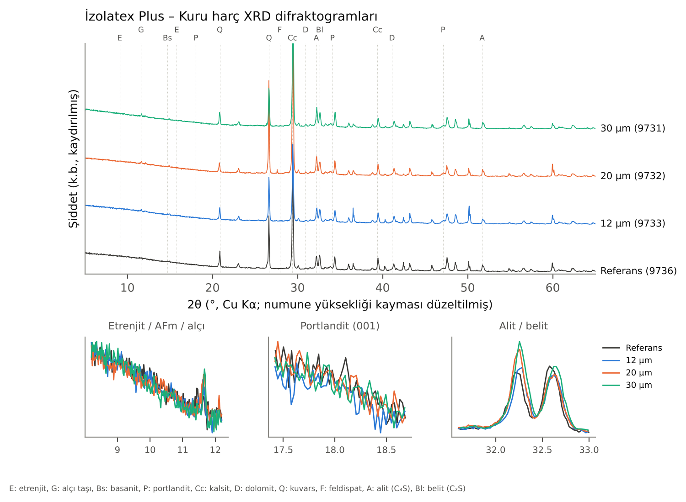{width=16cm}

#### 1 gün

1\. günde hiçbir numunede belirgin etrenjit ya da portlandit oluşmamış (5–31), alit pikleri korunmuştur (Şekil 22). Polimer modifiyeli bu sistemde ilk gün az miktarda kristalin hidratasyon ürünü oluşmaktadır. 30 µm numunesinin zemini ile kalsit ve alit değerleri diğerlerinden yüksektir; bunun numune hazırlamadan kaynaklandığı düşünülmektedir. FTIR ölçümü yalnızca Referans ve 12 µm için vardır ve polimer bantları dışında fark görülmemektedir (Şekil 23).

{width=16cm}

{width=16cm}

#### 7 gün

7\. günde portlandit oluşmaya başlamış, ancak değerler çok dağınık çıkmıştır: 12 µm 606, Referans 370, 20 µm 149, 30 µm 49 (Şekil 24). Aynı 30 µm numunesinin ikinci ölçümünde (9844) portlandit 509, etrenjit 102 bulunmuştur. Aynı ambalaj ve yaşta yaklaşık 10 katlık bu fark nedeniyle 7 günlük XRD sonuçları ambalaj sıralamasında kullanılmamıştır. FTIR'da 3640 cm⁻¹ bandı 12 µm* numunesinde 15,6, 30 µm ikinci ölçümde 17,0, Referansta 10,4 mAbs olup tekrar aralıkları geniştir (Şekil 25).

{width=16cm}

{width=16cm}

#### 28 gün

28\. günde tüm numunelerde etrenjit ve portlandit oluşmuştur (Şekil 26). Portlandit 20 µm'de 428, 12 µm'de 257, Referansta 220'dir; etrenjit ise 20 µm'de 116, Referansta 91, 12 µm'de 81'dir. Kalan alit birbirine yakındır (30–48). FTIR'da Referans ve 12 µm neredeyse çakışmaktadır (3640 cm⁻¹: 19,8 ve 18,9 mAbs; Si–O: 963 ve 962 cm⁻¹; Şekil 27). 30 µm'nin 28 günlük ölçümü yoktur [VERİ GEREKLİ].

İzolatex Plus kuru harcında da ön hidratasyon izi bulunmamakla birlikte alçı taşı farkının ayrıca izlenmesi gerekir. 28. günde 12 ve 20 µm Referansla aynı ya da daha yüksek değer vermiştir. 1 ve 7 günlük veriler numune geometrisi ve tekrarlanabilirlik sorunları nedeniyle karar için kullanılmamalıdır.

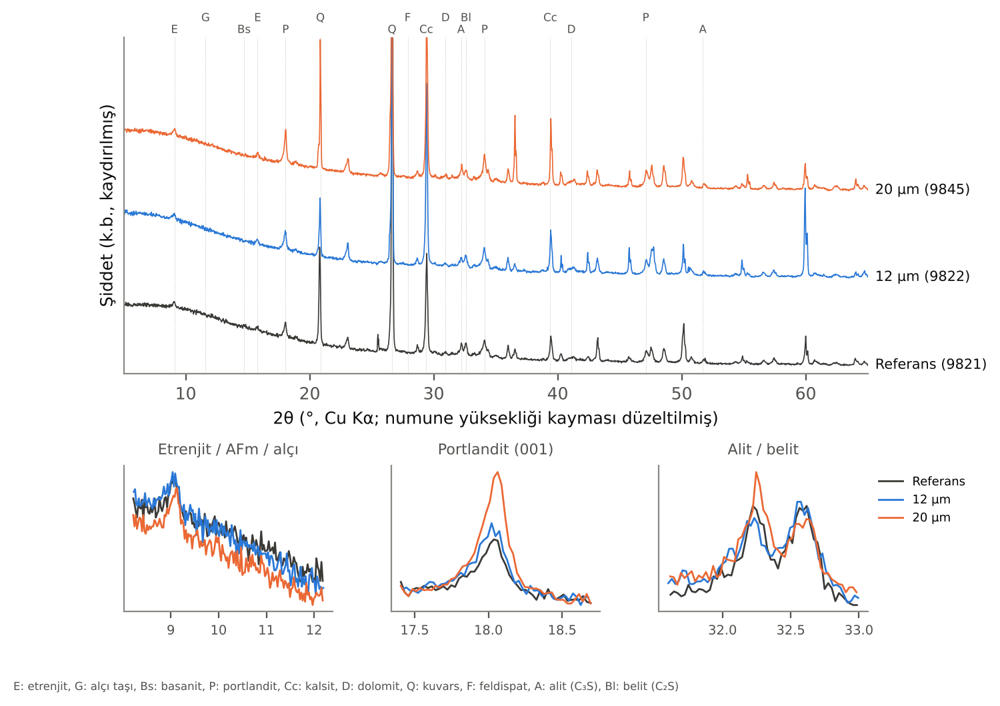{width=16cm}

{width=16cm}

| Yaş | Ambalaj | Ölçüm no | Etrenjit (9,1°) | Portlandit (18,0°) | Alit (51,7°) | Kalsit (29,4°) |
|---|---|---|--:|--:|--:|--:|
| Kuru harç | Referans | 9736 | 58 | 25 | 220 | 3872 |
| Kuru harç | 12 µm | 9733 | 35 | 45 | 122 | 3030 |
| Kuru harç | 20 µm | 9732 | 45 | 27 | 181 | 6512 |
| Kuru harç | 30 µm | 9731 | 15 | 10 | 140 | 5235 |
| 1 gün | Referans | 9725 | 13 | 5 | 57 | 1022 |
| 1 gün | 12 µm | 9725 | 17 | 7 | 113 | 863 |
| 1 gün | 20 µm | 9737 | 31 | 14 | 58 | 1200 |
| 1 gün | 30 µm | 9738 | 12 | 21 | 152 | 3880 |
| 7 gün | Referans | 9752 | 24 | 370 | 23 | 363 |
| 7 gün | 12 µm | 9753 | 17 | 606 | 68 | 1353 |
| 7 gün | 20 µm | 9765 | 16 | 149 | 24 | 499 |
| 7 gün | 30 µm | 9766 | 9 | 49 | 27 | 185 |
| 28 gün | Referans | 9821 | 91 | 220 | 48 | 1141 |
| 28 gün | 12 µm | 9822 | 81 | 257 | 45 | 1896 |
| 28 gün | 20 µm | 9845 | 116 | 428 | 30 | 1814 |
| 7 gün (tekrar) | 30 µm | 9844 | 102 | 509 | 36 | 1644 |

: Tablo 8. İzolatex Plus XRD net pik alanları (k.b.; doğrusal taban çizgisi üzerindeki alan, numune yüksekliği kayması düzeltilmiş)

| Yaş | Ambalaj | Ölçüm no | n | Ca(OH)₂ 3640 cm⁻¹ (mAbs) | O–H bandı alanı (k.b.) | Si–O bandı minimumu (cm⁻¹) |
|---|---|---|--:|--:|--:|--:|
| 1 gün | Referans | 9786 | 4 | 0,8 (0,6–0,8) | 14865 (14026–15966) | 1060 (1060–1060) |
| 1 gün | 12 µm | 9787 | 3 | 1,8 (0,7–2,6) | 28028 (16424–49261) | 1060 (1060–1060) |
| 7 gün | Referans | 9806 | 2 | 10,4 (9,0–11,9) | 14627 (13830–15425) | 1012 (963–1060) |
| 7 gün | 12 µm* | 9807 | 2 | 15,6 (8,6–22,6) | 20063 (19925–20202) | 1060 (1060–1060) |
| 7 gün | 30 µm | 9816 | 2 | 8,4 (7,8–9,1) | 16049 (15918–16180) | 944 (944–944) |
| 28 gün | Referans | 9860 | 2 | 19,8 (18,7–20,9) | 18040 (16850–19229) | 963 (963–963) |
| 28 gün | 12 µm | 9861 | 2 | 18,9 (14,3–23,6) | 18932 (16813–21050) | 962 (961–964) |
| 7 gün (tekrar) | 30 µm | 9880 | 2 | 17,0 (14,7–19,3) | 17099 (15175–19023) | 961 (960–962) |

: Tablo 9. İzolatex Plus FTIR göstergeleri (tekrar ölçümlerin ortalaması; parantez içinde en küçük–en büyük değer)

### 4.5. Technopool

Technopool'da kuvars (26,6°) ve feldispat (27,6–28,0°) baskın olup kalsit, alit ve belit de bulunmaktadır. Bu üründe 30 µm ambalaj test edilmemiştir. Kum içeriği nedeniyle FTIR'daki Si–O bölgesi kuvarsın ~1080 cm⁻¹ bandıyla örtüşmektedir. Göstergeler Tablo 10 ve 11'de verilmiştir.

#### Kuru harç

Etrenjit (33–44) ve portlandit (11–26) üç numunede de gürültü düzeyindedir (Şekil 28). Alit ambalaj numunelerinde Referanstan düşük değildir (Referans 160, 12 µm 271, 20 µm 203). Ön hidratasyon saptanmamıştır. Kuru harç FTIR ölçümü yoktur.

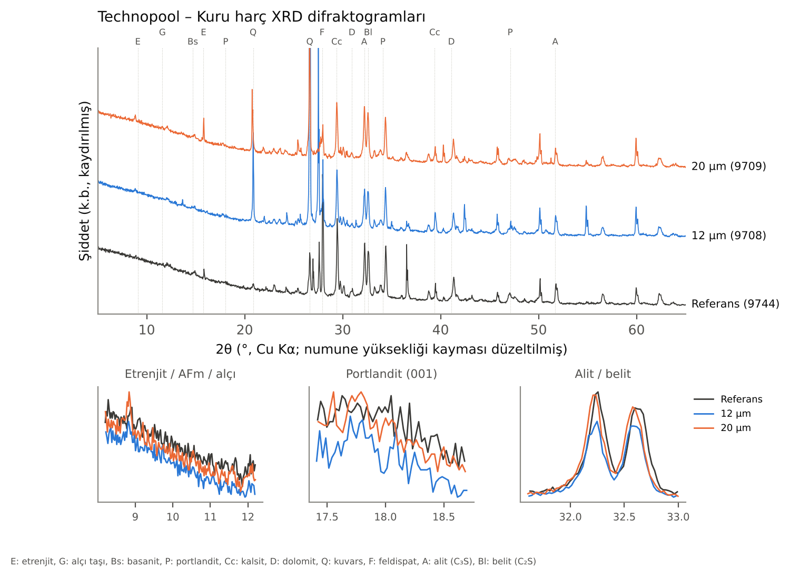{width=16cm}

#### 1 gün

1\. günde Referansın portlandit değeri (563), 12 µm (308) ve 20 µm (309) numunelerinin yaklaşık iki katıdır (Şekil 29). Etrenjit de aynı sırayı izlemektedir (224, 204 ve 164). 12 µm'de kalan alitin (147) Referanstan (108) yüksek olması, bu numunede silikat hidratasyonunun bir miktar geride olduğunu göstermektedir.

FTIR'da O–H alanı ambalaj numunelerinde daha yüksek görünmektedir (Şekil 30). Ancak Si–O bandı kuvarsla örtüştüğü ve tekrarlar arasında geniş aralıkta değiştiği için (12 µm'de 944–987 cm⁻¹) FTIR'dan sıralama yapılmamıştır. XRD sonuçlarına göre sıralama şöyledir:

Referans > 12 µm ≥ 20 µm

{width=16cm}

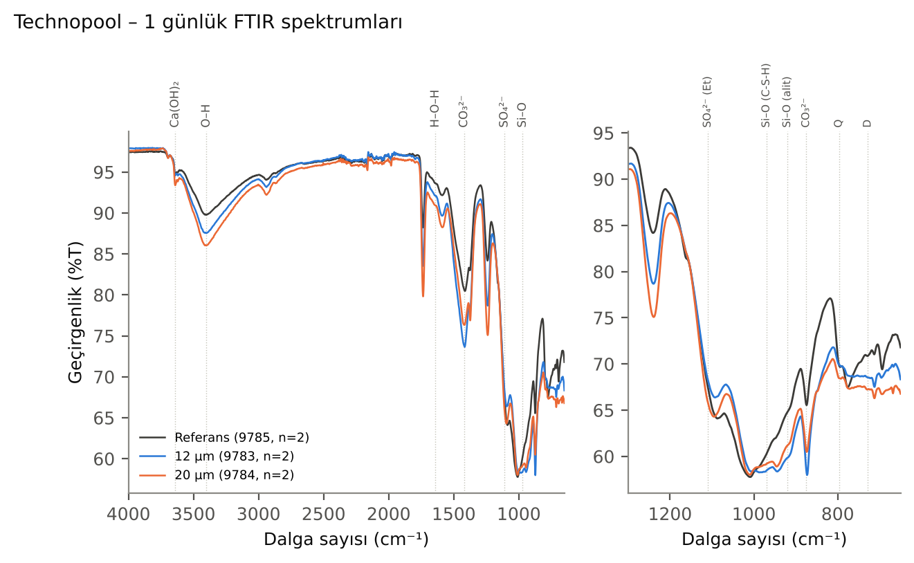{width=16cm}

#### 7 gün

7\. günde alit büyük ölçüde tükenmiştir (Şekil 31). Portlandit Referansta 1070, 12 µm'de 851, 20 µm'de 847'dir; Referans ambalaj numunelerinden yaklaşık %26 yüksektir. Etrenjit de aynı sıradadır (299, 273 ve 263). FTIR'daki O–H alanı da Referansta (20 199) 12 µm (17 014) ve 20 µm (15 973) numunelerinden yüksek olup XRD sonucuyla uyumludur (Şekil 32).

20 µm numunesinin 7 günlük durdurulmamış ölçümünde (9741) portlandit 994, etrenjit 301; durdurulmuş ölçümünde (9742) ise 847 ve 263'tür. Durdurma yapılmayan numunede portlandit yaklaşık %17, etrenjit %14 daha yüksektir; yani hidratasyon numune alındıktan sonra da sürmektedir. Durdurma işleminin tüm yaşlarda aynı şekilde uygulanması gerekir.

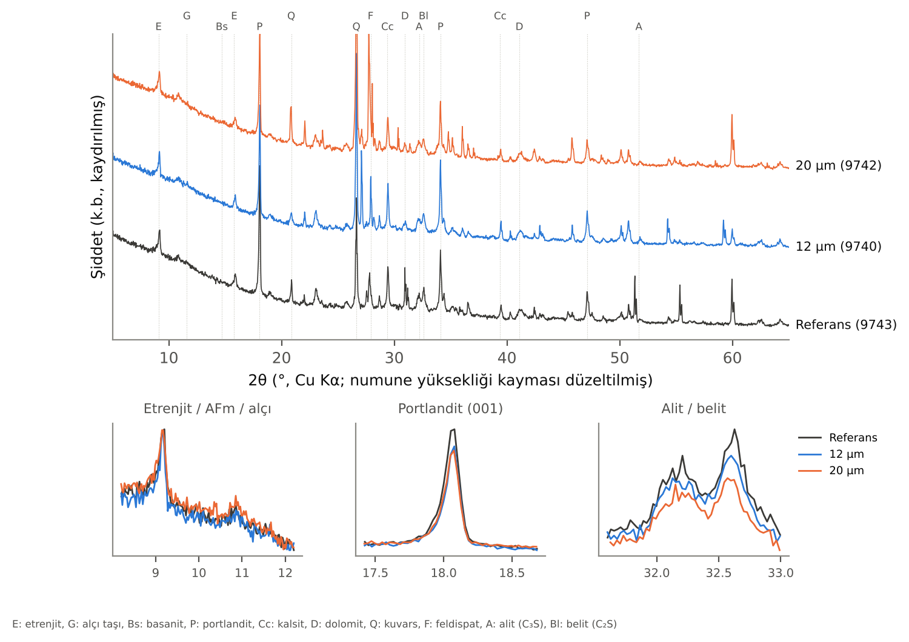{width=16cm}

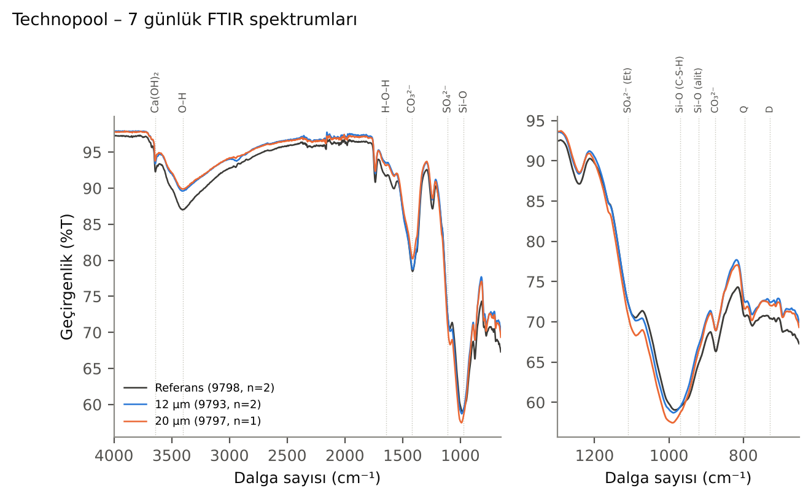{width=16cm}

#### 28 gün

28\. günde portlandit Referansta 748, 12 µm'de 713, 20 µm'de 516'dır; etrenjit Referansta 256, 12 ve 20 µm'de 181'dir (Şekil 33). Tüm numunelerde 11,7° civarında bir AFm piki (muhtemelen monokarbonat) oluşmuştur. 28 günlük FTIR ölçümü yalnızca 12 µm için bulunmaktadır (Şekil 34) [VERİ GEREKLİ: Referans ve 20 µm].

Technopool kuru harcında ön hidratasyon izi görülmemesine karşın Referans 1, 7 ve 28. günlerin tamamında en yüksek portlandit ve etrenjit değerlerini vermiştir. 12 µm 28. günde Referansa yaklaşmış, 20 µm ise geride kalmıştır. Bu farkın XRD'de görünmeyen amorf ya da yüzeysel bir ön hidratasyondan mı, yoksa parti veya numune farkından mı kaynaklandığı mevcut verilerle belirlenememektedir. Bu nedenle Technopool'da yapışma dayanımı ve açık bekletme süresi sonuçlarına bakılması gerekir.

{width=16cm}

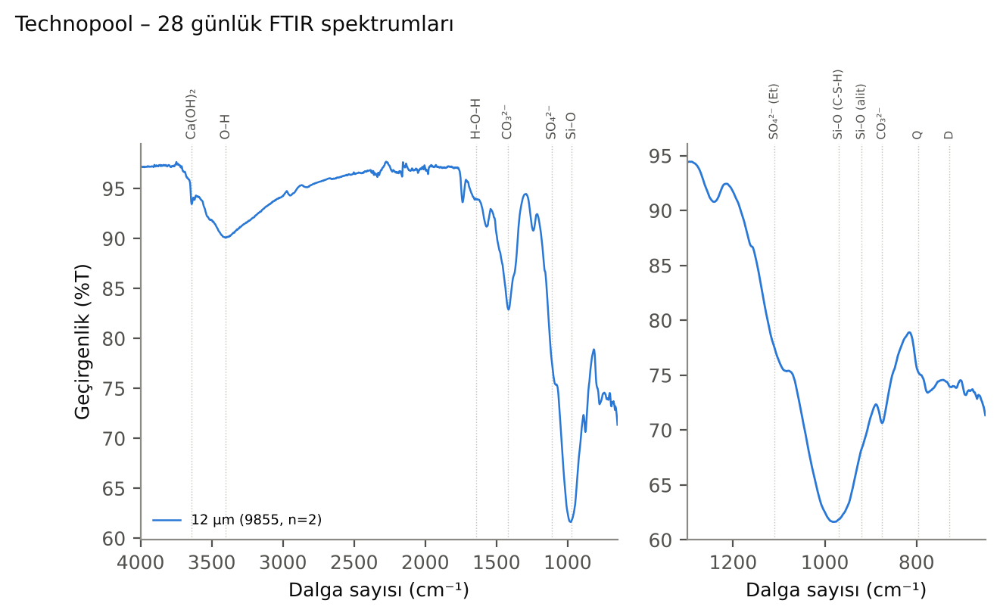{width=16cm}

| Yaş | Ambalaj | Ölçüm no | Etrenjit (9,1°) | Portlandit (18,0°) | Alit (51,7°) | Kalsit (29,4°) |
|---|---|---|--:|--:|--:|--:|
| Kuru harç | Referans | 9744 | 33 | 26 | 160 | 956 |
| Kuru harç | 12 µm | 9708 | 34 | 11 | 271 | 763 |
| Kuru harç | 20 µm | 9709 | 44 | 11 | 203 | 715 |
| 1 gün | Referans | 9717 | 224 | 563 | 108 | 784 |
| 1 gün | 12 µm | 9712 | 204 | 308 | 147 | 659 |
| 1 gün | 20 µm | 9716 | 164 | 309 | 73 | 487 |
| 7 gün | Referans | 9743 | 299 | 1070 | 9 | 356 |
| 7 gün | 12 µm | 9740 | 273 | 851 | 28 | 364 |
| 7 gün | 20 µm | 9742 | 263 | 847 | 30 | 287 |
| 28 gün | Referans | 9812 | 256 | 748 | 10 | 97 |
| 28 gün | 12 µm | 9819 | 181 | 713 | 7 | 232 |
| 28 gün | 20 µm | 9820 | 181 | 516 | 3 | 147 |
| 7 gün (durdurulmamış) | 20 µm | 9741 | 301 | 994 | 34 | 333 |

: Tablo 10. Technopool XRD net pik alanları (k.b.; doğrusal taban çizgisi üzerindeki alan, numune yüksekliği kayması düzeltilmiş)

| Yaş | Ambalaj | Ölçüm no | n | Ca(OH)₂ 3640 cm⁻¹ (mAbs) | O–H bandı alanı (k.b.) | Si–O bandı minimumu (cm⁻¹) |
|---|---|---|--:|--:|--:|--:|
| 1 gün | Referans | 9785 | 2 | 5,1 (4,4–5,8) | 14348 (14284–14412) | 1009 (1008–1010) |
| 1 gün | 12 µm | 9783 | 2 | 5,0 (4,1–5,8) | 19432 (18535–20329) | 966 (944–987) |
| 1 gün | 20 µm | 9784 | 2 | 8,3 (7,6–8,9) | 22013 (20989–23037) | 1010 (1009–1010) |
| 7 gün | Referans | 9798 | 2 | 10,2 (9,5–11,0) | 20199 (19755–20644) | 984 (984–985) |
| 7 gün | 12 µm | 9793 | 2 | 10,2 (9,2–11,2) | 17014 (15599–18428) | 988 (988–989) |
| 7 gün | 20 µm | 9797 | 1 | 9,5 | 15973 | 991 |
| 28 gün | 12 µm | 9855 | 2 | 6,9 (5,8–8,0) | 15577 (13572–17581) | 982 (980–983) |

: Tablo 11. Technopool FTIR göstergeleri (tekrar ölçümlerin ortalaması; parantez içinde en küçük–en büyük değer)

# 5. Sonuçlar

Macunart, İzolatex Plus ve Technopool'un XRD göstergeleri Şekil 35'te, beş ürünün özeti Tablo 12'de verilmiştir.

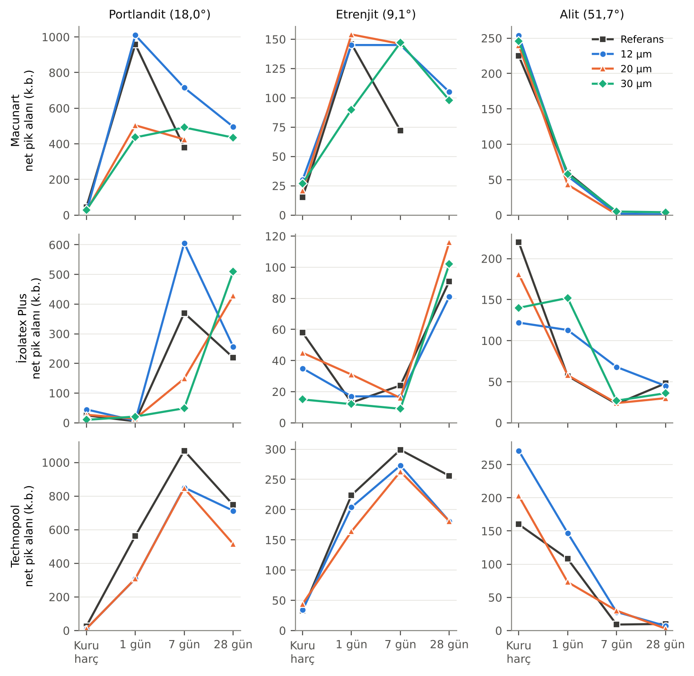{width=16cm}

| Ürün | Kuru harçta ön hidratasyon | 1–7 gün | 28 gün | Sonuç |
|---|---|---|---|---|
| Groutart Rapid* | – | 1 g: 12 µm (kristalin), 20 µm (C-S-H); 7 g: 20 µm (XRD), 30 µm (FTIR) | 12 µm (kristalin), 20 µm (C-S-H) | En dengeli: 20 µm |
| Mastar 10* | – | 30 µm önde | 30 µm önde; 12 ≈ 20 µm | En dengeli: 30 µm |
| Macunart | Yok | 1 g: 12 µm ≈ Ref > 20 > 30 µm; 7 g: ambalajlar yakın | 12 ≈ 30 µm (XRD), 12 ≈ 20 µm (FTIR) | Olumsuz etki yok |
| İzolatex Plus | Yok (alçı taşı farkı izlenmeli) | Veri tekrarlanabilir değil | 20 > 12 µm ≈ Ref | Olumsuz etki yok |
| Technopool | Yok | Ref > 12 ≥ 20 µm | Ref ≈ 12 > 20 µm | Ref önde, 20 µm geride |

: Tablo 12. Ürün bazında özet (*önceki rapordan; bu ürünlerin kuru harç ölçümü raporda yoktur)

Macunart, İzolatex Plus ve Technopool kuru harçlarının hiçbirinde etrenjit ya da portlandit oluşmamış ve alit korunmuştur; Macunart'ta FTIR sonuçları da aynı yöndedir. Bununla birlikte XRD kristalin fazları genellikle yaklaşık %1'in üzerinde saptayabildiğinden, nemden en çok etkilenen C₃A ve serbest kireçteki yüzeysel değişimler [7] ile amorf ön hidratasyon ürünleri bu yöntemle görülmeyebilir.

Ambalajın hidratasyona etkisi ürüne göre değişmektedir. Bütün ürünlerde kötü sonuç veren tek bir ambalaj tipi olmadığı gibi film kalınlığı arttıkça sonuçların iyileştiği bir eğilim de görülmemiştir. Bu sonuç, WVTR'nin film kalınlığıyla her zaman ters orantılı olmadığı bilgisiyle [8] birlikte, torbaların bariyer performansının kalınlık yerine ölçülmüş WVTR değerleriyle karşılaştırılması gerektiğini göstermektedir. Numuneler arasındaki farkların bir kısmı numune hazırlama ve ölçüm değişkenliğinden de kaynaklanıyor olabilir.

Referansın her yaşta önde olduğu tek ürün Technopool'dur ve bu üründe 20 µm 28. günde de geride kalmıştır.

Projenin hedefi açısından ara bulgular şöyledir. Macunart ve İzolatex Plus'ta 12 ve 20 µm ambalajların, 2 yıllık depolamaya karşılık kabul edilen yaşlandırmadan sonra ön hidratasyona yol açtığını gösteren mineralojik bir bulgu yoktur; bu iki üründe mikroyapı verileri ambalaj bariyerinin revize edilmesini gerektirmemektedir. Technopool ise ambalaj bariyerinin yeniden değerlendirilmesi gerekebilecek tek üründür ve bu üründe karar performans testlerine göre verilmelidir. 2025 çalışmasında neme en duyarlı ürünlerin CAC içeren ikili ve üçlü sistemler olduğu görülmüştür [1]. Bu nedenle bariyer revizyonu değerlendirmesinde öncelik CAC içeren ürünlere verilmelidir.

Sonuçlar henüz iklim profiline göre ayrıştırılamamaktadır. Numunelerin hangi profile tabi tutulduğu kayıtlarda yer almamakta ve bu raporda her ürün için tek bir yaşlandırma süresi bulunmaktadır. Farklı pazarlar için SKT önerisi verebilmek amacıyla her ürünün sıcak ve soğuk profillerde ayrı ayrı ve birden fazla yaşlandırma süresinde test edilmesi gerekir. SKT kararı ayrıca Tablo 5'teki performans testlerinin Referansla karşılaştırmalı sonuçlarına dayanmalıdır [VERİ GEREKLİ].

# 6. Öneriler ve Gelecek Çalışmalar

- Her numunenin hangi iklim profiline tabi tutulduğu kayda geçirilmeli; sıcak ve soğuk profiller aynı ürün ve ambalajda ayrı ayrı uygulanmalıdır.
- SKT'nin süreye bağlı değişimini görebilmek için ara yaşlandırma süreleri (örneğin 6 ve 12 ay eşdeğeri) eklenmeli ve "45 gün = 2 yıl" eşdeğerliği gerçek zamanlı depolanan numunelerle doğrulanmalıdır [9].
- Ambalaj bariyer revizyonuna temel oluşturmak için Referans ambalajın yapısı belirlenmeli ve tüm torbaların WVTR değerleri ölçülmelidir [8].
- Eksik ölçümler tamamlanmalıdır: Macunart 28 gün Referans ve 20 µm XRD; Technopool 28 gün Referans ve 20 µm FTIR; İzolatex Plus 28 gün 30 µm XRD ve FTIR; İzolatex Plus ve Technopool kuru harç FTIR.
- Kuru harçlarda 40–200 °C (bağlı su) ve 400–500 °C (portlandit) kütle kayıpları TGA ile Referansla karşılaştırmalı ölçülmelidir. TGA, XRD'de görünmeyen amorf ön hidratasyonu da yansıtır [10].
- Neme en duyarlı fazlar olan C₃A (kübik ve ortorombik), alçı taşı, basanit ve anhidrit kuru harçlarda Rietveld analiziyle belirlenmelidir [7, 11].
- XRD en az iki bağımsız numuneyle tekrarlanmalı, agregalı ürünlerde numune 63 µm altına öğütülmeli ya da elenmeli, İzolatex Plus gibi esnek numunelerde yüzey tutucu seviyesine getirilmelidir.
- Tüm yaşlarda aynı durdurma talimatı (AG_YK_TL_0397) uygulanmalıdır. RILEM önerisindeki izopropanol ile solvent değişimi [12] talimatla karşılaştırmalı olarak denenebilir.

# Kaynakça

[1] Kalekim Ar-Ge. (2025). *Tekli, İkili ve Üçlü Bağlayıcı Sistemlere Sahip Ürünlerin Raf Ömürlerinin Performans Özelliklerine Etkilerinin İncelenmesi – 2025 Çalışmaları Raporu*. Kurum içi rapor (Hizmete Özel).

[2] Taylor, H. F. W. (1997). *Cement chemistry* (2nd ed.). London: Thomas Telford. ISBN 0-7277-2592-0.

[3] Lothenbach, B., Le Saout, G., Gallucci, E., & Scrivener, K. (2008). Influence of limestone on the hydration of Portland cements. *Cement and Concrete Research, 38*(6), 848–860. https://doi.org/10.1016/j.cemconres.2008.01.002

[4] Matschei, T., Lothenbach, B., & Glasser, F. P. (2007). The AFm phase in Portland cement. *Cement and Concrete Research, 37*(2), 118–130. https://doi.org/10.1016/j.cemconres.2006.10.010

[5] Lamberet, S. (2004). *Durability of ternary binders based on Portland cement, calcium aluminate cement and calcium sulfate* (Doktora tezi No. 3151). École Polytechnique Fédérale de Lausanne.

[6] Whittaker, M., Dubina, E., Al-Mutawa, F., vd. (2013). The effect of prehydration on the engineering properties of CEM I Portland cement. *Advances in Cement Research, 25*(1), 12–20. https://doi.org/10.1680/adcr.12.00030

[7] Dubina, E., Wadsö, L., & Plank, J. (2011). A sorption balance study of water vapour sorption on anhydrous cement minerals and cement constituents. *Cement and Concrete Research, 41*(11), 1196–1204. https://doi.org/10.1016/j.cemconres.2011.07.009

[8] ASTM International. (2020). *ASTM F1249-20: Standard test method for water vapor transmission rate through plastic film and sheeting using a modulated infrared sensor*. West Conshohocken, PA. [yürürlükteki baskı DOĞRULANACAK]

[9] ASTM International. (2021). *ASTM F1980-21: Standard guide for accelerated aging of sterile barrier systems and medical devices*. West Conshohocken, PA.

[10] Scrivener, K., Snellings, R., & Lothenbach, B. (Eds.). (2016). *A practical guide to microstructural analysis of cementitious materials*. Boca Raton: CRC Press. ISBN 978-1-4987-3865-1.

[11] Scrivener, K. L., Füllmann, T., Gallucci, E., Walenta, G., & Bermejo, E. (2004). Quantitative study of Portland cement hydration by X-ray diffraction/Rietveld analysis and independent methods. *Cement and Concrete Research, 34*(9), 1541–1547. https://doi.org/10.1016/j.cemconres.2004.04.014

[12] Snellings, R., vd. (2018). RILEM TC-238 SCM recommendation on hydration stoppage by solvent exchange for the study of hydrate assemblages. *Materials and Structures, 51*(6), 172. https://doi.org/10.1617/s11527-018-1298-5 [yazar listesi DOĞRULANACAK]

[13] Ylmén, R., Jäglid, U., Steenari, B.-M., & Panas, I. (2009). Early hydration and setting of Portland cement monitored by IR, SEM and Vicat techniques. *Cement and Concrete Research, 39*(5), 433–439. https://doi.org/10.1016/j.cemconres.2009.01.017

[14] Yu, P., Kirkpatrick, R. J., Poe, B., McMillan, P. F., & Cong, X. (1999). Structure of calcium silicate hydrate (C-S-H): Near-, mid-, and far-infrared spectroscopy. *Journal of the American Ceramic Society, 82*(3), 742–748. https://doi.org/10.1111/j.1151-2916.1999.tb01826.x

[15] Trezza, M. A., & Lavat, A. E. (2001). Analysis of the system 3CaO·Al₂O₃–CaSO₄·2H₂O–CaCO₃–H₂O by FT-IR spectroscopy. *Cement and Concrete Research, 31*(6), 869–872. https://doi.org/10.1016/S0008-8846(01)00502-6

# Ek A. Veri Dosyaları

Ham veriler `veri/xrd/` ve `veri/ftir/` klasörlerinde, hesaplanan göstergeler `sekiller/gostergeler.json` dosyasında, grafikleri ve tabloları üreten kodlar `kod/` klasöründe bulunmaktadır. Ölçüm numaraları Tablo 6–11'de verilmiştir; XRD ve FTIR ölçüm numaraları birbirinden bağımsızdır.
