**Groutart Rapid Ürünü ile Gerçekleştirilen Çalışmalar**

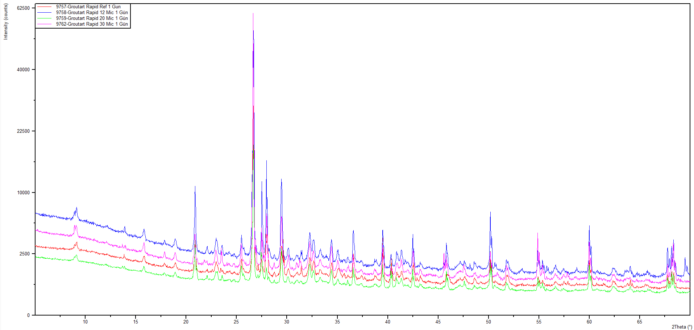{width="6.3in" height="3.0in"}

Şekil -Groutart Rapid-Ref/12mic/20mic/30mic 1 Günlük Kür Karşılaştırmalı XRD Difraktogramları

Şekil 1'de 1 günlük hidratasyon sonrasına ait olan karşılaştırmalı XRD difraktogramları verilmiştir. Difraktogramlar incelendiğinde, tüm numunelerde hem hidratasyon ürünlerinin oluştuğu hem de karakteristik piklerin belirginleştiği görülmektedir.

$2\theta \approx 9^{\circ}$ bölgesinin Etrenjit fazını ifade ettiği düşünülmekte olup dört numunede de ilgili bölgede pikler gözlenmiştir. Pik şiddetleri karşılaştırıldığında;

Groutart Rapid-12µ \>Groutart Rapid-Referans\>Groutart Rapid-30µ\>Groutart Rapid-20 µ

şeklindedir. Sıralamadaki en yüksek pik şiddetine sahip olan Groutart Rapid-12µ numunesi, alüminyum-sülfat reaksiyonlarının bu seride daha hızlı ilerlediği izlenimini vermektedir. $2\theta \approx 18^{\circ},34^{\circ},47^{\circ}$ bölgesinde tüm numunelerde belirgin pikler görülmüş olup en şiddetli pikin Groutart Rapid-12µ numunesine ait olduğu gözlenmiştir. Diğer yandan Groutart Rapid-20µ ve Groutart Rapid-30µ numunelerinde ilgili pikin şiddetleri düşük olarak gözlenmiştir. Reaksiyona girmemiş klinker fazlarına ait pikleri ifade eden $2\theta \approx 29^{\circ}\text{-}33^{\circ},41^{\circ}\text{-}42^{\circ},51^{\circ}\text{-}52^{\circ}$ bölgesi incelendiğinde her bir numunede kalıntı fazlar gözlenmektedir. İlgili bölgede Groutart Rapid-12µ numunesinin pik şiddeti bir miktar daha düşük olması nedeniyle bu numunede erken yaştaki çimento tüketiminin daha yüksek olduğu görülmektedir. Diğer numunelerde ise kalan klinker miktarları birbirine yakın olarak değerlendirilmektedir.

Genel olarak en yüksek hidratasyon ürünü yoğunluğuna ve dolayısıyla en hızlı reaksiyon kinetiğine Groutart Rapid-12µ numunesinin sahip olduğu düşünülmektedir. Düşük etrenjt fazı ve hidratasyon ürünü göstermekte olan Groutart Rapid-20µ numunesinin ise erken yaş reaksiyon kinetiğinin en yavaş ilerleyen numune olduğu düşünülmektedir.

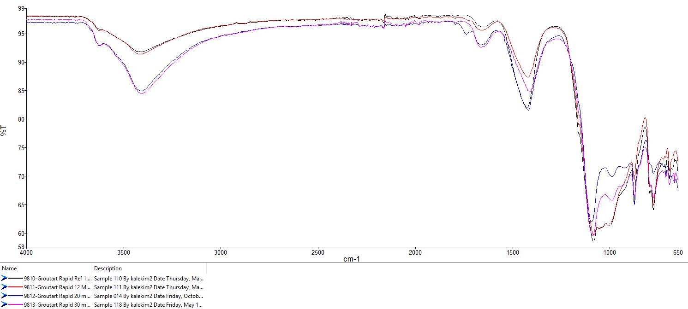{width="5.541666666666667in" height="2.495138888888889in"}

Şekil 2'de 1 günlük FTIR spektrumları karşılaştırmalı olarak verilmiştir. Her bir numune için hidratasyon reaksiyonlarının gerçekleştiği ve karakteristik bantların oluştuğu görülmektedir. Yaklaşık 3400cm-1 ve 1650cm- bölgelerinin yapısal su ve hidrat fazlarını temsil ettiği düşünülmekte olup bu bölgelerdeki en yüksek absorbans değişimi sırasıyla Groutart Rapid-12 µ ve Groutart Rapid-20µ numunelerinde görülmektedir. Bu durum bu numunelerin erken yaş hidratasyon ürünlerinin daha yoğun olarak geliştiğini göstermektedir. Şekil 1 yorumlanırken ifade edilen portlandit fazına şekil 2'deki FTIR spektrumunda yaklaşık 3640cm-1 bandı her bir numunede gözlenmiştir. En belirgin absorbans ise Groutart Rapid-12µ ve Groutart Rapid-20µ numunelerinde gözlenirken Groutart Rapid-Referans ve Groutart Rapid-30µ numunelerinde ilgili oluşum daha düşük seviyede kalmıştır.

1000cm-1 ve 1100cm-1 aralığındaki C-S-H jeli ve etrenjit fazları birlikte değerlendirildiğinde en yüksek bant gelişiminin Groutart Rapid-20µ ve Groutart Rapid-12µ numunelerinde olduğu tespit edilmiştir. Groutart Rapid-20µ numunesinde özellikle 970-1000cm-1 bölgesinde göstermiş olduğu derin bant belirginliği amorf C-S-H jeli oluşumunun bu numunede diğer numunelere kıyasla daha yüksek olduğunu ortaya koymaktadır.

1 günlük kür süresi sonunda yapılan XRD ve FTIR analizi sonuçları birlikte değerlendirildiğinde Groutart Rapid-12µ numunesinde kristal hidratasyon ürünlerinin, Groutart Rapid-20µ numunesinde ise temel bağlayıcı faz olarak değerlendirilen amorf C-S-H jeli oluşumunun öne çıktığı görülmektedir. Tüm bu tespitler doğrultusunda erken yaş hidratasyon verimi ve bağlayıcı faz gelişimi açısından Groutart Rapid-20µ numunesinin diğer numunelere göre daha avantajlı olduğu değerlendirilmektedir.

Şekil 3'te 7 günlük hidratasyon sonrasına ait olan karşılaştırmalı XRD difraktogramlarına yer verilmiştir.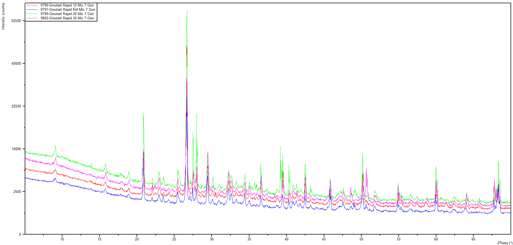{width="6.218055555555556in" height="2.9722222222222223in"} Şekil 1'de verilen 1 günlük kürlenme sonuçları ile kıyaslandığında tüm numunelerde hidratasyon reaksiyonlarının belirgin şekilde ilerlemiş olduğu ve üründe gözlemlenen piklerin daha da belirginleştiği görülmektedir. Etrenjit fazını ifade eden $2\theta \approx 9^{\circ}$ bölgesindeki piklerin tüm numunelerde belirgin şekilde görüldüğü ve en yüksek pik şiddetine sahip olan numunenin Groutart Rapid-20µ olduğu, Groutart Rapid-12µ ve Groutart Rapid-30µ numunelerinin birbirine yakın davranış sergilediği, Groutart Rapid-Referans numunesinde ise diğer numunelere kıyasla etrenjit gelişiminin daha düşük seviyede kaldığı görülmüştür. $2\theta \approx 18^{\circ},34^{\circ},47^{\circ}$ bölgesi portlandit fazını temsil etmekte olup bu bölgedeki en şiddetli pik Groutart Rapid-20µ numunesinde gözlenmiş olup bunu sırasıyla Groutart Rapid-12µ, Groutart Rapid-30µ ve Groutart Rapid-Referans numuneleri takip etmektedir. Bu durumda Groutart Rapid-20µ numunesinin silikat fazı hidratasyonunun gelişiminin diğer numunelerden önde olduğu düşünülmektedir.

Reaksiyona girmemiş klinker fazlarına ait pikleri ifade eden $2\theta \approx 29^{\circ}\text{-}33^{\circ},41^{\circ}\text{-}42^{\circ},51^{\circ}\text{-}52^{\circ}$ bölgesi incelendiğinde her bir numunede kalıntı fazlar gözlenmekle birlikte en düşük pik şiddetleri Groutart Rapid-20µ numunesinde gözlenmiştir. Diğer yandan Groutart Rapid-Referans numunesi bu bölgede en şiddetli piklere sahip olduğundan reaksiyona girmemiş fazların varlığının bu numunede en yüksek olduğu düşünülmektedir. Hidratasyon ürünleri ve klinker tüketimi piklerinin şiddetleri birlikte değerlendirildiğinde Groutart Rapid-20µ numunesi hem yüksek kristal faz yoğunluğu hem de ileri reaksiyon kinetiği açısından öne çıkmaktadır.

Sonuç olarak, 7 günlük kür süresi sonunda hidratasyon ilerleme dereceleri şu şekilde sıralanabilir;

Groutart Rapid-20µ\>Groutart Rapid-12µ\>Groutart Rapid-30µ≈Groutart Rapid-Referans

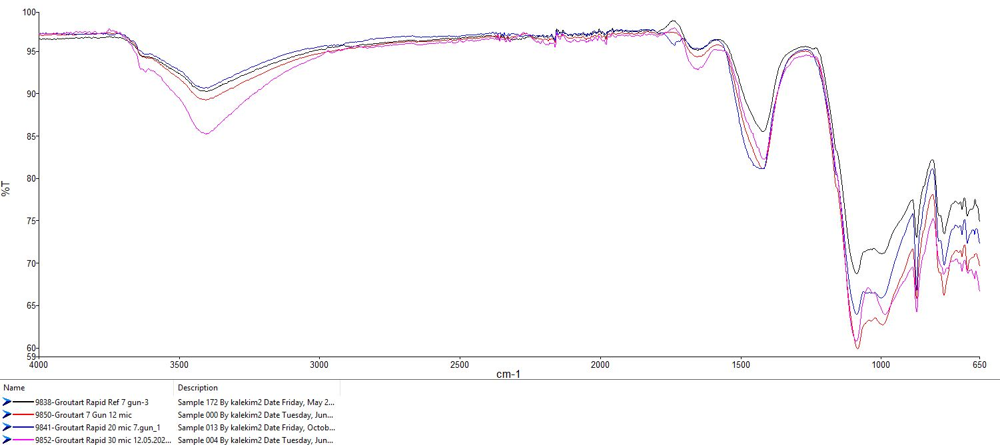{width="6.3in" height="2.807638888888889in"}

Şekil -Groutart Rapid-Ref/12mic/20mic/30mic 7 Günlük Kür Karşılaştırmalı FTIR Spektrumları

Şekil 4'te 7 günlük FTIR spektrumları karşılaştırmalı olarak verilmiştir. Şekil 2'de verilen 1 günlük kür süresi sonunda yapılan FTIR analizi sonuçları ile karşılaştırıldığında tüm numunelerde hidratasyon reaksiyonlarının devam ettiği ve Şekil 2'ye göre bantların daha belirgin hala geldiği görülmektedir. Yapısal su ve hidrat fazlarını ifade eden 3400cm-1 ve 1650cm-1 bölgelerinde en yüksek bant şiddeti gösteren numunenin Groutart Rapid-30µ olduğu tespit edilmiştir. Groutart Rapid-20µ ve Groutart Rapid-12µ numunelerinin benzer davranışta oldukları gözlenirken Groutart Rapid-Referans numunesinin gelişiminin diğer numunelere kıyasla daha sınırlı kaldığı düşünülmektedir. Yaklaşık 3640cm-1 bölgesi portlandit fazını ifade etmekte olup tüm numunelerde varlığını devam ettirdiği ve XRD bulguları ile örtüşmektedir.

C-S-H jeli ve etrenjit oluşumlarını ifade eden 900-1200cm-1 bölgesinde en belirgin bant gösteren numunenin Groutart Rapid-30µ olduğu görülmektedir. Yaklaşık 950-1000cm-1 bölgesindeki bant derinlikleri ve yayılımları, amorf yapılı C-S-H jelinin oluşumu incelendiğinde en yüksek seviyeye ulaşan numunenin Groutart Rapid-30µ olduğu tespit edilmiştir. Bunu sırasıyla Groutart Rapid-20µ, Groutart Rapid-12µ ve Groutart Rapid-Referans numuneleri takip etmektedir.

1 günlük kür süresi sonunda yapılan FTIR analizi sonucunda en yüksek performans gösteren Groutart Rapid-20µ numunesi iken 7 günlük kür süresi sonunda en yüksek performans gösteren numune Groutart Rapid-30µ olarak tespit edilmiştir. Bu durum mikronize katkı boyutunun zamanla reaksiyon kinetiğinin üzerindeki etkisinin değiştiğine ve Groutart Rapid-30µ numunesinin ilerleyen kür sürelerinde daha yüksek bağlayıcı faz ürettiğini ifade etmektedir.

Sonuç olarak 7 günlük XRD analizlerinde kristal hidratasyon ürünlerinin açısından Groutart Rapid-20µ numunesi öne çıksa da mekanik bağlayıcı performansı belirleyen amorf C-S-H jeli gelişimi açısından sonuçlar;

Groutart Rapid-30µ\> Groutart Rapid-20µ\>Groutart Rapid-Referans

şeklinde sıralanmaktadır. Bu durumda 7 günlük nihai reaksiyon verimi ve bağlayıcı fazın optimizasyonu açısından en yüksek performansı Groutart Rapid-30µ numunesinin gösterdiği tespit edilmiştir.

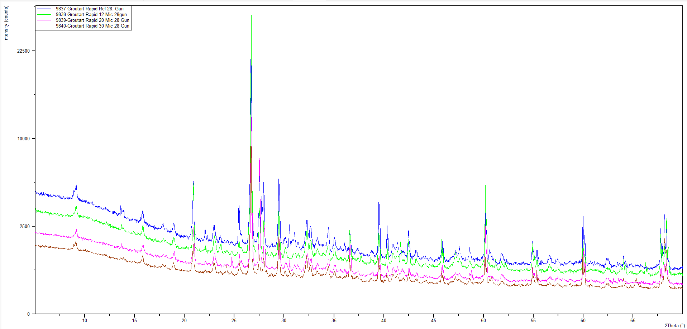{width="6.3in" height="3.020138888888889in"}

Şekil -Groutart Rapid-Ref/12mic/20mic/30mic 28 Günlük Kür Karşılaştırmalı XRD Difraktogramları

Şekil 5'te 28 günlük hidratasyon sonrasına ait olan karşılaştırmalı XRD difraktogramlarına yer verilmiştir. Şekil 1 ve Şekil 3'te verilen sırasıyla 1 ve 7 günlük kür sürelerine ait XRD difraktogramları ile kıyaslandığında tüm numunelerde hidratasyon reaksiyonlarının ilerlediği ve hidratasyon ürünlerinin kararlı bir yapı kazandığı tespit edilmiştir. Etrenjit fazını ifade eden $2\theta \approx 9^{\circ}$ bölgesindeki pik şiddetleri kıyaslandığında en yüksek yoğunluğun Groutart Rapid-12µ numunesinde olduğu görülmektedir. Groutart Rapid-20µ ve Groutart Rapid-Referans numunelerinin benzer davranış sergilediği görülürken Groutart Rapid-30µ numunesinin etrenjit bölgesindeki piklerinin daha düşük şiddette kaldığı görülmektedir. Portlandit fazını ifade eden $2\theta \approx 18^{\circ},34^{\circ},47^{\circ}$ bölgesi incelendiğinde en yüksek pik verenin Groutart Rapid-12µ numunesi olduğu ve bunu sırayla Groutart Rapid-Referans, Groutart Rapid-20µ ve Groutart Rapid-30µ numunelerinin takip ettiği görülmektedir.

Reaksiyona girmemiş klinker fazlarının incelendiği $2\theta \approx 29^{\circ}\text{-}33^{\circ},41^{\circ}\text{-}42^{\circ},51^{\circ}\text{-}52^{\circ}$ bölgesindeki piklerin şiddetleri önceki kür sürelerine kıyasla düşük olması, çimento tüketiminin 28 gün boyunca sürdüğünü doğrulamaktadır. 1, 7 ve 28 günlük XRD sonuçları birlikte değerlendirildiğinde; 1.günde Groutart Rapid-12µ, 7.günde Groutart Rapid-20µ numuneleri öndeyken 28.günde kristal hidratasyon ürünleri bakımından Groutart Rapid-12µ numunesinin tekrar diğerlerinden üstün hale geldiği görülmektedir. Bu dalgalanma, mikronize katkı boyutunun hidratasyon kinetiğini kür yaşına bağlı olarak farklı aşamalarda aktive ettiğini ortaya koymaktadır.

Sonuç olarak, 28 günlük XRD difraktogramlarına göre kristal hidratasyon ürünlerinin gelişimi;

Groutart Rapid-12µ\>Groutart Rapid-Referans\>Groutart Rapid-20µ\>Groutart Rapid-30µ

şeklindedir.

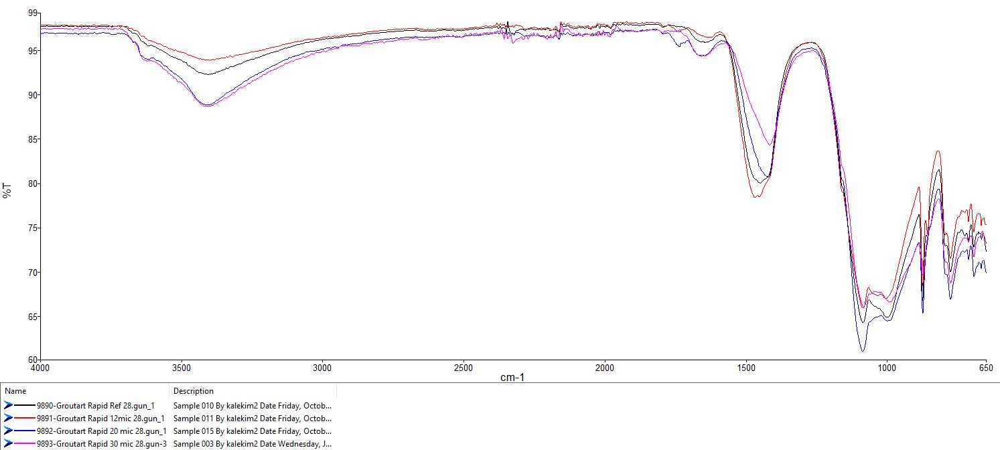{width="6.3in" height="2.8361111111111112in"}

Şekil 6'da 28 günlük FTIR spektrumları karşılaştırmalı olarak verilmiştir. Hidratasyon reaksiyonlarının her bir numunede belirgin şekilde ilerlediği görülmektedir. Yapısal su ve hidrat fazlarını ifade eden 3400cm-1 ve 1650cm-1 bölgelerinde en yüksek bant şiddeti gösteren numunenin Groutart Rapid-20µ olduğu dünüşülmekte olup bu numuneyi sırasıyla Groutart Rapid-Referans, Groutart Rapid-30µ ve Groutart Rapid-12µ numuneleri izlemektedir.

Hidratasyon sonucundaki verimi ve C-S-H jeli ile etrenjit oluşumlarını kapsayan 900-1200cm^-1^ bölgelerinde özellikle 950-1000cm^-1^ aralığındaki bant derinliğinde net bir ayrım gözlenmekte olup en belirgin seviyeye ulaşan numunenin Groutart Rapid-20µ olduğu tespit edilmiştir. Bunu sırasıyla Groutart Rapid-Referans, Groutart Rapid-30µ ve en düşük olarak seyreden Groutart Rapid-12µ numunesi izlemektedir. Dolayısıyla C-S-H oluşumu sınırlı kalan numune Groutart Rapid-12µ olmuştur.

28 günlük kür süreli analizlerde XRD sonuçları kristalin faz yoğunlukları açısından Groutart Rapid-12µ numunesini öne çıkarırken, amorf C-S-H gelişimi açısından FTIR verilerine göre;

Groutart Rapid-20µ\>Groutart Rapid-Referans\>Groutart Rapid-30µ\>Groutart Rapid-12µ

şeklinde sıralanmaktadır.

Bütünsel olarak 1, 7, 28 günlük kür süreli FTIR sonuçları ele alındığında;

-   1.günde Groutart Rapid-20µ numunesi,

-   7.günde Groutart Rapid-30µ numunesi,

-   28.günde Groutart Rapid-20µ numunesi,

ön plana çıkmaktadır. Kristal hidratasyon ürünleri açısından Groutart Rapid-12µ numunesi her ne kadar yüksek pikler göstermiş olsa da bağlayıcı C-S-H jeli oluşumu, sürecin dengesi ve nihai mekanik dayanımın potansiyeli açısından en optimize ve avantajlı sonuçları Groutart Rapid-20µ numunesinin verdiği düşünülmektedir.

**Mastar-10 Ürünü ile Gerçekleştirilen Çalışmalar**

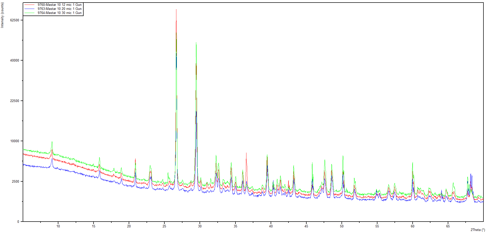{width="6.3in" height="3.0125in"}

Şekil -Mastar10-12mic/20mic/30mic 1 Günlük Kür Karşılaştırmalı XRD Difraktogramları

Şekil 7'de 1 günlük hidratasyon sonrasına ait olan XRD difraktogramlarına yer verilmiştir. Tüm numunelerde hidratasyon reaksiyonlarının başlamış olduğu aynı zamanda karakteristik hidratasyon ürünlerinin oluştuğu gözlenmektedir.

$2\theta \approx 9^{\circ}$ bölgesinin Etrenjit fazını ifade ettiği düşünülmekte olup pik şiddetleri karşılaştırıldığında en yüksek yoğunluk gözlenen numunenin Mastar10-30 µ numunesi, olduğu ve bunu sırasıyla takip eden Mastar10-12 µ ve Mastar10-20 µ numuneleridir. Bu durumda Mastar10-30 µ numunesinin alüminat-sülfat reaksiyonlarının daha hızlı ilerlediğini işaret etmektedir. $2\theta \approx 18^{\circ},34^{\circ},47^{\circ}$ bölgesi portlandit fazını temsil etmekte olup bu bölgedeki en belirgin pikleri sırasıyla Mastar10-30 µ, Mastar10-12 µ ve Mastar10-20 µ numunelerinin verdiği düşünülmektedir.

Reaksiyona girmemiş klinker fazlarını ifade eden $2\theta \approx 29^{\circ}\text{-}33^{\circ},41^{\circ}\text{-}42^{\circ},51^{\circ}\text{-}52^{\circ}$ bölgelerindeki pikler, erken kür süresi olması nedeniyle tüm numunelerde baskın şekilde gözlenmektedir. Ancak Mastar10-30 µ numunesinde hidratasyon ürünlerinin belirgin olması nedeniyle hidratasyon reaksiyonunun ilerleme derecesi diğer numunelerden yüksek olduğuna işaret etmektedir.

Sonuç olarak 1 günlük kür süresi sonunda yapılan reaksiyon durdurma işleminin ardından hidratasyon ürünlerinin gelişimi şu şekilde sıralanabilir;

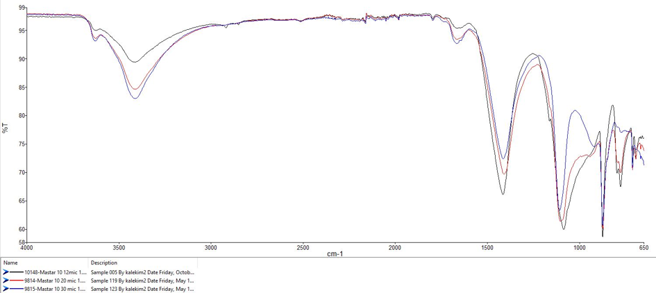{width="5.821767279090114in" height="2.6in"}Mastar10-30 µ \> Mastar10-12 µ \>Mastar10-20 µ

Şekil 8'de 1 günlük kür süresi ardından reaksiyon durdurma işlemine tabi tutulan numunelerin FTIR analizlerine yer verilmiştir. Spektrumlar incelendiğinde tüm numunelerde hidratasyon ürünlerine ait karakteristik bantların bulunduğu gözlenmektedir.

Yapısal su ve hidrat fazlarını ifade eden yaklaşık 3400cm^-1^ ve 1650cm^-1^ bölgesi incelendiğinde absorpsiyonu en şiddetli olan numunenin Mastar10-30mic numunesi olduğu bunu takiben sırayla Mastar10-20 µ ve en düşük şiddette olanın Mastar10-12 µ numunesi olduğu gözlenmektedir.

C-S-H gelişimi açısından önemli olan 900-1200cm^-1^ bandında en belirgin olan numunenin Mastar10-30 µ olduğu görülmektedir. Mastar10-12 µ ve Mastar10-20 µ numuneleri ise birbirine yakın olarak gözlenmektedir.

1 günlük FTIR spektrumlarına göre hidratasyon ürünlerinin gelişimi değerlendirildiğinde numuneler;

Mastar10-30 µ \>Mastar10-20 µ \>Mastar10-12 µ

Şeklinde sıralanabilmektedir.

Hem XRD hem de FTIR analiz sonuçları birlikte değerlendirildiğinde, Mastar10-30 µ numunesinin hidratasyon ilerlemesi gelişimi açısından diğer numunelerden önde olduğu düşünülmektedir. Sonuç olarak 1 günlük kür sonrasında yapılan reaksiyon durdurma işleminde hidratasyon ilerleme derecesi açısından sıralama şu şekilde yapılabilir;

Mastar10-30 µ \>Mastar10-12µ$\approx$Mastar10-20 µ

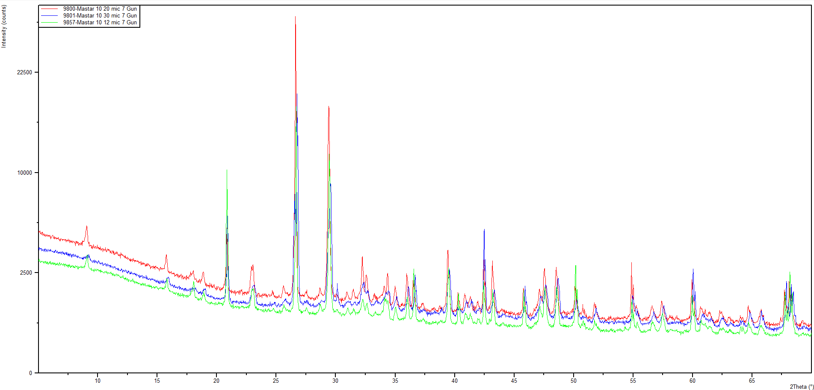{width="6.3in" height="3.0215277777777776in"}

Şekil -Mastar10-12mic/20mic/30mic 7 Günlük Kür Karşılaştırmalı XRD Difraktogramları

Şekil 9'da 7 günlük kür süresi sonunda reaksiyon durdurma işlemi uygulanan numunelerin karşılaştırmalı XRD difraktogramlarına yer verilmiştir. Difraktogramlar incelendiğinde tüm numunelerde hidratasyon reaksiyonlarının devam etmekte olduğu düşünülmektedir.

Etrenjit fazını ifade eden $2\theta \approx 9^{\circ}$ bölgesinde en belirgin pik gelişimi Mastar10-20 µ numunesinde gözlenmektedir. Mastar10-30 µ numunesi yakın davranış sergilerken Mastar10-12 µ numunesinde ise ilgili faz pikinin diğerlerinden daha düşük kaldığı görülmektedir. $2\theta \approx 29^{\circ}\text{-}33^{\circ},41^{\circ}\text{-}42^{\circ},51^{\circ}\text{-}52^{\circ}$ bölgelerindeki pikler, ilgili tüm numunelerde reaksiyona girmemiş klinker fazlarının halihazırda bulunmaya devam ettiğine işaret etmektedir.

1 günlük kür süreli XRD difraktogramları ile kıyaslandığında 1.günde en belirgin kristal ürün gelişimi Mastar10-30 µ numunesinde görülürken 7.günde Mastar10-20 µ numunesinin önde olduğu değerlendirilmektedir.

7 günlük kür süreli XRD difraktogramları hidratasyon ürünlerinin gelişimi açısından;

Mastar10-20 µ \>Mastar10-30 µ \>Mastar10-12 µ

Şeklinde sıralanabilmektedir.

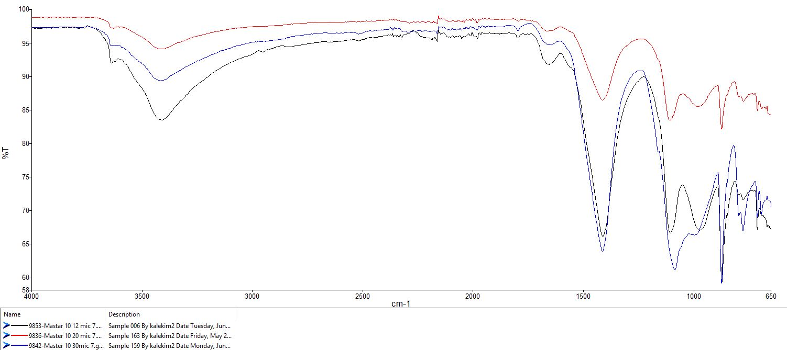{width="6.3in" height="2.8041666666666667in"}

Şekil 10'da 7 günlük kür sonunda reaksiyon durdurma işlemi uygulanan numunelerin FTIR spektrumlarına yer verilmiştir. Spektrumlar incelendiğinde tüm numunelerde hidratasyon ürünlerine ait karakteristik bantların bulunduğuna dair işaretler görülmektedir.

Yapısal su ve hidrat fazlarını ifade eden yaklaşık 3400cm^-1^ ve 1650cm^-1^ bölgesi incelendiğinde en belirgin bant gelişiminin Mastar10-12 µ numunesinde olduğu, Masta10-20 µ numunesinin ise bu bölgede zayıf kaldığı değerlendirilmektedir. Portlandit fazını ifade eden 3640cm^-1^ bölgesinde Mastar10-12 µ ve Mastar10-30 µ numuneleri belirgin pik verirken Mastar10-20mic numunesinin zayıf pik verdiği görülmektedir.

C-S-H ile ifade edilen 900-1200cm-1bandında Mastar10-30 µ numunesinde en derin bandı verenin Mastar10-30 µ numunesinin olduğu, Mastar10-12 µ numunesinin bunu takip ettiği ancak Mastar10-20 µ numunesinin bant gelişiminin bu bölgede sınırlı kaldığı görülmektedir. Bu durum Mastar10-30 µ ve Mastar10-12 µ numunelerinin Mastar10-20 µ numunesine kıyasla C-S-H oluşumlarının daha ileri olabileceğine işaret etmektedir.

7 günlük FTIR spektrumlarına bakıldığında hidratasyon gelişimi sıralaması;

Mastar10-30µ$\approx$Mastar10-12 µ \>Mastar10-20 µ

şeklinde sıralanabilmektedir.

Hem XRD hem de FTIR sonuçları birlikte değerlendirildiğinde XRD'de kristal hidratasyon açısından Mastar10-20 µ numunesi öne çıkmaktadır. FTIR'da bağlı su ve C-S-H açısından Mastar10-30 µ ve Mastar10-12 µ numunelerinin Mastar10-20 µ numunesinin önünde olduğu görülmektedir. Mastar10-30 µ numunesi her iki analizde de üst sıralarda yer alarak tutarlı bir davranış sergilediği düşünülmektedir. Bu nedenle 7 günlük kür sonunda hidratasyon gelişiminin Mastar10-30 µ numunesinde daha ileri olduğu, Mastar10-12 µ ve Mastar10-20 µ numuneleri arasındaki farkın ise sınırlı olduğu düşünülmektedir. Bu durumda hidratasyon gelişimi bakımından şu şekilde bir sıralama yapılabilir;

Mastar10-30 µ \>Mastar10-12µ$\approx$Mastar10-20 µ

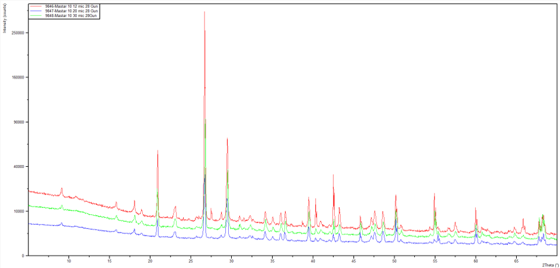{width="6.300694444444445in" height="3.020138888888889in"}

Şekil -Mastar10-12mic/20mic/30mic 28 Günlük Kür Karşılaştırmalı XRD Difraktogramları

Şekil 11'de 28 günlük kür süresi sonunda reaksiyon durdurma işlemi uygulanan numunelerin karşılaştırmalı XRD difraktogramlarına yer verilmiştir. Difraktogramlar incelendiğinde tüm numunelerde hidratasyon reaksiyonlarının devam etmekte olduğu düşünülmektedir.

Etrenjit fazını ifade eden $2\theta \approx 9^{\circ}$ bölgesinde en belirgin pik şiddeti Mastar10-12 µ numunesinde görülmektedir. İlgili bölgedeki pik şiddeti en düşük olan numune Mastar10-20 µ numunesi olarak tespit edilmiştir. $2\theta \approx 18^{\circ},34^{\circ},47^{\circ}$ bölgesi portlandit fazını temsil etmekte olup bu bölgedeki en belirgin pik Mastar10-12 µ numunesinde görülmektedir.

$2\theta \approx 29^{\circ}\text{-}33^{\circ},41^{\circ}\text{-}42^{\circ},51^{\circ}\text{-}52^{\circ}$ bölgelerindeki pikler incelendiğinde tüm numunelerde reaksiyona girmemiş klinker fazlarının halen mevcut olduğu göstermektedir. 28 günlük kür sonunda elde edilen XRD verilerine göre kristal hidratasyon ürünlerinin gelişimi açısından;

Mastar10-12 µ \>Mastar10-30 µ \>Mastar10-20 µ

Şeklinde sıralanabilmektedir.

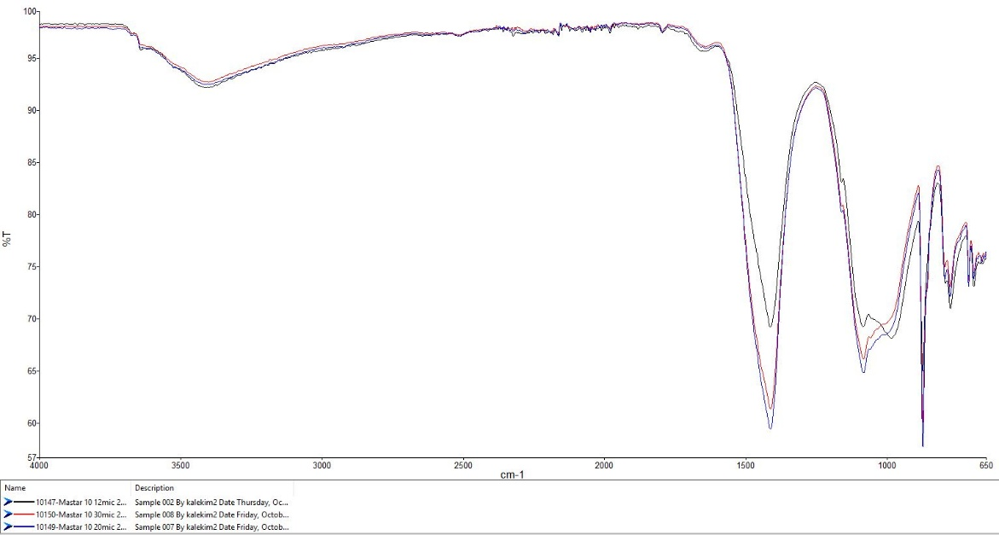{width="5.330302930883639in" height="2.854932195975503in"}

Şekil 12'de 28 günlük kür sonunda reaksiyon durdurma işlemi uygulanan numunelerin FTIR spektrumlarına yer verilmiştir. Spektrumlar incelendiğinde tüm numunelerde hidratasyon ürünlerine ait karakteristik bantların bulunduğuna dair işaretler görülmektedir.

Yapısal su ve hidrat fazlarını ifade eden yaklaşık 3400 cm⁻¹ ve 1650 cm⁻¹ bölgeleri incelendiğinde üç numunenin birbirine çok yakın şiddette bant verdiği, bu göstergelerle numuneler arasında ayrım yapılamadığı değerlendirilmektedir. Portlandit fazını ifade eden 3640 cm⁻¹ bölgesinde Mastar10-12 µ, Mastar10-20 µ ve Mastar10-30 µ numunelerinin hepsinde zayıf bir omuz görülmekte olup bu bölge sıralamada belirleyici kabul edilmemiştir.

C-S-H ile ifade edilen 900-1200 cm⁻¹ bandında Mastar10-20 µ ve Mastar10-30 µ numunelerinin \~1090 cm⁻¹ civarında benzer derinlikte bant verdiği, Mastar10-12 µ numunesinin ise bu bölgede daha sığ bir bant ve omuz yapısı gösterdiği görülmektedir. Bu durum Mastar10-20 µ ve Mastar10-30 µ numunelerinin C-S-H oluşumlarının Mastar10-12 µ numunesine kıyasla bir miktar daha ileri olabileceğine işaret etmektedir. Ancak farklar sınırlıdır ve bu bölge \~1420-1480 cm⁻¹ karbonat bantlarından etkilenebilmektedir.

28 günlük FTIR spektrumlarına bakıldığında C-S-H gelişimi sıralaması;

Mastar10-20 µ ≈Mastar10-30 µ \>Mastar10-12 µ

şeklinde sıralanabilmektedir.

Hem XRD hem de FTIR sonuçları birlikte değerlendirildiğinde XRD'de kristal hidratasyon ürünleri açısından Mastar10-12 µ numunesi öne çıkmaktadır. FTIR'da ise C-S-H açısından Mastar10-20µ ve Mastar10-30µ numunelerinin Mastar10-12µ numunesinin önünde olduğu görülmektedir. Mastar10-30µ numunesi XRD'de ikinci, FTIR'da ilk sırada yer alarak her iki analizde de üst sıralarda bulunmakta ve tutarlı bir davranış sergilediği düşünülmektedir. Bu nedenle 28 günlük kür sonunda hidratasyon gelişiminin Mastar10-30µ numunesinde daha dengeli ilerlediği, Mastar10-12µ ve Mastar10-20µ numuneleri arasındaki farkın ise sınırlı olduğu düşünülmektedir. Bu durumda hidratasyon gelişimi bakımından;

Mastar10-30µ\>Mastar10-12µ ≈ Mastar10-20µ

Şeklinde sıralanabilmektedir.

Bütünsel olarak 1, 7 ve 28 günlük kür süreli FTIR sonuçları ele alındığında, bağlı su ve Si-O (C-S-H) göstergeleri bakımından;

-   1\. günde Mastar10-30µ numunesi,

-   7\. günde Mastar10-30µ ve Mastar10-12µ numuneleri (Mastar10-30µ ufak farkla önde),

-   28\. günde ise Mastar10-20µ ve Mastar10-30µ numuneleri ön plana çıkmaktadır.

Bağlayıcı C-S-H göstergeleri ve yöntemler arası tutarlılık birlikte değerlendirildiğinde Mastar10-30µ numunesi her üç yaşta da üst sıralarda yer almış, bu nedenle hidratasyon gelişimi bakımından en dengeli davranışı sergileyen numune olarak Mastar10-30µ öne çıkmıştır.
